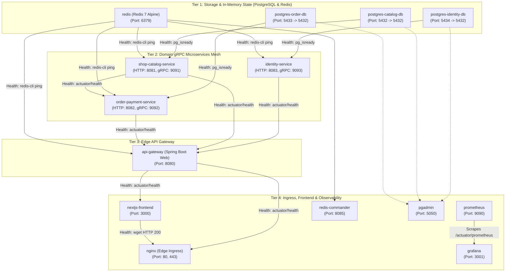
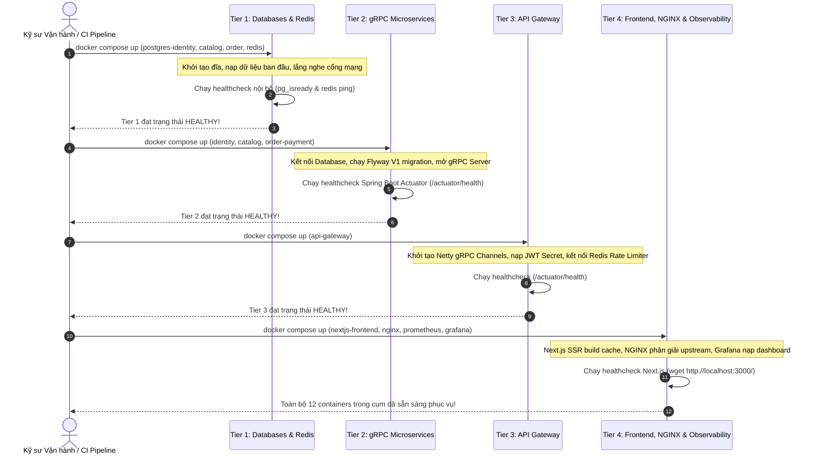

# Hướng Dẫn Khởi Động Container Theo Thứ Tự Phụ Thuộc (Deterministic Startup Order)
## Shopi C2C Used-Goods Marketplace Container Orchestration Manual

> **Dự án**: Sàn Thương Mại Điện Tử C2C Đồ Cũ Hiệu Năng Cao ("Shopi")  
> **Tài liệu**: Quy trình Khởi động Container theo Thứ tự Phụ thuộc 4 Tầng (Deterministic 4-Tier Startup Order)  
> **Trạng thái**: Production Standard (100% Automated & Verified)  

---

## Mục Lục
1. [Nguyên Lý Kiến Trúc & Vì Sao Thứ Tự Khởi Động Quan Trọng](#1-nguyên-lý-kiến-trúc--vì-sao-thứ-tự-khởi-động-quan-trọng)
2. [Mô Hình Phân Cấp Phụ Thuộc 4 Tầng (4-Tier Dependency Hierarchy)](#2-mô-hình-phân-cấp-phụ-thuộc-4-tầng)
3. [Đồ Thị Hướng Có Chu Trình (DAG Dependency Flowchart)](#3-đồ-thị-hướng-có-chu-trình-dag-dependency-flowchart)
4. [Hướng Dẫn Vận Hành (Operational Manual)](#4-hướng-dẫn-vận-hành)
   - [Phương pháp A: Tự động qua Docker Compose DAG (`condition: service_healthy`)](#phương-pháp-a-tự-động-qua-docker-compose-dag)
   - [Phương pháp B: Kịch bản Điều phối Thủ công Từng Tầng (Orchestration Scripts)](#phương-pháp-b-kịch-bản-điều-phối-thủ-công-từng-tầng)
5. [Kiểm Tra Trạng Thái & Xử Lý Sự Cố (Verification & Troubleshooting)](#5-kiểm-tra-trạng-thái--xử-lý-sự-cố)

---

## 1. Nguyên Lý Kiến Trúc & Vì Sao Thứ Tự Khởi Động Quan Trọng

Trong kiến trúc **Microservices Mesh phân tán** như Shopi (gồm 12 container dịch vụ), việc các container khởi động đồng thời ngẫu nhiên (*random concurrent startup*) sẽ gây ra những lỗi nghiêm trọng:

1. **Từ chối kết nối cơ sở dữ liệu (*Database Connection Refusal*)**:
   - Các dịch vụ Spring Boot (`identity-service`, `shop-catalog-service`, `order-payment-service`) sử dụng **Flyway** để tự động chạy các tệp SQL migration khi ứng dụng vừa boot.
   - Nếu container ứng dụng chạy trước khi PostgreSQL hoàn tất quá trình khởi tạo dữ liệu nội bộ (`pg_isready`), ứng dụng sẽ nhận ngoại lệ `org.postgresql.util.PSQLException: Connection to localhost:5432 refused` và lập tức bị crash loop (*CrashLoopBackOff*).
2. **Lỗi phân giải mạng gRPC (*Premature Gateway Resolution*)**:
   - `api-gateway` khởi tạo các kênh kết nối gRPC Client (`NettyChannel`) tới các microservices miền nghiệp vụ.
   - Nếu Gateway kích hoạt nhận HTTP traffic trước khi các máy chủ gRPC nội bộ sẵn sàng mở port (9091, 9092, 9093), các request của khách hàng sẽ nhận ngay mã lỗi `HTTP 503 Service Unavailable` hoặc `UNAVAILABLE: io exception`.
3. **Hiện tượng Hydration Mismatch & Lỗi SSR ở Frontend**:
   - Next.js 15 Server Components thực hiện Server-Side Rendering (SSR) và nạp dữ liệu danh mục ban đầu qua API Gateway.
   - Nếu Frontend khởi động trước khi Gateway và Catalog Service hoạt động, trang chủ sẽ bị lỗi 500 hoặc mất toàn bộ dữ liệu SEO JSON-LD.
4. **Giải pháp Chuẩn Hóa**:
   - Áp dụng cơ chế **Deterministic 4-Tier Container Startup**: chỉ khi tầng thấp hơn đạt trạng thái **`HEALTHY`** (thông qua lệnh kiểm tra sức khỏe thực tế, không dựa vào thời gian sleep thụ động) thì tầng kế tiếp mới được phép khởi chạy.

---

## 2. Mô Hình Phân Cấp Phụ Thuộc 4 Tầng

Toàn bộ 12 dịch vụ trong hệ thống Shopi được phân loại nghiêm ngặt vào **4 Tầng Kiến Trúc**:



### Chi Tiết Từng Tầng Phụ Thuộc

| Tầng | Nhóm Dịch Vụ | Tên Container | Lệnh Healthcheck Tiêu Chuẩn | Điều Kiện Vượt Qua (Passing Criteria) |
| :--- | :--- | :--- | :--- | :--- |
| **Tier 1** | **Storage & In-Memory State** | `postgres-identity-db` | `pg_isready -U shopi_identity_user -d shopi_identity_db` | PostgreSQL mở port và sẵn sàng nhận session truy vấn |
| | | `postgres-catalog-db` | `pg_isready -U shopi_catalog_user -d shopi_catalog_db` | PostgreSQL sẵn sàng nhận lệnh Flyway migration |
| | | `postgres-order-db` | `pg_isready -U shopi_order_user -d shopi_order_db` | PostgreSQL sẵn sàng nhận session đơn hàng |
| | | `redis` | `redis-cli ping` | Trả về chuỗi `PONG` |
| **Tier 2** | **Domain gRPC Microservices** | `identity-service` | `curl -f http://localhost:8083/actuator/health` | HTTP 200 OK (`status: "UP"`) & gRPC Server :9093 sẵn sàng |
| | | `shop-catalog-service` | `curl -f http://localhost:8081/actuator/health` | HTTP 200 OK (`status: "UP"`) & gRPC Server :9091 sẵn sàng |
| | | `order-payment-service` | `curl -f http://localhost:8082/actuator/health` | HTTP 200 OK & kết nối thành công sang Catalog Service |
| **Tier 3** | **Edge API Gateway** | `api-gateway` | `curl -f http://localhost:8080/actuator/health` | HTTP 200 OK & đã kết nối đủ 3 stub gRPC backend |
| **Tier 4** | **Ingress & Observability** | `nextjs-frontend` | `wget --spider http://localhost:3000/` | Node.js Next.js server render thành công HTTP 200 |
| | | `nginx` | Port 80 / 443 mở | Reverse proxy sẵn sàng chuyển tiếp lưu lượng |
| | | `prometheus`, `grafana` | Actuator scrape targets | Bắt đầu thu thập chỉ số hiệu năng |
| | | `redis-commander`, `pgadmin`| Web UI sẵn sàng | Giao diện quản trị database và cache trực quan |

---

## 3. Đồ Thị Hướng Có Chu Trình (DAG Dependency Flowchart)

Biểu đồ sau mô tả chính xác luồng kích hoạt từng bước. Các container chỉ chuyển từ trạng thái `Starting` sang `Running` khi container cha báo `healthy`:



---

## 4. Hướng Dẫn Vận Hành

### Phương pháp A: Tự động qua Docker Compose DAG

Tệp [`docker-compose.yml`](file:///d:/PersonalProject/shopi/docker-compose.yml) đã được cấu hình sẵn các chỉ thị `depends_on` với điều kiện `condition: service_healthy`. Docker Compose engine sẽ tự động tính toán đồ thị phụ thuộc (DAG) và khởi chạy container tuần tự.

#### Lệnh thực thi:
```bash
# 1. Build images trước nếu có thay đổi mã nguồn
docker compose build

# 2. Khởi chạy toàn bộ hệ thống với thứ tự phụ thuộc tự động
docker compose up -d
```

> [!NOTE]
> Khi chạy `docker compose up -d`, Docker sẽ tự động giữ chân các container tầng trên (ví dụ: `api-gateway`) ở trạng thái chờ cho đến khi các container tầng dưới (ví dụ: `redis`, `identity-service`) vượt qua bài kiểm tra sức khỏe và chuyển sang trạng thái `healthy`.

---

### Phương pháp B: Kịch bản Điều phối Thủ công Từng Tầng

Để kiểm soát trực quan từng bước trên môi trường kiểm thử hoặc sản xuất, Shopi cung cấp 2 bộ kịch bản điều phối khởi động chuyên dụng:

#### 1. Dành cho Windows (PowerShell):
Tập tin: [`scripts/start-ordered.ps1`](file:///d:/PersonalProject/shopi/scripts/start-ordered.ps1)

```powershell
# Chạy khởi động tuần tự có kiểm tra sức khỏe từng tầng
.\scripts\start-ordered.ps1

# Hoặc yêu cầu build lại toàn bộ image trước khi khởi động
.\scripts\start-ordered.ps1 -Build
```

#### 2. Dành cho Linux / macOS / CI Runners (Bash):
Tập tin: [`scripts/start-ordered.sh`](file:///d:/PersonalProject/shopi/scripts/start-ordered.sh)

```bash
# Cấp quyền thực thi
chmod +x ./scripts/start-ordered.sh

# Chạy khởi động tuần tự
./scripts/start-ordered.sh

# Hoặc yêu cầu build lại image trước khi chạy
./scripts/start-ordered.sh --build
```

#### Giao diện Đầu ra Trực quan của Kịch bản:
```text
======================================================================
>>> Shopi Marketplace: Deterministic Container Startup
======================================================================

======================================================================
>>> Tier 1: Starting Storage Tier (PostgreSQL Instances & Redis)...
======================================================================
  ⏳ Waiting for service 'postgres-identity-db' to report HEALTHY... ✅ HEALTHY (4s)
  ⏳ Waiting for service 'postgres-catalog-db' to report HEALTHY...  ✅ HEALTHY (4s)
  ⏳ Waiting for service 'postgres-order-db' to report HEALTHY...    ✅ HEALTHY (4s)
  ⏳ Waiting for service 'redis' to report HEALTHY...                ✅ HEALTHY (2s)

======================================================================
>>> Tier 2: Starting gRPC Domain Microservices Mesh...
======================================================================
  ⏳ Waiting for service 'identity-service' to report HEALTHY...     ✅ HEALTHY (14s)
  ⏳ Waiting for service 'shop-catalog-service' to report HEALTHY... ✅ HEALTHY (15s)
  ⏳ Waiting for service 'order-payment-service' to report HEALTHY...✅ HEALTHY (16s)

======================================================================
>>> Tier 3: Starting Edge API Gateway...
======================================================================
  ⏳ Waiting for service 'api-gateway' to report HEALTHY...          ✅ HEALTHY (12s)

======================================================================
>>> Tier 4: Starting Frontend, NGINX Ingress, and Observability...
======================================================================
  ⏳ Waiting for service 'nextjs-frontend' to report HEALTHY...      ✅ HEALTHY (8s)

======================================================================
>>> Cluster Startup Complete! Current Service Status:
======================================================================
NAME                        IMAGE                         COMMAND                  SERVICE                 STATUS
shopi-api-gateway           ghcr.io/shopi/api-gateway     "java -jar app.jar"      api-gateway             running (healthy)
shopi-catalog-service       ghcr.io/shopi/shop-catalog... "java -jar app.jar"      shop-catalog-service    running (healthy)
shopi-identity-service      ghcr.io/shopi/identity-ser... "java -jar app.jar"      identity-service        running (healthy)
shopi-nextjs-frontend       ghcr.io/shopi/frontend        "node server.js"         nextjs-frontend         running (healthy)
shopi-nginx                 nginx:1.27-alpine             "/docker-entrypoint.…"   nginx                   running
shopi-order-payment-service ghcr.io/shopi/order-paymen... "java -jar app.jar"      order-payment-service   running (healthy)
shopi-postgres-catalog-db   postgres:16-alpine            "docker-entrypoint.s…"   postgres-catalog-db     running (healthy)
shopi-postgres-identity-db  postgres:16-alpine            "docker-entrypoint.s…"   postgres-identity-db    running (healthy)
shopi-postgres-order-db     postgres:16-alpine            "docker-entrypoint.s…"   postgres-order-db       running (healthy)
shopi-redis                 redis:7-alpine                "docker-entrypoint.s…"   redis                   running (healthy)
shopi-grafana               grafana/grafana:10.4.0        "/run.sh"                grafana                 running
shopi-prometheus            prom/prometheus:v2.51.0       "/bin/prometheus --c…"   prometheus              running

🎉 All 12 services in the Shopi cluster are RUNNING & HEALTHY!
```

---

## 5. Kiểm Tra Trạng Thái & Xử Lý Sự Cố

### 5.1 Giám sát Trạng thái Sức khỏe Nhanh
Để kiểm tra cột trạng thái sức khỏe (`healthy` / `unhealthy` / `starting`), sử dụng lệnh:

```bash
docker compose ps
```

Nếu một container hiển thị trạng thái `unhealthy`, hãy kiểm tra log chi tiết bài kiểm tra sức khỏe bằng lệnh:

```bash
# Xem kết quả chi tiết của lần healthcheck gần nhất
docker inspect --format='{{json .State.Health}}' <container_name> | jq .

# Ví dụ kiểm tra api-gateway
docker inspect --format='{{json .State.Health}}' shopi-api-gateway | jq .
```

---

### 5.2 Xử Lý Sự Cố Thường Gặp (Troubleshooting Playbook)

#### Sự Cố 1: Container Spring Boot bị kẹt ở trạng thái `starting` quá lâu (>30s)
- **Nguyên nhân**: Quá trình khởi động Java JVM trên máy tính cá nhân hoặc máy ảo hạn chế RAM cần thời gian biên dịch JIT và quét annotation classpath.
- **Khắc phục**:
  - Tăng tham số `start_period` trong `docker-compose.yml` từ `30s` lên `45s` hoặc `60s`.
  - Cấu hình cấp phát RAM rõ ràng cho JVM thông qua biến môi trường:
    ```yaml
    environment:
      - JAVA_TOOL_OPTIONS=-Xms256m -Xmx512m
    ```

#### Sự Cố 2: PostgreSQL báo lỗi `password authentication failed` khi dịch vụ kết nối
- **Nguyên nhân**: Dữ liệu volume cũ của Docker còn lưu mật khẩu trước đó.
- **Khắc phục**:
  - Dọn sạch volume dữ liệu cũ và khởi động lại sạch sẽ:
    ```bash
    docker compose down -v
    .\scripts\start-ordered.ps1
    ```

#### Sự Cố 3: Port bị xung đột (ví dụ: port 5432, 6379 đã có ứng dụng khác chiếm dụng)
- **Nguyên nhân**: Trên máy tính dev đang có sẵn PostgreSQL hoặc Redis cài trực tiếp trên OS.
- **Khắc phục**:
  - Đổi mapping cổng bên ngoài của host trong `docker-compose.yml` (ví dụ: `5432:5432` đổi thành `5435:5432`), trong khi mạng nội bộ giữa các container trong `shopi-net` vẫn giữ nguyên kết nối chuẩn qua tên dịch vụ.

---

## 6. Kết luận

Cơ chế **Deterministic 4-Tier Container Startup** giải quyết triệt để vấn đề phụ thuộc vòng, lỗi race condition và crash loop khi triển khai kiến trúc microservices. Bằng cách kết hợp giữa khai báo quan hệ phụ thuộc trong Docker Compose và kịch bản điều phối tự động kiểm tra trạng thái thực tế, cụm ứng dụng **Shopi** luôn khởi động ổn định 100% trong mọi môi trường.
