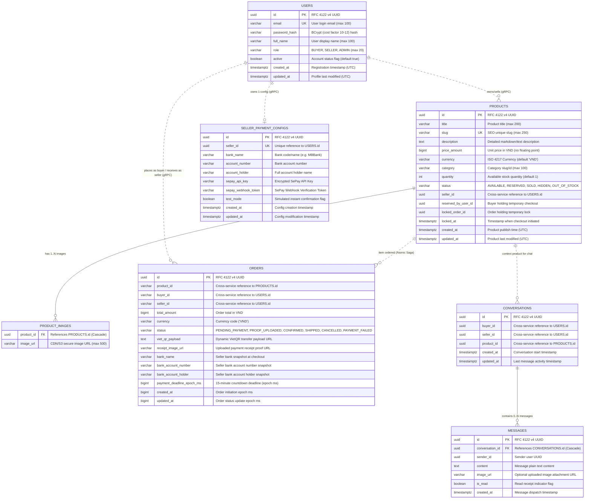

# Database Design & Architecture Specification

> **Project**: Shopi C2C Used-Goods Marketplace  
> **Pattern**: Database-per-Service + Direct Inventory Deduction (Atomic Saga) + Redis Multi-Level Caching  
> **Database Engines**: PostgreSQL 16 Alpine, Redis 7 Alpine  
> **Status**: Production Specification  

---

## 1. Executive Summary & Design Principles

Shopi implements the **Database-per-Service** architectural pattern. Each autonomous microservice owns its private relational database schema and multi-level cache. Cross-database queries or foreign keys between microservice boundaries are strictly forbidden to enforce loose coupling, independent scalability, and localized failure domains.

### Key Architectural Tenets:
1. **Zero Shared Storage**: Microservices never connect to another service's database directly. Inter-service data queries and transactions are negotiated through binary **gRPC (HTTP/2 Protobuf)**.
2. **UUID Primary Keys (RFC 4122 v4)**: All primary keys use 128-bit Universally Unique Identifiers (UUID) generated on the application layer to avoid sequential enumeration attacks and facilitate distributed shard rebalancing.
3. **Direct Inventory Deduction (No Holding Lock)**: Inventory quantity is decremented atomically at checkout time (`UPDATE products SET quantity = quantity - 1, status = CASE WHEN (quantity - 1) <= 0 THEN 'OUT_OF_STOCK' ELSE 'AVAILABLE' END WHERE id = :id AND quantity > 0`). If an order expires or is cancelled, compensation automatically restores quantity (`UPDATE products SET quantity = quantity + 1, status = 'AVAILABLE' WHERE id = :id`).
4. **Saga Distributed Transactions**: Cross-service transactional consistency is achieved via orchestrated Saga state machines with automated compensation rollbacks.
5. **Multi-Level Redis Fast-Path**: Ephemeral authentication tokens, token family tracking, rate-limiting counters, and reservation timeouts reside in Redis 7 with sub-millisecond access and automated TTL expiration.

---

## 2. Multi-Service Entity Relationship Diagram (ERD)



---

## 3. Physical Schema Specification

### 3.1 Database 1: `shopi_identity_db` (Port `5434` / Internal `5432`)
- **Owner Service**: `identity-service` (Spring Boot, gRPC Port 9093, HTTP Port 8083)
- **Primary Responsibility**: User credentials, identity claims, password security.

#### Table: `users`
| Column Name | Data Type | Nullable | Constraints & Defaults | Description |
| :--- | :--- | :--- | :--- | :--- |
| `id` | `UUID` | No | `PRIMARY KEY` | Unique identifier generated via `UUID.randomUUID()` |
| `email` | `VARCHAR(100)` | No | `UNIQUE` | Case-insensitive normalized email address |
| `password_hash` | `VARCHAR(255)` | No | | BCrypt hashed password with salt cost 10 |
| `full_name` | `VARCHAR(100)` | No | | Full customer display name |
| `role` | `VARCHAR(20)` | No | `DEFAULT 'BUYER'` | Enumeration: `'BUYER'`, `'SELLER'`, `'ADMIN'` |
| `active` | `BOOLEAN` | No | `DEFAULT TRUE` | Soft-disable flag for ban/moderation |
| `created_at` | `TIMESTAMPTZ` | No | `DEFAULT NOW()` | Record creation timestamp |
| `updated_at` | `TIMESTAMPTZ` | No | `DEFAULT NOW()` | Record modification timestamp |

#### Seed Accounts:
- Admin: `admin@shopi.vn` / `admin123` (`a0000000-0000-0000-0000-000000000001`)
- Seller: `seller@shopi.vn` / `seller123` (`b0000000-0000-0000-0000-000000000002`)
- Buyer: `buyer@shopi.vn` / `buyer123` (`c0000000-0000-0000-0000-000000000003`)

---

### 3.2 Database 2: `shopi_catalog_db` (Port `5432` / Internal `5432`)
- **Owner Service**: `shop-catalog-service` (Spring Boot, gRPC Port 9091, HTTP Port 8081)
- **Primary Responsibility**: C2C used-goods product listings, image metadata, atomic inventory deduction.

#### Table: `products`
| Column Name | Data Type | Nullable | Constraints & Defaults | Description |
| :--- | :--- | :--- | :--- | :--- |
| `id` | `UUID` | No | `PRIMARY KEY` | RFC 4122 v4 Product ID |
| `title` | `VARCHAR(200)` | No | | Product title / headline |
| `slug` | `VARCHAR(250)` | No | `UNIQUE` | URL-friendly slug for SEO routing |
| `description` | `TEXT` | No | | Full description including used condition notes |
| `price_amount` | `BIGINT` | No | | Integer price in VND |
| `currency` | `VARCHAR(10)` | No | `DEFAULT 'VND'` | ISO 4217 Currency symbol |
| `category` | `VARCHAR(100)` | No | | Category slug (`DoDienTu`, `MayAnh`, `NoiThat`) |
| `quantity` | `INT` | No | `DEFAULT 1` | Available stock count (decrements immediately on purchase) |
| `status` | `VARCHAR(30)` | No | `DEFAULT 'AVAILABLE'` | `'AVAILABLE'`, `'RESERVED'`, `'SOLD'`, `'HIDDEN'`, `'OUT_OF_STOCK'` |
| `seller_id` | `UUID` | No | | Identifier of seller in `identity-service` |
| `reserved_by_user_id` | `UUID` | Yes | `DEFAULT NULL` | Buyer holding checkout lock |
| `locked_order_id` | `UUID` | Yes | `DEFAULT NULL` | Order ID associated with checkout |
| `locked_at` | `TIMESTAMPTZ` | Yes | `DEFAULT NULL` | Timestamp when checkout was initiated |
| `created_at` | `TIMESTAMPTZ` | No | `DEFAULT NOW()` | Publication timestamp |
| `updated_at` | `TIMESTAMPTZ` | No | `DEFAULT NOW()` | Last modification timestamp |

#### Table: `product_images`
| Column Name | Data Type | Nullable | Constraints & Defaults | Description |
| :--- | :--- | :--- | :--- | :--- |
| `product_id` | `UUID` | No | `REFERENCES products(id) ON DELETE CASCADE` | Associated product |
| `image_url` | `VARCHAR(500)` | No | | HTTPS link to CDN or `/api/uploads/...` |

---

### 3.3 Database 3: `shopi_order_db` (Port `5433` / Internal `5432`)
- **Owner Service**: `order-payment-service` (Spring Boot, gRPC Port 9092, HTTP Port 8082)
- **Primary Responsibility**: Order lifecycle state machine, SePay webhook processing, seller bank accounts, buyer-seller chat.

#### Table: `orders`
| Column Name | Data Type | Nullable | Constraints & Defaults | Description |
| :--- | :--- | :--- | :--- | :--- |
| `id` | `UUID` | No | `PRIMARY KEY` | RFC 4122 v4 Order ID |
| `product_id` | `VARCHAR(64)` | No | | Product ID being purchased |
| `buyer_id` | `VARCHAR(64)` | No | | Buyer ID initiating purchase |
| `seller_id` | `VARCHAR(64)` | No | | Product owner receiving funds |
| `total_amount` | `BIGINT` | No | | Amount due in VND |
| `currency` | `VARCHAR(16)` | No | `DEFAULT 'VND'` | Currency denomination |
| `status` | `VARCHAR(32)` | No | | State machine status (Section 5) |
| `viet_qr_payload` | `TEXT` | Yes | | Pre-generated VietQR QuickLink with seller bank info |
| `receipt_image_url` | `VARCHAR(1024)` | Yes | | Buyer-uploaded payment proof screenshot |
| `bank_name` | `VARCHAR(100)` | Yes | | Seller bank name snapshot (e.g. MBBank) |
| `bank_account_number` | `VARCHAR(50)` | Yes | | Seller bank account number snapshot |
| `bank_account_holder` | `VARCHAR(100)` | Yes | | Seller account holder name snapshot |
| `payment_deadline_epoch_ms` | `BIGINT` | No | | Millisecond epoch limit ($T + 15\text{m}$) |
| `created_at` | `BIGINT` | No | | Millisecond epoch timestamp |
| `updated_at` | `BIGINT` | No | | Millisecond epoch timestamp |

#### Table: `seller_payment_configs`
| Column Name | Data Type | Nullable | Constraints & Defaults | Description |
| :--- | :--- | :--- | :--- | :--- |
| `id` | `UUID` | No | `PRIMARY KEY` | Unique config UUID |
| `seller_id` | `UUID` | No | `UNIQUE` | References seller in `identity-service` |
| `bank_name` | `VARCHAR(100)` | Yes | | Supported bank code (e.g. MBBank, VCB, ACB) |
| `account_number` | `VARCHAR(50)` | Yes | | Account number for VietQR generation |
| `account_holder` | `VARCHAR(100)` | Yes | | Account owner name |
| `sepay_api_key` | `VARCHAR(255)` | Yes | | SePay API integration key |
| `sepay_webhook_token` | `VARCHAR(255)` | Yes | | Verification secret for incoming webhooks |
| `test_mode` | `BOOLEAN` | No | `DEFAULT TRUE` | Allows `/api/orders/{id}/simulate-payment` |
| `created_at` | `TIMESTAMPTZ` | No | `DEFAULT NOW()` | Creation timestamp |
| `updated_at` | `TIMESTAMPTZ` | No | `DEFAULT NOW()` | Modification timestamp |

#### Table: `conversations`
| Column Name | Data Type | Nullable | Constraints & Defaults | Description |
| :--- | :--- | :--- | :--- | :--- |
| `id` | `UUID` | No | `PRIMARY KEY` | Conversation UUID |
| `buyer_id` | `UUID` | No | | Buyer UUID |
| `seller_id` | `UUID` | No | | Seller UUID |
| `product_id` | `UUID` | No | | Inquired product UUID |
| `created_at` | `TIMESTAMPTZ` | No | `DEFAULT NOW()` | Conversation initiation timestamp |
| `updated_at` | `TIMESTAMPTZ` | No | `DEFAULT NOW()` | Last message timestamp |

#### Table: `messages`
| Column Name | Data Type | Nullable | Constraints & Defaults | Description |
| :--- | :--- | :--- | :--- | :--- |
| `id` | `UUID` | No | `PRIMARY KEY` | Message UUID |
| `conversation_id` | `UUID` | No | `REFERENCES conversations(id) ON DELETE CASCADE` | Associated chat thread |
| `sender_id` | `UUID` | No | | Author user UUID |
| `content` | `TEXT` | Yes | | Message text body |
| `image_url` | `VARCHAR(500)` | Yes | | Uploaded image path `/api/uploads/...` |
| `is_read` | `BOOLEAN` | No | `DEFAULT FALSE` | Read receipt flag |
| `created_at` | `TIMESTAMPTZ` | No | `DEFAULT NOW()` | Sent timestamp |

---

## 4. Redis 7 Key Architecture

| Key Pattern | Redis Type | Default TTL | Owning Service | Purpose & Payload |
| :--- | :--- | :--- | :--- | :--- |
| `auth:refresh:<refreshToken>` | `STRING` | 14 days | `identity-service` | Active refresh token to user mapping: `<userId>` |
| `auth:blacklist:<jwtToken>` | `STRING` | 15 minutes | `api-gateway` / `identity-service` | Revoked access token blacklist: `"revoked"` |
| `order:timeout:<orderId>` | `STRING` | 15 minutes | `order-payment-service` | Active checkout timeout tracker: `<productId>` |
| `ratelimit:<clientKey>` | `STRING` | 60 seconds | `api-gateway` | Sliding token bucket rate limit counter (60 req/min) |

---

## 5. Direct Inventory Deduction & Saga Compensation Lifecycle

```
[AVAILABLE] (quantity = N)
     │
     ▼ (1) CreateOrder: Direct Atomic Inventory Decrement
     │   UPDATE products SET quantity = quantity - 1, 
     │   status = CASE WHEN quantity - 1 <= 0 THEN 'OUT_OF_STOCK' ELSE 'AVAILABLE' END
     │
[PENDING_PAYMENT] (Order created, VietQR displayed, 15m timer active)
     │
     ├─ (2a) SePay Webhook / Simulate Payment ──► [CONFIRMED] -> [SHIPPED]
     │       (Order confirmed, product marked SOLD if quantity = 0)
     │
     ├─ (2b) Buyer Uploads Receipt ────────────► [PROOF_UPLOADED] ──► Seller Confirm ──► [CONFIRMED]
     │
     └─ (2c) Cancel Order / 15m Timeout ──────► [CANCELLED]
             (Compensation Rollback: UPDATE products SET quantity = quantity + 1, status = 'AVAILABLE')
```
