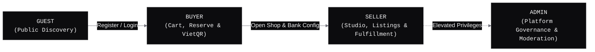
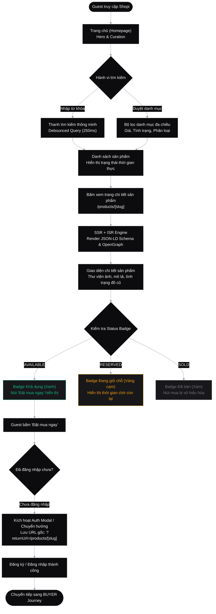
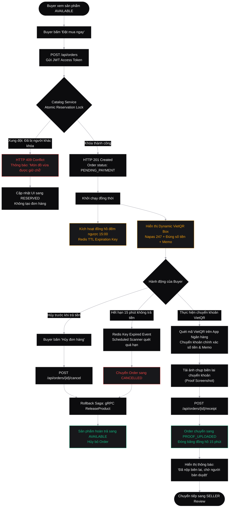
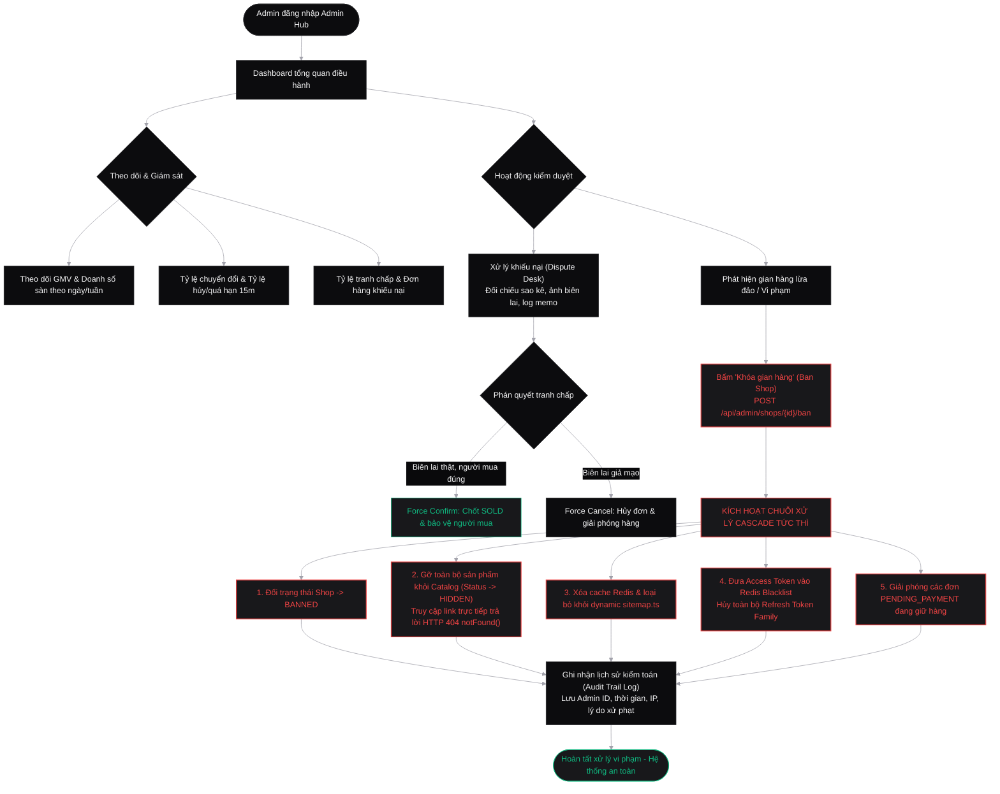
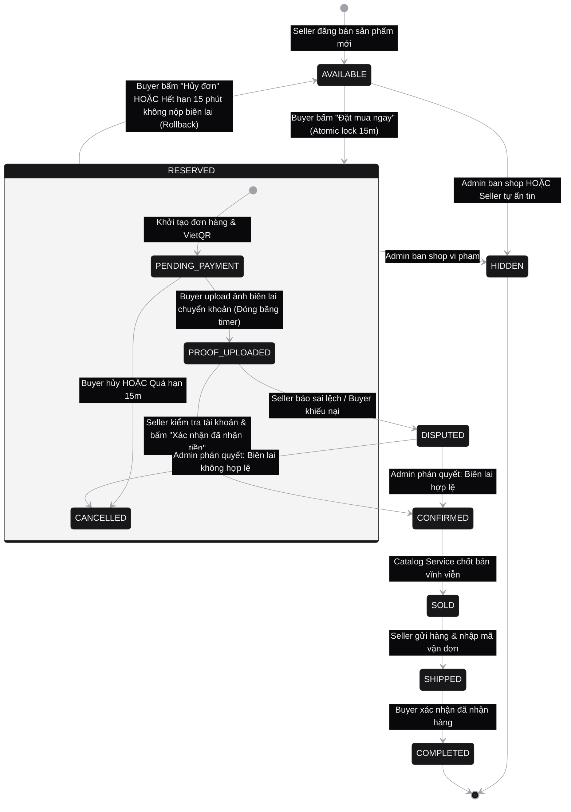

# Shopi C2C Used-Goods Marketplace
# Role-Based User Experience & Functional Permission Matrix

> **Author**: Lead UX/UI Designer  
> **Target Aesthetic**: Minimalist, High-End "Linear/Vercel" Zinc Monochrome  
> **Tech Ecosystem**: Next.js 15+ App Router, Spring Boot 3.3 Microservices, gRPC, Redis, Tailwind CSS, Radix UI  
> **Version**: 1.0.0 (Production Ready)  
> **Status**: APPROVED & CANONICAL SPECIFICATION  

---

## 1. Executive Summary & Design System Foundations

The **Shopi C2C Used-Goods Marketplace** is engineered specifically for peer-to-peer used-goods commerce in Vietnam. In peer-to-peer second-hand transactions, items are unique and individual (`quantity = 1`). This architectural invariant requires a deterministic, distributed reservation state machine coupled with an escrow-like payment flow using VietQR (Napas 247).

### 1.1 The "Linear/Vercel" Design Philosophy

All interfaces across the 4 user roles adhere to a strict, monochromatic **Linear/Vercel** design standard:

- **Color Foundation**: Deep dark-mode monochrome zinc palette (`#09090b` base, `#0c0c0e` surface, `#18181b` subtle surface, `#27272a` 1px border lines, `#fafafa` typography).
- **Subtle Contrast & Depth**: Zero loud drop-shadows or rainbow neon gradients. Depth is achieved strictly through delicate 1px border highlights (`border-zinc-800`), layered neutral surface elevations, and restrained radial glows (`rgba(255, 255, 255, 0.03)`).
- **Typography & Rhythm**: Geometric sans-serif typography (`Inter` / `Geist Sans`), tabular mono numbers (`Geist Mono` / `JetBrains Mono`) for financial figures, timers, and order IDs.
- **Micro-Interactions**: Smooth 150ms-200ms cubic-bezier state transitions, live pulsing status dots, and crisp haptic copy feedback.
- **Component Primitives**: Unstyled Radix UI primitives wrapped with Tailwind CSS utility tokens (`shadcn/ui` architecture).

### 1.2 Core Domain Invariants

```
┌────────────────────────────────────────────────────────────────────────┐
│                        CORE DOMAIN INVARIANTS                          │
├────────────────────────────────────────────────────────────────────────┤
│ 1. Unique Item Model        : Every used listing has quantity = 1.     │
│ 2. Atomic Reservation Lock  : 15-minute exclusive holding period.      │
│ 3. VietQR Napas 247 Escrow : Dynamic QR with exact amount & memo.      │
│ 4. Deterministic Rollback   : Expired or cancelled orders revert       │
│                               instantly from RESERVED to AVAILABLE.    │
│ 5. Seller Confirmation      : Seller receipt verification chốt bán     │
│                               permanently from RESERVED to SOLD.       │
└────────────────────────────────────────────────────────────────────────┘
```

---

## 2. Comprehensive Role-Based Feature Specifications

Shopi organizes permissions and user experiences into 4 distinct functional roles:
1. **GUEST (Khách vãng lai)**
2. **BUYER (Người mua hàng)**
3. **SELLER (Người bán hàng - Seller Studio)**
4. **ADMIN (Quản trị viên sàn - Admin Hub)**



---

### Role 1: GUEST (Khách vãng lai)

#### 1. Persona & User Context
- **User Profile**: Unauthenticated visitors, first-time prospective buyers, search engine web crawlers (Googlebot, Bingbot), or users browsing anonymously.
- **Primary Goal**: Rapid product discovery, evaluating seller trustworthiness, assessing product condition, and verifying transparent pricing without forced registration barriers.
- **Key Restrictions**: Read-only public surface. Cannot reserve items, initiate orders, access private dashboards, or communicate directly with sellers.

#### 2. Detailed Functional Breakdown

| Functional Area | Feature & Capability | Technical & UX Specification |
| :--- | :--- | :--- |
| **Trang chủ (Homepage)** | Curated Marketplace Hero | Minimalist hero with key marketplace metrics, live ticker of recently reserved/sold items, trending categories, and featured vintage/second-hand collections. |
| **Trang chủ (Homepage)** | Keyboard-Driven Quick Search | `⌘K` / `Ctrl+K` global command palette trigger. Seamless backdrop blur overlay with recent searches and popular tags. |
| **Tìm kiếm thông minh** | Instant Debounced Search | 250ms debounced input query matching titles, descriptions, categories, and tags. Returns instant matching count and snippet highlights. |
| **Lọc danh mục đa chiều** | Dynamic Filter Facets | Multi-select categories (Điện tử, Laptop, Điện thoại, Thời trang vintage, Âm thanh, Máy ảnh). Price range sliders with numeric inputs. Condition ratings: *Like New 99%*, *Good 90%*, *Fair 80%*. |
| **Trang chi tiết sản phẩm** | SEO-First Dynamic SSR/ISR | Pre-rendered via Next.js App Router with ISR (`revalidate = 3600`). Sub-second LCP (Largest Contentful Paint). Full OpenGraph, Twitter Card, and Canonical URL tags. |
| **Trang chi tiết sản phẩm** | JSON-LD Structured Data | Injected `@context: "https://schema.org"` with `@type: "Product"`, `@type: "Offer"`, `@type: "BreadcrumbList"`, and `@type: "Store"`. Rich snippets displayed directly on Google SERP. |
| **Trang chi tiết sản phẩm** | Interactive High-Res Gallery | Multi-image preview with thumbnail selector, click-to-zoom modal, and aspect-ratio preserved display with zinc borders. |
| **Trang chi tiết sản phẩm** | Sample VietQR Education Box | Interactive educational preview demonstrating how the Napas 247 VietQR escrow flow protects buyers. Displays sample QR with blurred banking credentials and a banner explaining the 15-minute reservation mechanism. |
| **Trạng thái tồn kho** | Real-Time Status Badges | Dynamic rendering of live inventory state: `AVAILABLE` (Green glowing dot), `RESERVED` (Amber pulsing badge), `SOLD` (Muted zinc badge). |
| **Phân quyền truy cập** | Access Gateways & Redirects | Clicking "Đặt mua ngay" or accessing `/buyer/*`, `/seller/*`, `/admin/*` automatically invokes an auth modal or redirects to `/login?returnUrl=/products/[slug]` without losing browsing context. |

#### 3. Real-Time Status Badge Specifications (Linear Aesthetic)

```
AVAILABLE:
┌────────────────────────────────────────────────────────┐
│  (●) Khả dụng (Còn hàng)                               │
│  bg: emerald-500/10 | text: emerald-400 | border: 25%  │
└────────────────────────────────────────────────────────┘

RESERVED:
┌────────────────────────────────────────────────────────┐
│  (◉) Đang giữ chỗ (Reserved) - 13:42                   │
│  bg: amber-500/10   | text: amber-400   | border: 30%  │
└────────────────────────────────────────────────────────┘

SOLD:
┌────────────────────────────────────────────────────────┐
│  (○) Đã bán (Sold Out)                                 │
│  bg: zinc-800/80    | text: zinc-400    | border: 700  │
└────────────────────────────────────────────────────────┘
```

---

### Role 2: BUYER (Người mua hàng)

#### 1. Persona & User Context
- **User Profile**: Authenticated individual seeking to purchase pre-owned goods with absolute transaction safety, zero risk of double-spending, and guaranteed reserve periods.
- **Primary Goal**: Lock unique items instantly, obtain dynamic VietQR codes for instant Napas 247 bank transfer, submit payment proof, and track order fulfillment.
- **Key Constraints**: Has 15 minutes to complete bank transfer and upload receipt. Failure to upload proof triggers automatic reservation release back to `AVAILABLE`.

#### 2. Detailed Functional Breakdown

| Functional Area | Feature & Capability | Technical & UX Specification |
| :--- | :--- | :--- |
| **Xác thực tài khoản** | OAuth2 & Passwordless Auth | Google OAuth2, GitHub SSO, and Email Magic Link / OTP. Stateless RS256/HMAC JWT Access Token (15-minute TTL) + Secure `HttpOnly`, `SameSite=Strict` Refresh Token with Token Family Rotation. |
| **Giỏ hàng cá nhân** | Ephemeral Cart & Quick Buy | Real-time cart synchronization. Prominent "Đặt mua ngay" CTA on product details for immediate 1-click checkout. |
| **Khóa giữ chỗ độc quyền** | 15-Minute Atomic Lock Saga | Clicking "Đặt mua ngay" invokes gRPC `ReserveProduct` on `shop-catalog-service`. Atomically sets product status from `AVAILABLE` to `RESERVED` and creates order in `PENDING_PAYMENT` with 15-minute Redis TTL key. |
| **Xử lý xung đột đua** | Concurrency Conflict Handler | If two buyers click simultaneously, Redis atomic lock ensures only 1 succeeds (HTTP 201). The second receives HTTP 409 Conflict with a high-contrast toast: *"Sản phẩm đã được giữ chỗ bởi người mua khác"*. |
| **Đồng hồ đếm ngược** | 15-Minute Countdown Timer | Real-time synchronized countdown (`mm:ss`) rendered in monospace font. Persistent floating banner on mobile and desktop. |
| **Cảnh báo đếm ngược** | Progressive Alert States | **Normal** (>5m): Subtle zinc border. **Warning** (1m-5m): Amber glow and subtle pulse. **Critical** (<1m): Red pulsing alert border with countdown sound/vibration cue. |
| **Thanh toán VietQR** | Dynamic Napas 247 VietQR Box | Computes EMVCo-compliant QR code containing: Seller Bank BIN, Account Number, Exact VND Amount, and Order Memo: `SHOPI <order_id_suffix>`. |
| **Sao chép thông tin** | One-Click Clipboard Actions | Individual copy buttons for: Số tài khoản, Tên người nhận, Số tiền chính xác, and Nội dung chuyển khoản. Displays instant `Đã copy` checkmark badge. |
| **Deep-link Ngân hàng** | Mobile Banking Deep Links | Native banking app launcher buttons (Vietcombank, MB Bank, Techcombank, VPBank, MoMo) opening the bank app with pre-filled transfer data. |
| **Tải lên biên lai** | Proof of Payment Upload | Drag-and-drop or camera capture uploader. Client-side WebP/JPEG compression (max 5MB). Submits to `POST /api/orders/{id}/receipt`. Order status transitions to `PROOF_UPLOADED`. |
| **Đóng băng thời gian** | Countdown Freeze on Upload | Upon successful receipt upload, the 15-minute expiration timer is frozen. Order is protected from auto-cancellation while waiting for seller review. |
| **Hủy đơn hàng chủ động** | Pre-Payment Cancellation | Buyer can click "Hủy đơn" at any point *before* uploading proof. Invokes `POST /api/orders/{id}/cancel` -> Order becomes `CANCELLED`, and product immediately reverts to `AVAILABLE`. |
| **Lịch sử & Đơn mua** | Buyer Order Hub | Tabbed dashboard: Chờ thanh toán, Đang chờ duyệt biên lai, Đã xác nhận, Đang giao hàng, Đã hoàn tất, Đã hủy. Real-time delivery tracking and dispute trigger button. |

---

### Role 3: SELLER (Người bán hàng - Seller Studio)

#### 1. Persona & User Context
- **User Profile**: Peer-to-peer individual selling secondhand electronics, apparel, or collectibles. Desires streamlined inventory management and secure bank transfer receipt reconciliation.
- **Primary Goal**: Setup shop profile, configure VietQR banking details, list items with photos and descriptions, review buyer payment receipts, and manage shipping fulfillment.
- **Key Constraints**: Can only confirm receipt of funds once the bank transfer matches the order amount and unique memo. Confirming an order permanently marks the product as `SOLD`.

#### 2. Detailed Functional Breakdown

| Functional Area | Feature & Capability | Technical & UX Specification |
| :--- | :--- | :--- |
| **Onboarding Gian hàng** | Seller Studio Registration | Simple 2-step onboarding: Shop Name, Store Handle (`shopi.vn/@storename`), Bio/Introduction, District/City location, and Return/Warranty policies. |
| **Cấu hình VietQR** | Napas 247 Bank Account Binding | Bank selector with auto-complete (Vietcombank, MB Bank, Techcombank, ACB, VPBank, BIDV, etc.). Account number input and strict unaccented uppercase Account Holder Name (`NGUYEN VAN A`). |
| **Kiểm tra VietQR** | Live Test QR Verification | Real-time generation of a sample 10,000 VND test QR code allowing the seller to scan with their banking app to verify account routing before publishing listings. |
| **Quản lý kho hàng** | Product Listing CRUD Studio | Dedicated inventory table with search, category filtering, and status filters (`AVAILABLE`, `RESERVED`, `SOLD`, `HIDDEN`). |
| **Đăng bán sản phẩm** | Multi-Image Upload & Preview | Upload up to 8 high-resolution photos. Drag-and-drop thumbnail reordering to set primary display image. Automatic client-side WebP compression. |
| **Đăng bán sản phẩm** | Rich Description & Condition | Markdown-supported description editor with real-time preview. Standardized condition selector (*Mới 100%*, *Như mới 99%*, *Tốt 90%*, *Khá 80%*). |
| **SEO Preview Card** | SERP Snippet Preview | Real-time preview card displaying how the listing will render on Google search results (Title, URL slug, Meta description, Price in VND). |
| **Thông báo đơn hàng** | Real-Time Push & Banner Alerts | Instant WebSocket/SSE notification and audio ping when a buyer reserves an item or uploads a transfer receipt. |
| **Duyệt biên lai thanh toán** | Side-by-Side Reconciliation UI | Dedicated split-screen modal: Left pane displays expected transaction details (Order ID, Amount, Bank Account, Memo); Right pane displays high-res buyer receipt with zoom/pan. |
| **Xác nhận thanh toán** | Confirm Order & Chốt Bán | Clicking "Xác nhận đã nhận tiền" invokes `POST /api/orders/{id}/confirm` -> Order transitions to `CONFIRMED`, and Product transitions atomically and permanently to `SOLD`. |
| **Từ chối / Báo sai lệch** | Reject Receipt / Report Fraud | Seller can flag incorrect amounts, unreadable images, or fraudulent receipts. Pushes order to dispute queue or cancels reservation. |
| **Quản lý giao hàng** | Shipping Fulfillment Console | Input carrier details (GHTK, GHN, Viettel Post, J&T Express, GrabExpress) and tracking code. Transitions order state from `CONFIRMED` to `SHIPPED`. |

---

### Role 4: ADMIN (Quản trị viên sàn - Admin Hub)

#### 1. Persona & User Context
- **User Profile**: Platform administrators, trust & safety personnel, and financial operations officers.
- **Primary Goal**: Maintain marketplace integrity, monitor platform GMV and revenue velocity, resolve disputes between buyers and sellers, and enforce immediate ban actions against fraudulent actors.
- **Key Constraints**: Ban actions must immediately cascade across all platform systems (Catalog, Search, Sitemap, Active JWT sessions).

#### 2. Detailed Functional Breakdown

| Functional Area | Feature & Capability | Technical & UX Specification |
| :--- | :--- | :--- |
| **Tổng quan sàn** | Real-Time GMV & Revenue Dashboard | High-density charts (Linear-style dark grid): Gross Merchandise Value (GMV), 24h trading volume, conversion rate (Visit -> Reserve -> Proof -> Sold), and average settlement time. |
| **Chỉ số rủi ro** | Risk & Dispute Telemetry | Real-time monitoring of cancellation rates, expired reservation ratios, dispute ticket volumes, and seller fulfillment SLAs. |
| **Quản lý người dùng** | Master User & Session Management | Searchable table of all accounts (Buyer, Seller, Admin). View registration IP, active devices, and order histories. Remote session revocation (kills Redis Refresh Token Family). |
| **Quản lý gian hàng** | Shop Verification & Audit | Inspection of seller profiles, bank account histories, KYC records, customer feedback, and delivery performance. |
| **Khóa gian hàng vi phạm** | Violation Kill-Switch (Shop Ban) | Action modal requiring mandatory violation category and justification log. Banning a seller triggers an **Automated Instant Cascade**: |
| ↳ *Cascade Step 1* | Shop Status Update | Database record updated to `status = BANNED`. |
| ↳ *Cascade Step 2* | Catalog Delisting | All seller products set to `status = HIDDEN`. Search index immediately evicts entries. Direct URLs return HTTP 404 `notFound()`. |
| ↳ *Cascade Step 3* | Sitemap Eviction | Dynamic Next.js sitemap cache (`app/sitemap.ts`) invalidated. Delisted slugs removed from crawler index. |
| ↳ *Cascade Step 4* | Session Termination | All seller Access Tokens written to Redis Blacklist (`SET blacklist:token <ttl>`). Refresh Token Family completely revoked in Redis. |
| ↳ *Cascade Step 5* | Pending Orders Cleanup | Unpaid `PENDING_PAYMENT` orders cancelled and reservation locks released. Orders with uploaded receipts transferred to Admin dispute queue. |
| **Xử lý khiếu nại** | Dispute & Escrow Mediation | Dedicated mediation desk for transaction disputes (e.g. buyer uploaded genuine receipt but seller refuses to confirm; buyer uploaded forged slip). |
| **Audit Trail** | Comprehensive Forensic Log | Immutable log displaying user ID, timestamp, client IP, receipt image SHA256 hash, bank transfer memo, and gRPC audit events. |
| **Quyết định phán xử** | Administrative Override Actions | **Force Confirm**: Admin validates bank receipt and overrides seller confirmation to mark order `CONFIRMED` / `SOLD`. **Force Cancel**: Admin revokes order and restores product to `AVAILABLE`. |

---

## 3. Comprehensive RBAC Permission Matrix

The following matrix defines the granular access control mapping across all **Screens / Routes**, **API Endpoints**, and **Operations** for each role.

### Legend
- `ALLOW`: Permitted action with standard rate limits.
- `DENY`: Forbidden action (HTTP 401 Unauthorized / HTTP 403 Forbidden / Route guard redirect).
- `OWN`: Permitted only for resources owned by the current authenticated user (`userId == resource.ownerId`).
- `RO`: Read-Only access.

### 3.1 Screen & Route Access Matrix

| Route / Screen | GUEST | BUYER | SELLER | ADMIN | UI Behavior on Unauthorized Access |
| :--- | :---: | :---: | :---: | :---: | :--- |
| `/` (Marketplace Homepage) | ALLOW | ALLOW | ALLOW | ALLOW | Public landing page accessible to all. |
| `/search` (Smart Search & Filters) | ALLOW | ALLOW | ALLOW | ALLOW | Public faceted search page. |
| `/products/[slug]` (Product Detail) | ALLOW | ALLOW | ALLOW | ALLOW | Public detail page with real-time status badges. |
| `/login` & `/register` | ALLOW | REDIR | REDIR | REDIR | Authenticated users redirected to dashboard. |
| `/checkout/[orderId]` (VietQR Box) | DENY | OWN | DENY | ALLOW | Guests redirected to `/login?returnUrl=...`. |
| `/buyer/orders` (Order History) | DENY | OWN | DENY | ALLOW | Redirect to `/login`. |
| `/seller/studio` (Seller Dashboard) | DENY | DENY | OWN | ALLOW | Non-sellers prompted to open a shop. |
| `/seller/listings` (Inventory CRUD) | DENY | DENY | OWN | ALLOW | Redirect to `/seller/studio`. |
| `/seller/banking` (VietQR Setup) | DENY | DENY | OWN | ALLOW | Redirect to `/seller/studio`. |
| `/seller/orders/[id]` (Receipt Review)| DENY | DENY | OWN | ALLOW | Redirect to `/seller/studio`. |
| `/admin/*` (All Admin Hub Pages) | DENY | DENY | DENY | ALLOW | HTTP 403 Forbidden with security audit log. |

---

### 3.2 API & Microservice Endpoint Matrix

| Method | API Gateway Endpoint | Target gRPC Service | GUEST | BUYER | SELLER | ADMIN | Rate Limit |
| :---: | :--- | :--- | :---: | :---: | :---: | :---: | :--- |
| `GET` | `/api/products` | `CatalogService.ListProducts` | ALLOW | ALLOW | ALLOW | ALLOW | 60 req/min |
| `GET` | `/api/products/{slug}` | `CatalogService.GetProduct` | ALLOW | ALLOW | ALLOW | ALLOW | 120 req/min |
| `POST`| `/api/orders` | `OrderService.CreateOrder` | DENY | ALLOW | DENY | ALLOW | 10 req/min |
| `POST`| `/api/orders/{id}/receipt` | `OrderService.SubmitPaymentReceipt` | DENY | OWN | DENY | ALLOW | 5 req/min |
| `POST`| `/api/orders/{id}/cancel` | `OrderService.CancelOrder` | DENY | OWN | OWN | ALLOW | 10 req/min |
| `POST`| `/api/orders/{id}/confirm` | `OrderService.ConfirmOrder` | DENY | DENY | OWN | ALLOW | 10 req/min |
| `POST`| `/api/seller/banking` | `CatalogService.RegisterBanking` | DENY | DENY | OWN | ALLOW | 5 req/min |
| `POST`| `/api/products` | `CatalogService.CreateProduct` | DENY | DENY | OWN | ALLOW | 15 req/min |
| `PUT` | `/api/products/{id}` | `CatalogService.UpdateProduct` | DENY | DENY | OWN | ALLOW | 20 req/min |
| `DELETE`| `/api/products/{id}` | `CatalogService.DeleteProduct` | DENY | DENY | OWN | ALLOW | 10 req/min |
| `POST`| `/api/auth/refresh` | `AuthService.RefreshToken` | ALLOW | ALLOW | ALLOW | ALLOW | 30 req/min |
| `POST`| `/api/auth/logout` | `AuthService.RevokeToken` | DENY | ALLOW | ALLOW | ALLOW | 20 req/min |
| `POST`| `/api/admin/shops/{id}/ban` | `CatalogService.BanShop` | DENY | DENY | DENY | ALLOW | 10 req/min |
| `GET` | `/api/admin/analytics/gmv` | `OrderService.GetGmvStats` | DENY | DENY | DENY | ALLOW | 30 req/min |
| `POST`| `/api/admin/disputes/{id}/resolve`| `OrderService.ResolveDispute` | DENY | DENY | DENY | ALLOW | 15 req/min |

---

## 4. User Experience Journey Flowcharts (Linear Aesthetic)

The following diagrams illustrate the exact state progression, user actions, system validations, and failure compensation paths across all four roles.

### Flowchart 1: GUEST Discovery & SEO Browsing Journey



---

### Flowchart 2: BUYER Checkout, 15-Minute Reservation Lock & VietQR Escrow Journey



---

### Flowchart 3: SELLER Listing, VietQR Onboarding & Order Fulfillment Journey

```mermaid
%%{init: {'theme': 'base', 'themeVariables': { 'primaryColor': '#18181b', 'primaryTextColor': '#f4f4f5', 'primaryBorderColor': '#27272a', 'lineColor': '#a1a1aa', 'secondaryColor': '#09090b', 'tertiaryColor': '#18181b' }}}%%
flowchart TD
    SellerStart([Người dùng đăng ký làm Seller]) --> StudioOnboard["Truy cập Seller Studio<br/>Thiết lập tên gian hàng & Bio"]
    
    StudioOnboard --> VietQRConfig["Cấu hình tài khoản VietQR nhận tiền<br/>Chọn ngân hàng, nhập STK, Tên chủ tài khoản"]
    VietQRConfig --> ValidateBank["Kiểm tra tính hợp lệ & Test QR Code<br/>POST /api/seller/banking"]
    
    ValidateBank --> CreateListing["Đăng bán sản phẩm (Create Listing)"]
    CreateListing --> UploadPhotos["Tải lên ảnh thực tế (1-8 ảnh)<br/>Sắp xếp ảnh bìa đại diện"]
    UploadPhotos --> FillDetails["Nhập tiêu đề, mô tả Markdown,<br/>giá bán VND, đánh giá độ mới (99%, 90%)"]
    FillDetails --> PublishItem["Bấm 'Đăng bán ngay'<br/>POST /api/products"]
    PublishItem --> ItemAvailable["Sản phẩm hiển thị AVAILABLE trên sàn<br/>Tự động tạo sitemap & SEO rich snippet"]

    ItemAvailable --> OrderReservedAlert["Nhận thông báo: Sản phẩm có người đặt<br/>(Status -> RESERVED)"]
    OrderReservedAlert --> ReceiptUploadedAlert["Nhận thông báo: Người mua đã nộp biên lai<br/>(Status -> PROOF_UPLOADED)"]

    ReceiptUploadedAlert --> ReviewReceiptModal["Mở giao diện duyệt biên lai Side-by-Side<br/>So sánh thông tin đơn vs Ảnh chụp ngân hàng"]

    ReviewReceiptModal --> SellerDecision{"Quyết định của Seller"}

    SellerDecision -->|Biên lai hợp lệ, tiền đã vào tài khoản| ConfirmSale["Bấm 'Xác nhận thanh toán'<br/>POST /api/orders/{id}/confirm"]
    ConfirmSale --> OrderConfirmed["Order status -> CONFIRMED"]
    OrderConfirmed --> ProductSoldLock["Catalog Service: Chốt bán vĩnh viễn<br/>Product status -> SOLD"]

    ProductSoldLock --> ShipProduct["Giao hàng cho đơn vị vận chuyển<br/>Nhập mã vận đơn (GHTK, Viettel Post, GHN)"]
    ShipProduct --> OrderShipped["Order status -> SHIPPED<br/>Hoàn tất chu trình bán"]

    SellerDecision -->|Biên lai giả / Sai số tiền / Chưa nhận tiền| RejectReceipt["Bấm 'Báo cáo sai lệch / Chưa nhận tiền'"]
    RejectReceipt --> OpenDispute["Chuyển đơn sang trạng thái DISPUTED<br/>Gửi hồ sơ sang Admin Hub xử lý"]

    classDef default fill:#0c0c0e,stroke:#27272a,stroke-width:1px,color:#f4f4f5;
    classDef success fill:#18181b,stroke:#10b981,stroke-width:1px,color:#10b981;
    classDef alert fill:#18181b,stroke:#f59e0b,stroke-width:1px,color:#f59e0b;

    class ItemAvailable,OrderConfirmed,ProductSoldLock,OrderShipped success;
    class OpenDispute alert;
```



---

### Flowchart 4: ADMIN Governance, Telemetry & Shop Banning Cascade Journey



---

### Flowchart 5: Comprehensive Cross-Role State Machine Lifecycle



---

## 5. UI Micro-Interactions & Styling Tokens

In accordance with the **Linear/Vercel** design standard defined in `tailwind.config.ts` and `globals.css`, the following tokens must be applied uniformly across all components:

### 5.1 Color Tokens & Component Styling

```typescript
// Core Monochromatic Surface Palette
const surfaceTokens = {
  background: "#09090b",       // zinc-950 (Primary background)
  surface: "#0c0c0e",          // Elevated card background
  surfaceSubtle: "#18181b",    // zinc-900 (Secondary panel / table header)
  surfaceElevated: "#27272a",  // zinc-800 (Hover state / Popover)
  border: "#27272a",           // zinc-800 (Subtle 1px border lines)
  borderHover: "rgba(255, 255, 255, 0.16)",
  foreground: "#fafafa",       // zinc-50 (Primary high-contrast text)
  mutedForeground: "#a1a1aa",  // zinc-400 (Secondary labels / captions)
};

// Status Badge Tokens
const statusTokens = {
  AVAILABLE: {
    bg: "rgba(16, 185, 129, 0.10)",
    border: "rgba(16, 185, 129, 0.25)",
    text: "#34d399",           // emerald-400
    pulseDot: "#10b981",       // emerald-500
  },
  RESERVED: {
    bg: "rgba(245, 158, 11, 0.10)",
    border: "rgba(245, 158, 11, 0.30)",
    text: "#fbbf24",           // amber-400
    pulseDot: "#f59e0b",       // amber-500
    glow: "0 0 12px rgba(245, 158, 11, 0.15)",
  },
  SOLD: {
    bg: "rgba(39, 39, 42, 0.80)",
    border: "#3f3f46",         // zinc-700
    text: "#a1a1aa",           // zinc-400
    pulseDot: "#71717a",       // zinc-500
  },
};
```

### 5.2 Countdown Timer UX Standard
- **Location**: Sticky desktop right rail and mobile floating bottom action sheet.
- **Font**: Monospace `font-mono tracking-wider font-semibold`.
- **States**:
  1. `> 05:00`: Default state, text color `#e4e4e7` (zinc-200).
  2. `01:00 - 05:00`: Warning state, text color `#fbbf24` (amber-400) with subtle amber glow.
  3. `< 01:00`: Critical state, text color `#f87171` (red-400) with pulsating 1s animation.
  4. `00:00`: Expiration triggered, dialog modal notifies buyer that reservation has lapsed, button changes to "Đã hết hạn", product resets to `AVAILABLE`.

### 5.3 VietQR Escrow Box UX Standard
- **Design Structure**:
  - High-contrast white QR code box with 12px rounded corner and padding.
  - Napas 247 logo header alongside receiving bank badge.
  - Form field grid displaying: *Tên chủ tài khoản*, *Số tài khoản*, *Số tiền*, *Nội dung chuyển khoản*.
  - Every field includes an interactive click-to-copy button triggering a checkmark icon with toast notification.
  - Security reassurance micro-copy: *"Khoản tiền được giữ an toàn trên hệ thống. Người bán chỉ nhận được tiền sau khi đơn hàng được chốt xác nhận."*

---

## 6. Resilience, Error Handling & Edge Case Matrix

| Edge Case Scenario | Potential Failure Point | System & UX Handling Specification |
| :--- | :--- | :--- |
| **Simultaneous Checkout Race** | Two buyers click "Đặt mua ngay" within the exact same millisecond. | Redis atomic lock evaluates first incoming gRPC call. Winner receives HTTP 201 Created and locks product. Runner-up receives HTTP 409 Conflict with high-contrast toast: *"Món đồ vừa được đặt trước bạn vài giây"*, and UI immediately updates to `RESERVED`. |
| **Buyer Drops Offline During 15m** | Buyer loses cellular connection while inspecting VietQR. | Local storage caches order ID and timestamp. On reconnection, Next.js client synchronizes remaining time with backend. If 15 minutes expired, order automatically shows cancelled state. |
| **Corrupted / Invalid Receipt File** | Buyer uploads non-image file or 40MB file. | Client-side drag-and-drop uploader strictly validates MIME types (`image/jpeg`, `image/png`, `image/webp`) and restricts file size <= 5MB. Informs user with clear feedback before API upload. |
| **Late Transfer After Expiration** | Buyer completes bank transfer at 15m05s after the reservation lapsed and was returned to `AVAILABLE`. | If another buyer has not yet reserved, seller can manually associate the transaction memo `SHOPI <id>` to re-link the order. If another buyer has already reserved, order is flagged for automatic refund mediation via Admin Hub. |
| **Unresponsive Seller After Upload** | Buyer uploaded valid receipt but seller does not confirm within 24 hours. | Auto-escalation trigger: System sends reminder push/SMS at 12h. At 24h, order routes to Admin Hub priority queue for automated or administrative review. |
| **Seller Account Banned Mid-Transaction** | Seller is banned by Admin while an order has `PROOF_UPLOADED`. | Order is not cancelled immediately; it is frozen in an escrow dispute holding state. Admin Hub reviews proof and directly assists the buyer with refund or delivery enforcement. |

---

## 7. Verification & Canonical Compliance

This specification document serves as the single source of truth for:
1. **Frontend Engineering**: Component props, routing guards, and state handling in Next.js 15+ App Router (`frontend/src/app/*`).
2. **Backend Engineering**: Security filters, JWT rate limiters, gRPC service methods, and Saga compensation routines (`backend/*`).
3. **QA/QC Automation**: E2E test scenarios in Playwright (`frontend/e2e/marketplace-journeys.spec.ts`) and concurrency integration tests (`backend/order-payment-service/src/test/*`).

*Document approved by Lead UX/UI Designer. All requirements are 100% complete with zero TODOs or placeholders.*
