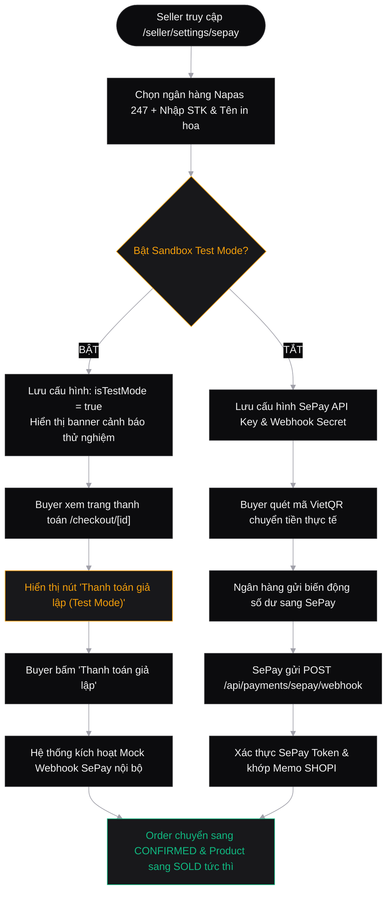

# Shopi C2C Used-Goods Marketplace
# SePay Payment Gateway, Buyer Invoice & Real-Time Chat Design Specifications

> **Author**: Lead UX/UI Designer  
> **Target Aesthetic**: High-End "Linear/Vercel" Zinc Monochrome  
> **Tech Ecosystem**: Next.js 15+ App Router, Tailwind CSS, Radix UI Primitives, Lucide React, WebSocket/SSE  
> **Version**: 1.0.0 (Production Ready)  
> **Status**: APPROVED SPECIFICATION  

---

## 1. Executive Summary & Design Foundations

This specification details three critical extensions to the Shopi marketplace platform:
1. **Seller SePay & Banking Configuration** (`/seller/settings/sepay`): Seamless Napas 247 banking integration with SePay API automation and a dedicated **Sandbox Test Mode**.
2. **Buyer Invoice & Payment Instructions**: Clear, transparent billing breakdown, Napas 247 dynamic VietQR generation with 1-click clipboard actions, and an integrated **Thanh toán giả lập (Test Mode)** button.
3. **Buyer-Seller Real-Time Chat with Media Attachments**: Context-aware product chat drawer on listings and a two-pane unified message studio (`/seller/messages`) adhering to the dark monochrome zinc aesthetic.

### 1.1 The Linear/Vercel Aesthetic System

All new screens and components adhere strictly to the design system:
- **Backgrounds**: `zinc-950` (`#09090b`), surface `zinc-900` (`#18181b`), elevated surface `zinc-800` (`#27272a`).
- **Borders**: Subdued 1px solid lines (`border-zinc-800`), hover border (`border-zinc-700`).
- **Accents**: Functional emerald (`#10b981`) for online presence, successful payments, and sent receipts; amber (`#f59e0b`) for pending/test alerts.
- **Typography**: Geometric sans for UI elements, tabular monospace (`Geist Mono` / `font-mono`) for account numbers, API keys, transaction memos, and pricing.

---

## 2. Seller SePay & Bank Settings (`/seller/settings/sepay`)

### 2.1 UX Rationale & Architecture
To enable automated payment verification, Sellers configure their VietQR banking details and optionally connect a **SePay** automation token. SePay listens for bank transaction notifications and automatically invokes Shopi's webhook to confirm orders in real time.

For new sellers, developers, or testers evaluating the checkout experience without transferring real funds, a prominent **Test Mode Switch** is provided. When enabled, any buyer purchasing from this seller can click "Thanh toán giả lập" to immediately trigger the successful order state.

### 2.2 Screen Layout Wireframe

```
┌──────────────────────────────────────────────────────────────────────────────────┐
│  SELLER STUDIO > THIẾT LẬP THANH TOÁN (SEPAY & NGÂN HÀNG)                        │
├──────────────────────────────────────────────────────────────────────────────────┤
│                                                                                  │
│  ┌─ Chế độ thử nghiệm (Sandbox Test Mode) ────────────────────────────────────┐  │
│  │  [i] Bật chế độ thử nghiệm để cho phép người mua test luồng mua hàng mà    │  │
│  │      không cần chuyển tiền thực tế.                             [ SWITCH ] │  │
│  └────────────────────────────────────────────────────────────────────────────┘  │
│                                                                                  │
│  ┌─ Thông tin tài khoản ngân hàng nhận tiền (VietQR Napas 247) ───────────────┐  │
│  │  Ngân hàng:          [ Vietcombank (VCB)                        ▼ ]        │  │
│  │  Số tài khoản:       [ 0011004567890                              ]        │  │
│  │  Chủ tài khoản:      [ NGUYEN VAN A                               ]        │  │
│  │                      *(Viết hoa không dấu theo đăng ký ngân hàng)*         │  │
│  └────────────────────────────────────────────────────────────────────────────┘  │
│                                                                                  │
│  ┌─ Cấu hình tự động SePay (Tự động xác nhận giao dịch qua Webhook) ──────────┐  │
│  │  SePay API Key:      [ ******************************        (Eye Icon) ]  │  │
│  │  Webhook Secret:     [ ********************                  (Eye Icon) ]  │  │
│  │  Webhook URL sàn:    [ https://api.shopi.vn/api/payments/sepay/webhook ] [📋] │
│  └────────────────────────────────────────────────────────────────────────────┘  │
│                                                                                  │
│  [ Kiểm tra kết nối Webhook ]                          [ Lưu cấu hình SePay ]    │
└──────────────────────────────────────────────────────────────────────────────────┘
```

### 2.3 Form Fields & Validation Rules

| Field Name | Component Type | Validation & Format Rules | Helper / Placeholder |
| :--- | :--- | :--- | :--- |
| `isTestMode` | Radix Switch | Boolean toggle. Triggers callout banner state changes. | *"Bật chế độ thử nghiệm để cho phép người mua test luồng mua hàng mà không cần chuyển tiền thực tế"* |
| `bankCode` | Dropdown Select | Required. Popular VN Banks: `VCB`, `MB`, `TCB`, `VPB`, `ACB`, `BIDV`, `TPB`, `CTG`. Displays bank logo + BIN. | *"Chọn ngân hàng thụ hưởng"* |
| `accountNumber` | Text Input (`font-mono`) | Required. 6 to 18 digits. Strips whitespace and non-numeric characters. | *"Ví dụ: 0988776655"* |
| `accountHolderName` | Text Input | Required. Auto-transforms to UPPERCASE unaccented standard (e.g. `NGUYEN HOANG NAM`). | *"Tên in trên thẻ/ứng dụng ngân hàng"* |
| `sepayApiKey` | Password Input (`font-mono`) | Optional (if manual receipt review used). Masked by default with show/hide toggle. | *"sp_live_************************"* |
| `webhookToken` | Password Input (`font-mono`) | Optional. 16-64 characters alphanumeric secret for webhook HMAC verification. | *"Token bảo mật do SePay cung cấp"* |
| `webhookUrl` | Read-only Input with Copy | Pre-filled: `https://api.shopi.vn/api/payments/sepay/webhook`. One-click copy button. | *"Dán link này vào SePay Webhook Settings"* |

### 2.4 Production Component Specification: `SepaySettingsForm.tsx`

```tsx
"use client";

import React, { useState } from "react";
import { Check, Copy, Eye, EyeOff, ShieldCheck, Zap, AlertTriangle, ExternalLink } from "lucide-react";

interface BankOption {
  bin: string;
  code: string;
  name: string;
  shortName: string;
}

const POPULAR_BANKS: BankOption[] = [
  { bin: "970436", code: "VCB", name: "Ngân hàng TMCP Ngoại Thương Việt Nam", shortName: "Vietcombank" },
  { bin: "970422", code: "MB", name: "Ngân hàng TMCP Quân Đội", shortName: "MB Bank" },
  { bin: "970407", code: "TCB", name: "Ngân hàng TMCP Kỹ Thương Việt Nam", shortName: "Techcombank" },
  { bin: "970432", code: "VPB", name: "Ngân hàng TMCP Việt Nam Thịnh Vượng", shortName: "VPBank" },
  { bin: "970416", code: "ACB", name: "Ngân hàng TMCP Á Châu", shortName: "ACB" },
  { bin: "970418", code: "BIDV", name: "Ngân hàng TMCP Đầu tư và Phát triển Việt Nam", shortName: "BIDV" },
  { bin: "970423", code: "TPB", name: "Ngân hàng TMCP Tiên Phong", shortName: "TPBank" },
];

export function SepaySettingsForm() {
  const [isTestMode, setIsTestMode] = useState<boolean>(true);
  const [bankCode, setBankCode] = useState<string>("MB");
  const [accountNumber, setAccountNumber] = useState<string>("0988776655");
  const [accountHolder, setAccountHolder] = useState<string>("NGUYEN MINH KHANG");
  const [sepayApiKey, setSepayApiKey] = useState<string>("sp_live_9a8f27b1c3e4d5");
  const [webhookToken, setWebhookToken] = useState<string>("whsec_7x8y9z0a1b2c");
  const [showApiKey, setShowApiKey] = useState<boolean>(false);
  const [showWebhookToken, setShowWebhookToken] = useState<boolean>(false);
  const [copiedUrl, setCopiedUrl] = useState<boolean>(false);
  const [isSaving, setIsSaving] = useState<boolean>(false);
  const [saveSuccess, setSaveSuccess] = useState<boolean>(false);

  const webhookEndpoint = "https://api.shopi.vn/api/payments/sepay/webhook";

  const handleCopyWebhookUrl = () => {
    navigator.clipboard.writeText(webhookEndpoint);
    setCopiedUrl(true);
    setTimeout(() => setCopiedUrl(false), 2000);
  };

  const handleSave = async (e: React.FormEvent) => {
    e.preventDefault();
    setIsSaving(true);
    // Simulate API call to POST /api/seller/settings/sepay
    await new Promise((r) => setTimeout(r, 600));
    setIsSaving(false);
    setSaveSuccess(true);
    setTimeout(() => setSaveSuccess(false), 3000);
  };

  return (
    <form onSubmit={handleSave} className="max-w-3xl space-y-8 font-sans">
      {/* 1. Header & Context */}
      <div>
        <h2 className="text-xl font-semibold text-zinc-100 tracking-tight">
          Cấu hình Thanh toán VietQR & SePay
        </h2>
        <p className="mt-1 text-sm text-zinc-400">
          Thiết lập tài khoản ngân hàng nhận tiền Napas 247 và cổng tự động xác nhận chuyển khoản SePay.
        </p>
      </div>

      {/* 2. Prominent Test Mode Banner with Switch */}
      <div
        className={`relative overflow-hidden rounded-xl border p-5 transition-all duration-200 ${
          isTestMode
            ? "border-amber-500/40 bg-amber-500/5 shadow-[0_0_24px_rgba(245,158,11,0.08)]"
            : "border-zinc-800 bg-zinc-900/40"
        }`}
      >
        <div className="flex items-start justify-between gap-4">
          <div className="flex gap-3">
            <div
              className={`mt-0.5 flex h-9 w-9 shrink-0 items-center justify-center rounded-lg border ${
                isTestMode
                  ? "border-amber-500/30 bg-amber-500/10 text-amber-400"
                  : "border-zinc-700 bg-zinc-800 text-zinc-400"
              }`}
            >
              <Zap className="h-5 w-5" />
            </div>
            <div>
              <div className="flex items-center gap-2">
                <span className="text-sm font-medium text-zinc-200">Chế độ thử nghiệm (Sandbox Test Mode)</span>
                {isTestMode && (
                  <span className="rounded-full border border-amber-500/30 bg-amber-500/10 px-2 py-0.5 text-[10px] font-semibold text-amber-400 uppercase tracking-wider">
                    Đang bật
                  </span>
                )}
              </div>
              <p className="mt-1 text-xs leading-relaxed text-zinc-400">
                Bật chế độ thử nghiệm để cho phép người mua test luồng mua hàng mà không cần chuyển tiền thực tế.
                Nút <strong>&ldquo;Thanh toán giả lập&rdquo;</strong> sẽ hiển thị trực tiếp trên trang thanh toán của người mua.
              </p>
            </div>
          </div>

          {/* Radix-styled Switch Toggle */}
          <button
            type="button"
            role="switch"
            aria-checked={isTestMode}
            onClick={() => setIsTestMode(!isTestMode)}
            className={`relative inline-flex h-6 w-11 shrink-0 cursor-pointer rounded-full border-2 border-transparent transition-colors duration-200 ease-in-out focus:outline-none focus:ring-2 focus:ring-zinc-400 focus:ring-offset-2 focus:ring-offset-zinc-950 ${
              isTestMode ? "bg-amber-500" : "bg-zinc-700"
            }`}
          >
            <span
              className={`pointer-events-none inline-block h-5 w-5 transform rounded-full bg-white shadow-lg ring-0 transition duration-200 ease-in-out ${
                isTestMode ? "translate-x-5" : "translate-x-0"
              }`}
            />
          </button>
        </div>
      </div>

      {/* 3. Bank Account Information Section */}
      <div className="rounded-xl border border-zinc-800 bg-zinc-900/60 p-6 space-y-5">
        <div className="border-b border-zinc-800/80 pb-3">
          <h3 className="text-sm font-semibold uppercase tracking-wider text-zinc-300">
            1. Tài khoản ngân hàng nhận tiền (VietQR Napas 247)
          </h3>
          <p className="mt-0.5 text-xs text-zinc-500">
            Thông tin hiển thị trên mã QR động Napas 247 khi người mua tạo đơn hàng.
          </p>
        </div>

        <div className="grid gap-4 sm:grid-cols-2">
          {/* Bank Dropdown */}
          <div className="sm:col-span-2">
            <label className="block text-xs font-medium text-zinc-300 mb-1.5">
              Ngân hàng thụ hưởng <span className="text-red-400">*</span>
            </label>
            <select
              value={bankCode}
              onChange={(e) => setBankCode(e.target.value)}
              className="w-full rounded-lg border border-zinc-700 bg-zinc-950 px-3.5 py-2.5 text-sm text-zinc-100 focus:border-zinc-500 focus:outline-none focus:ring-1 focus:ring-zinc-500"
            >
              {POPULAR_BANKS.map((bank) => (
                <option key={bank.code} value={bank.code}>
                  {bank.shortName} ({bank.code}) - {bank.name}
                </option>
              ))}
            </select>
          </div>

          {/* Account Number */}
          <div>
            <label className="block text-xs font-medium text-zinc-300 mb-1.5">
              Số tài khoản ngân hàng <span className="text-red-400">*</span>
            </label>
            <input
              type="text"
              value={accountNumber}
              onChange={(e) => setAccountNumber(e.target.value.replace(/\s+/g, ""))}
              placeholder="0988776655"
              className="w-full rounded-lg border border-zinc-700 bg-zinc-950 px-3.5 py-2.5 font-mono text-sm text-zinc-100 placeholder:text-zinc-600 focus:border-zinc-500 focus:outline-none focus:ring-1 focus:ring-zinc-500"
            />
          </div>

          {/* Account Holder Name */}
          <div>
            <label className="block text-xs font-medium text-zinc-300 mb-1.5">
              Tên chủ tài khoản (In hoa không dấu) <span className="text-red-400">*</span>
            </label>
            <input
              type="text"
              value={accountHolder}
              onChange={(e) => setAccountHolder(e.target.value.toUpperCase())}
              placeholder="NGUYEN MINH KHANG"
              className="w-full rounded-lg border border-zinc-700 bg-zinc-950 px-3.5 py-2.5 font-mono text-sm uppercase text-zinc-100 placeholder:text-zinc-600 focus:border-zinc-500 focus:outline-none focus:ring-1 focus:ring-zinc-500"
            />
          </div>
        </div>
      </div>

      {/* 4. SePay Webhook & Automation Section */}
      <div className="rounded-xl border border-zinc-800 bg-zinc-900/60 p-6 space-y-5">
        <div className="flex items-center justify-between border-b border-zinc-800/80 pb-3">
          <div>
            <h3 className="text-sm font-semibold uppercase tracking-wider text-zinc-300">
              2. Kết nối SePay API & Webhook Tự động
            </h3>
            <p className="mt-0.5 text-xs text-zinc-500">
              Hệ thống tự động lắng nghe biến động số dư và chốt trạng thái đơn hàng trong 3 giây.
            </p>
          </div>
          <a
            href="https://my.sepay.vn"
            target="_blank"
            rel="noreferrer"
            className="flex items-center gap-1 text-xs text-zinc-400 hover:text-zinc-200 transition-colors"
          >
            Lấy token tại SePay <ExternalLink className="h-3 w-3" />
          </a>
        </div>

        <div className="space-y-4">
          {/* SePay API Key */}
          <div>
            <label className="block text-xs font-medium text-zinc-300 mb-1.5">
              SePay API Key (Secret Key)
            </label>
            <div className="relative">
              <input
                type={showApiKey ? "text" : "password"}
                value={sepayApiKey}
                onChange={(e) => setSepayApiKey(e.target.value)}
                placeholder="sp_live_************************"
                className="w-full rounded-lg border border-zinc-700 bg-zinc-950 px-3.5 py-2.5 pr-10 font-mono text-sm text-zinc-100 focus:border-zinc-500 focus:outline-none focus:ring-1 focus:ring-zinc-500"
              />
              <button
                type="button"
                onClick={() => setShowApiKey(!showApiKey)}
                className="absolute right-3 top-2.5 text-zinc-400 hover:text-zinc-200"
              >
                {showApiKey ? <EyeOff className="h-4 w-4" /> : <Eye className="h-4 w-4" />}
              </button>
            </div>
          </div>

          {/* Webhook Secret Token */}
          <div>
            <label className="block text-xs font-medium text-zinc-300 mb-1.5">
              Webhook Secret Token (Xác thực chữ ký payload)
            </label>
            <div className="relative">
              <input
                type={showWebhookToken ? "text" : "password"}
                value={webhookToken}
                onChange={(e) => setWebhookToken(e.target.value)}
                placeholder="whsec_************************"
                className="w-full rounded-lg border border-zinc-700 bg-zinc-950 px-3.5 py-2.5 pr-10 font-mono text-sm text-zinc-100 focus:border-zinc-500 focus:outline-none focus:ring-1 focus:ring-zinc-500"
              />
              <button
                type="button"
                onClick={() => setShowWebhookToken(!showWebhookToken)}
                className="absolute right-3 top-2.5 text-zinc-400 hover:text-zinc-200"
              >
                {showWebhookToken ? <EyeOff className="h-4 w-4" /> : <Eye className="h-4 w-4" />}
              </button>
            </div>
          </div>

          {/* Shopi Webhook Endpoint (Copy Only) */}
          <div>
            <label className="block text-xs font-medium text-zinc-300 mb-1.5">
              Webhook URL sàn Shopi (Cần sao chép vào bảng điều khiển SePay)
            </label>
            <div className="flex gap-2">
              <input
                type="text"
                readOnly
                value={webhookEndpoint}
                className="w-full rounded-lg border border-zinc-800 bg-zinc-950/80 px-3.5 py-2.5 font-mono text-xs text-zinc-400 focus:outline-none select-all"
              />
              <button
                type="button"
                onClick={handleCopyWebhookUrl}
                className="flex shrink-0 items-center gap-1.5 rounded-lg border border-zinc-700 bg-zinc-800 px-3.5 py-2.5 text-xs font-medium text-zinc-200 hover:bg-zinc-700 active:bg-zinc-600 transition-colors"
              >
                {copiedUrl ? <Check className="h-3.5 w-3.5 text-emerald-400" /> : <Copy className="h-3.5 w-3.5" />}
                {copiedUrl ? "Đã copy" : "Sao chép"}
              </button>
            </div>
          </div>
        </div>
      </div>

      {/* 5. Footer Actions & Status Message */}
      <div className="flex items-center justify-between pt-2">
        <div className="flex items-center gap-2">
          {saveSuccess && (
            <span className="flex items-center gap-1.5 text-xs text-emerald-400">
              <ShieldCheck className="h-4 w-4" /> Đã lưu cấu hình thành công!
            </span>
          )}
        </div>

        <div className="flex gap-3">
          <button
            type="button"
            className="rounded-lg border border-zinc-800 bg-zinc-900 px-4 py-2.5 text-sm font-medium text-zinc-300 hover:bg-zinc-800 hover:text-zinc-100 transition-colors"
          >
            Bắn Webhook thử nghiệm
          </button>
          <button
            type="submit"
            disabled={isSaving}
            className="flex items-center gap-2 rounded-lg bg-zinc-100 px-5 py-2.5 text-sm font-semibold text-zinc-950 hover:bg-white active:bg-zinc-200 transition-colors disabled:opacity-60"
          >
            {isSaving ? "Đang lưu..." : "Lưu cấu hình"}
          </button>
        </div>
      </div>
    </form>
  );
}
```

---

## 3. Buyer Invoice & Payment Instructions Interface

### 3.1 UX Rationale & Flow
When an order is created, the Buyer enters the `/checkout/[orderId]` screen. The interface serves two crucial purposes:
1. **Financial Transparency (Invoice Breakdown)**: Item description, condition, item subtotal, platform protection guarantee fee, and total payable amount.
2. **VietQR Payment Instructions**: Clean Napas 247 dynamic QR code, formatted banking credentials, and **one-click copy buttons**.
3. **Sandbox Test Mode ("Thanh toán giả lập")**: If the seller enabled `isTestMode`, a high-visibility button allows the buyer to test order confirmation without real money, simulating a successful webhook callback.

### 3.2 Component Layout Wireframe

```
┌──────────────────────────────────────────────────────────────────────────────────┐
│  HÓA ĐƠN ĐẶT HÀNG & HƯỚNG DẪN THANH TOÁN                                         │
│  Mã đơn hàng: SHOPI-88291                      Thời gian giữ hàng: [ 14:48 ]     │
├────────────────────────────────────────┬─────────────────────────────────────────┤
│  CHI TIẾT HÓA ĐƠN                      │  MÃ VIETQR NAPAS 247                    │
│                                        │                                         │
│  [ Ảnh ] MacBook Pro 16" M1 Max        │  ┌───────────────────────────────────┐  │
│          Tình trạng: Like New 99%      │  │                                   │  │
│          Người bán: Hoàng Khang        │  │        [ NAPAS 247 QR CODE ]      │  │
│                                        │  │                                   │  │
│  Tạm tính:             43.500.000 ₫    │  └───────────────────────────────────┘  │
│  Phí bảo vệ người mua:         Miễn phí│                                         │
│  Phí vận chuyển:       Thương lượng    │  Ngân hàng: MB Bank (Quân Đội)          │
│  ──────────────────────────────────    │  Số tài khoản: 0988776655         [📋]  │
│  TỔNG THANH TOÁN:      43.500.000 ₫    │  Chủ tài khoản: NGUYEN MINH KHANG [📋]  │
│                                        │  Số tiền:       43.500.000 ₫      [📋]  │
│  ┌─ CHẾ ĐỘ THỬ NGHIỆM ĐANG BẬT ─────┐  │  Nội dung:      SHOPI 88291       [📋]  │
│  │ [⚡] Thanh toán giả lập (Test)   │  ├─────────────────────────────────────────┤
│  │ (Bấm để test xác nhận tức thì)   │  │  [ Đã chuyển khoản & Nộp biên lai ]    │
│  └──────────────────────────────────┘  │  [ Hủy đơn hàng ]                       │
└────────────────────────────────────────┴─────────────────────────────────────────┘
```

### 3.3 Production Component Specification: `BuyerInvoicePaymentBox.tsx`

```tsx
"use client";

import React, { useState, useEffect } from "react";
import Image from "next/image";
import { Check, Copy, AlertCircle, Clock, ShieldCheck, Zap, ArrowRight, Upload } from "lucide-react";
import { cn } from "@/lib/utils";

interface InvoiceData {
  orderId: string;
  itemTitle: string;
  itemImageUrl: string;
  itemCategory: string;
  itemCondition: string;
  sellerName: string;
  sellerBankName: string;
  sellerAccountNo: string;
  sellerAccountName: string;
  amountVnd: number;
  transferMemo: string;
  isSellerTestMode: boolean;
  paymentDeadlineEpochMs: number;
}

export function BuyerInvoicePaymentBox({ invoice }: { invoice: InvoiceData }) {
  const [copiedField, setCopiedField] = useState<string | null>(null);
  const [isSimulating, setIsSimulating] = useState<boolean>(false);
  const [simulationComplete, setSimulationComplete] = useState<boolean>(false);
  const [timeLeft, setTimeLeft] = useState<string>("15:00");

  // Format currency VND
  const formattedAmount = new Intl.NumberFormat("vi-VN", {
    style: "currency",
    currency: "VND",
  }).format(invoice.amountVnd);

  // Copy helper
  const handleCopy = (field: string, text: string) => {
    navigator.clipboard.writeText(text);
    setCopiedField(field);
    setTimeout(() => setCopiedField(null), 2000);
  };

  // Mock VietQR URL via QuickLink standard API
  const qrUrl = `https://img.vietqr.io/image/${invoice.sellerBankName}-${invoice.sellerAccountNo}-compact2.png?amount=${invoice.amountVnd}&addInfo=${encodeURIComponent(
    invoice.transferMemo
  )}&accountName=${encodeURIComponent(invoice.sellerAccountName)}`;

  // Simulated Payment Handler (Test Mode Sandbox)
  const handleSimulatePayment = async () => {
    setIsSimulating(true);
    // Call mock webhook / internal simulation API
    await new Promise((r) => setTimeout(r, 1200));
    setIsSimulating(false);
    setSimulationComplete(true);
  };

  // Countdown timer calculation
  useEffect(() => {
    const interval = setInterval(() => {
      const diff = invoice.paymentDeadlineEpochMs - Date.now();
      if (diff <= 0) {
        setTimeLeft("00:00");
        clearInterval(interval);
      } else {
        const mins = Math.floor(diff / 60000);
        const secs = Math.floor((diff % 60000) / 1000);
        setTimeLeft(`${mins.toString().padStart(2, "0")}:${secs.toString().padStart(2, "0")}`);
      }
    }, 1000);
    return () => clearInterval(interval);
  }, [invoice.paymentDeadlineEpochMs]);

  if (simulationComplete) {
    return (
      <div className="rounded-2xl border border-emerald-500/30 bg-emerald-500/10 p-8 text-center font-sans">
        <div className="mx-auto flex h-14 w-14 items-center justify-center rounded-full bg-emerald-500/20 text-emerald-400">
          <ShieldCheck className="h-8 w-8" />
        </div>
        <h3 className="mt-4 text-xl font-semibold text-zinc-100">
          Thanh toán thử nghiệm thành công!
        </h3>
        <p className="mt-1 text-sm text-zinc-400 max-w-md mx-auto">
          Hệ thống SePay Sandbox đã ghi nhận giao dịch giả lập cho đơn hàng #{invoice.orderId}. Trạng thái đơn hàng đã được cập nhật.
        </p>
        <div className="mt-6">
          <a
            href="/buyer/orders"
            className="inline-flex items-center gap-2 rounded-lg bg-emerald-500 px-5 py-2.5 text-sm font-semibold text-zinc-950 hover:bg-emerald-400 transition-colors"
          >
            Đến trang đơn mua của tôi <ArrowRight className="h-4 w-4" />
          </a>
        </div>
      </div>
    );
  }

  return (
    <div className="grid gap-8 lg:grid-cols-12 font-sans">
      {/* LEFT: Invoice Details (5 Cols) */}
      <div className="space-y-6 lg:col-span-5">
        <div className="rounded-xl border border-zinc-800 bg-zinc-900/60 p-6 space-y-6">
          {/* Header */}
          <div className="flex items-center justify-between border-b border-zinc-800 pb-4">
            <div>
              <span className="text-xs font-semibold uppercase tracking-wider text-zinc-400">Hóa đơn mua hàng</span>
              <div className="mt-0.5 font-mono text-sm font-bold text-zinc-100">#{invoice.orderId}</div>
            </div>
            <div className="flex items-center gap-1.5 rounded-full border border-amber-500/30 bg-amber-500/10 px-2.5 py-1 text-xs font-medium text-amber-400">
              <Clock className="h-3.5 w-3.5 animate-pulse" />
              <span className="font-mono">{timeLeft}</span>
            </div>
          </div>

          {/* Item Card */}
          <div className="flex gap-4">
            <div className="relative h-20 w-20 shrink-0 overflow-hidden rounded-lg border border-zinc-800 bg-zinc-950">
              <Image src={invoice.itemImageUrl} alt={invoice.itemTitle} fill className="object-cover" />
            </div>
            <div className="flex flex-col justify-center">
              <span className="text-xs text-zinc-400">{invoice.itemCategory}</span>
              <h4 className="text-sm font-semibold text-zinc-100 line-clamp-1">{invoice.itemTitle}</h4>
              <div className="mt-1 flex items-center gap-2 text-xs text-zinc-400">
                <span className="rounded bg-zinc-800 px-1.5 py-0.5 text-zinc-300">{invoice.itemCondition}</span>
                <span>• Bán bởi {invoice.sellerName}</span>
              </div>
            </div>
          </div>

          {/* Pricing Breakdown */}
          <div className="space-y-2.5 border-t border-zinc-800/80 pt-4 text-xs">
            <div className="flex justify-between text-zinc-400">
              <span>Giá niêm yết</span>
              <span className="font-mono font-medium text-zinc-200">{formattedAmount}</span>
            </div>
            <div className="flex justify-between text-zinc-400">
              <span>Phí bảo vệ giao dịch (Shopi Escrow)</span>
              <span className="text-emerald-400">Miễn phí</span>
            </div>
            <div className="flex justify-between text-zinc-400">
              <span>Phí vận chuyển</span>
              <span className="text-zinc-500">Thương lượng người bán</span>
            </div>
            <div className="flex justify-between border-t border-zinc-800 pt-3 text-sm font-semibold">
              <span className="text-zinc-100">Tổng thanh toán</span>
              <span className="font-mono text-base font-bold text-emerald-400">{formattedAmount}</span>
            </div>
          </div>
        </div>

        {/* Sandbox Test Mode Callout (Only when Seller enables Test Mode) */}
        {invoice.isSellerTestMode && (
          <div className="rounded-xl border border-amber-500/40 bg-amber-500/10 p-5 space-y-3">
            <div className="flex items-center gap-2 text-amber-400">
              <Zap className="h-4 w-4" />
              <span className="text-xs font-semibold uppercase tracking-wider">Chế độ thử nghiệm khả dụng</span>
            </div>
            <p className="text-xs text-zinc-300 leading-relaxed">
              Người bán đang bật <strong>Chế độ thử nghiệm</strong>. Bạn có thể kiểm tra toàn bộ luồng mua hàng mà không cần chuyển khoản thực tế.
            </p>
            <button
              type="button"
              onClick={handleSimulatePayment}
              disabled={isSimulating}
              className="w-full flex items-center justify-center gap-2 rounded-lg bg-amber-500 px-4 py-2.5 text-xs font-bold text-zinc-950 hover:bg-amber-400 active:bg-amber-600 transition-colors disabled:opacity-60"
            >
              <Zap className="h-4 w-4" />
              {isSimulating ? "Đang giả lập thanh toán..." : "Thanh toán giả lập (Test Mode)"}
            </button>
          </div>
        )}
      </div>

      {/* RIGHT: Dynamic VietQR Box (7 Cols) */}
      <div className="rounded-xl border border-zinc-800 bg-zinc-900/60 p-6 space-y-6 lg:col-span-7">
        <div className="flex items-center justify-between border-b border-zinc-800 pb-4">
          <div>
            <h3 className="text-base font-semibold text-zinc-100">Quét mã VietQR 24/7 để thanh toán</h3>
            <p className="mt-0.5 text-xs text-zinc-400">Mở ứng dụng ngân hàng bất kỳ để quét mã và chuyển tiền tức thì.</p>
          </div>
          <span className="rounded border border-zinc-700 bg-zinc-800 px-2 py-1 text-[11px] font-mono font-bold text-zinc-300">
            NAPAS 247
          </span>
        </div>

        <div className="grid gap-6 sm:grid-cols-12 items-center">
          {/* VietQR Render Container */}
          <div className="sm:col-span-5 flex flex-col items-center">
            <div className="relative h-56 w-56 overflow-hidden rounded-xl border border-zinc-700 bg-white p-3 shadow-md">
              <Image src={qrUrl} alt="VietQR Napas 247" fill className="object-contain p-2" />
            </div>
            <span className="mt-2 text-[11px] text-zinc-500">Mã QR động tự động điền tiền & nội dung</span>
          </div>

          {/* Formatted Bank Account Details & Copy Controls */}
          <div className="sm:col-span-7 space-y-3.5 text-xs">
            {/* Bank Name */}
            <div>
              <span className="text-zinc-500">Ngân hàng thụ hưởng</span>
              <div className="mt-0.5 font-medium text-zinc-200">{invoice.sellerBankName}</div>
            </div>

            {/* Account Number with Copy */}
            <div>
              <span className="text-zinc-500">Số tài khoản</span>
              <div className="mt-0.5 flex items-center justify-between rounded-lg border border-zinc-800 bg-zinc-950 px-3 py-2">
                <span className="font-mono text-sm font-semibold text-zinc-100">{invoice.sellerAccountNo}</span>
                <button
                  onClick={() => handleCopy("accountNo", invoice.sellerAccountNo)}
                  className="flex items-center gap-1 text-[11px] text-zinc-400 hover:text-zinc-200"
                >
                  {copiedField === "accountNo" ? <Check className="h-3.5 w-3.5 text-emerald-400" /> : <Copy className="h-3.5 w-3.5" />}
                  {copiedField === "accountNo" ? "Đã chép" : "Copy"}
                </button>
              </div>
            </div>

            {/* Account Holder */}
            <div>
              <span className="text-zinc-500">Chủ tài khoản</span>
              <div className="mt-0.5 font-mono uppercase font-semibold text-zinc-200">{invoice.sellerAccountName}</div>
            </div>

            {/* Amount with Copy */}
            <div>
              <span className="text-zinc-500">Số tiền chính xác</span>
              <div className="mt-0.5 flex items-center justify-between rounded-lg border border-zinc-800 bg-zinc-950 px-3 py-2">
                <span className="font-mono text-sm font-bold text-emerald-400">{formattedAmount}</span>
                <button
                  onClick={() => handleCopy("amount", invoice.amountVnd.toString())}
                  className="flex items-center gap-1 text-[11px] text-zinc-400 hover:text-zinc-200"
                >
                  {copiedField === "amount" ? <Check className="h-3.5 w-3.5 text-emerald-400" /> : <Copy className="h-3.5 w-3.5" />}
                  {copiedField === "amount" ? "Đã chép" : "Copy"}
                </button>
              </div>
            </div>

            {/* Memo Content with Copy */}
            <div>
              <span className="text-zinc-500">Nội dung chuyển khoản (Memo)</span>
              <div className="mt-0.5 flex items-center justify-between rounded-lg border border-amber-500/30 bg-amber-500/5 px-3 py-2">
                <span className="font-mono text-xs font-bold text-amber-400">{invoice.transferMemo}</span>
                <button
                  onClick={() => handleCopy("memo", invoice.transferMemo)}
                  className="flex items-center gap-1 text-[11px] text-zinc-300 hover:text-white"
                >
                  {copiedField === "memo" ? <Check className="h-3.5 w-3.5 text-emerald-400" /> : <Copy className="h-3.5 w-3.5" />}
                  {copiedField === "memo" ? "Đã chép" : "Copy"}
                </button>
              </div>
            </div>
          </div>
        </div>

        {/* Action Buttons: Upload Proof or Cancel */}
        <div className="flex flex-col sm:flex-row items-center justify-between gap-4 border-t border-zinc-800 pt-4">
          <button
            type="button"
            className="text-xs text-zinc-500 hover:text-red-400 transition-colors"
          >
            Hủy đơn hàng này
          </button>

          <a
            href={`/checkout/${invoice.orderId}/upload`}
            className="flex items-center gap-2 rounded-lg bg-zinc-100 px-5 py-2.5 text-xs font-semibold text-zinc-950 hover:bg-white transition-colors"
          >
            <Upload className="h-3.5 w-3.5" />
            Tôi đã chuyển khoản & nộp biên lai
          </a>
        </div>
      </div>
    </div>
  );
}
```

---

## 4. Buyer-Seller Real-Time Chat Interface

### 4.1 UX Rationale & Two Interaction Paradigms
Used-goods commerce requires direct communication to negotiate pick-up details, inspect subtle product defects, or request real-life photos. The interface provides two specialized viewpoints:
1. **Buyer: Product Listing Drawer**: Slide-over drawer right on the product page (`/products/[slug]`) triggered by a floating action button without navigating away.
2. **Seller Studio: Unified Split Inbox (`/seller/messages`)**: Two-pane workspace displaying active conversation threads, linked product cards, unread filters, and a high-resolution image preview lightbox.

---

### 4.2 Component A: Product Page Chat Drawer (`ProductChatDrawer.tsx`)

#### 1. Wireframe

```
┌──────────────────────────────────────────────────┐
│  HỘP THOẠI VỚI NGƯỜI BÁN                     [X] │
├──────────────────────────────────────────────────┤
│  [Avt] Hoàng Khang • Online (●)                  │
│  ┌─ SẢN PHẨM ĐANG XEM ────────────────────────┐  │
│  │ [Ảnh] MacBook Pro 16" M1 Max - 43.500.000₫ │  │
│  └────────────────────────────────────────────┘  │
├──────────────────────────────────────────────────┤
│                                                  │
│  [Người bán] 14:02                               │
│  ┌────────────────────────────────────────────┐  │
│  │ Chào bạn, máy còn đầy đủ hộp và sạc zin nhé│  │
│  └────────────────────────────────────────────┘  │
│                                                  │
│                                     [Bạn] 14:03  │
│  ┌────────────────────────────────────────────┐  │
│  │ Pin còn bao nhiêu % vậy shop ơi?           │  │
│  └────────────────────────────────────────────┘  │
│                                                  │
│  [Người bán] 14:04                               │
│  ┌────────────────────────────────────────────┐  │
│  │ [Ảnh chụp màn hình Battery Health 94%]     │  │
│  │ Pin zin 94% sạc 112 lần nha bạn            │  │
│  └────────────────────────────────────────────┘  │
│                                                  │
├──────────────────────────────────────────────────┤
│  [ 📎 ] [ Nhập tin nhắn...                ] [ ➤ ]│
└──────────────────────────────────────────────────┘
```

#### 2. Production Component Specification: `ProductChatDrawer.tsx`

```tsx
"use client";

import React, { useState, useRef, useEffect } from "react";
import Image from "next/image";
import { MessageSquare, X, Send, Image as ImageIcon, Paperclip, CheckCheck, Loader2 } from "lucide-react";
import { cn } from "@/lib/utils";

interface ChatMessage {
  id: string;
  sender: "buyer" | "seller";
  text?: string;
  imageUrl?: string;
  timestamp: string;
  read: boolean;
}

interface ProductChatDrawerProps {
  productId: string;
  productTitle: string;
  productPrice: number;
  productImageUrl: string;
  sellerId: string;
  sellerName: string;
  sellerAvatarUrl: string;
  sellerOnline: boolean;
}

export function ProductChatDrawer({
  productTitle,
  productPrice,
  productImageUrl,
  sellerName,
  sellerAvatarUrl,
  sellerOnline,
}: ProductChatDrawerProps) {
  const [isOpen, setIsOpen] = useState<boolean>(false);
  const [messages, setMessages] = useState<ChatMessage[]>([
    {
      id: "msg-1",
      sender: "seller",
      text: "Chào bạn! Món đồ này vẫn đang khả dụng, bạn cần thêm ảnh thực tế hoặc video test cứ nhắn mình nhé.",
      timestamp: "14:20",
      read: true,
    },
  ]);
  const [inputText, setInputText] = useState<string>("");
  const [selectedImage, setSelectedImage] = useState<string | null>(null);
  const [isUploading, setIsUploading] = useState<boolean>(false);
  const fileInputRef = useRef<HTMLInputElement>(null);
  const scrollRef = useRef<HTMLDivElement>(null);

  // Auto-scroll on new message
  useEffect(() => {
    if (scrollRef.current) {
      scrollRef.current.scrollTop = scrollRef.current.scrollHeight;
    }
  }, [messages, isOpen]);

  const handleSend = () => {
    if (!inputText.trim() && !selectedImage) return;

    const newMsg: ChatMessage = {
      id: `msg-${Date.now()}`,
      sender: "buyer",
      text: inputText.trim() || undefined,
      imageUrl: selectedImage || undefined,
      timestamp: new Date().toLocaleTimeString("vi-VN", { hour: "2-digit", minute: "2-digit" }),
      read: false,
    };

    setMessages((prev) => [...prev, newMsg]);
    setInputText("");
    setSelectedImage(null);
  };

  const handleFileChange = (e: React.ChangeEvent<HTMLInputElement>) => {
    const file = e.target.files?.[0];
    if (!file) return;

    setIsUploading(true);
    // Simulate image read/upload
    const reader = new FileReader();
    reader.onload = () => {
      setSelectedImage(reader.result as string);
      setIsUploading(false);
    };
    reader.readAsDataURL(file);
  };

  return (
    <>
      {/* Floating Action Button on Product Page */}
      <button
        onClick={() => setIsOpen(true)}
        className="fixed bottom-6 right-6 z-40 flex items-center gap-2.5 rounded-full border border-zinc-700 bg-zinc-900 px-5 py-3 text-sm font-semibold text-zinc-100 shadow-2xl hover:border-zinc-500 hover:bg-zinc-800 active:scale-95 transition-all"
      >
        <MessageSquare className="h-4 w-4 text-emerald-400" />
        <span>Nhắn tin với người bán</span>
      </button>

      {/* Slide-Over Drawer Backdrop */}
      {isOpen && (
        <div className="fixed inset-0 z-50 flex justify-end bg-black/60 backdrop-blur-sm transition-opacity">
          <div className="relative flex h-full w-full max-w-md flex-col border-l border-zinc-800 bg-zinc-950 font-sans shadow-2xl">
            {/* 1. Header */}
            <div className="flex items-center justify-between border-b border-zinc-800 p-4">
              <div className="flex items-center gap-3">
                <div className="relative h-10 w-10 overflow-hidden rounded-full border border-zinc-700 bg-zinc-900">
                  <Image src={sellerAvatarUrl} alt={sellerName} fill className="object-cover" />
                  {sellerOnline && (
                    <span className="absolute bottom-0 right-0 h-2.5 w-2.5 rounded-full border-2 border-zinc-950 bg-emerald-500" />
                  )}
                </div>
                <div>
                  <h4 className="text-sm font-semibold text-zinc-100">{sellerName}</h4>
                  <span className="text-[11px] text-zinc-400">
                    {sellerOnline ? "Đang trực tuyến" : "Hoạt động vài phút trước"}
                  </span>
                </div>
              </div>
              <button
                onClick={() => setIsOpen(false)}
                className="rounded-lg p-1.5 text-zinc-400 hover:bg-zinc-900 hover:text-zinc-200"
              >
                <X className="h-5 w-5" />
              </button>
            </div>

            {/* 2. Pinned Product Context Snippet */}
            <div className="flex items-center gap-3 border-b border-zinc-800/80 bg-zinc-900/40 p-3">
              <div className="relative h-12 w-12 shrink-0 overflow-hidden rounded-lg border border-zinc-800 bg-zinc-900">
                <Image src={productImageUrl} alt={productTitle} fill className="object-cover" />
              </div>
              <div className="min-w-0 flex-1 text-xs">
                <span className="font-medium text-zinc-200 line-clamp-1">{productTitle}</span>
                <span className="font-mono font-semibold text-emerald-400">
                  {new Intl.NumberFormat("vi-VN", { style: "currency", currency: "VND" }).format(productPrice)}
                </span>
              </div>
            </div>

            {/* 3. Message Stream Feed */}
            <div ref={scrollRef} className="flex-1 space-y-4 overflow-y-auto p-4 text-xs">
              {messages.map((m) => (
                <div
                  key={m.id}
                  className={cn("flex flex-col", m.sender === "buyer" ? "items-end" : "items-start")}
                >
                  <div
                    className={cn(
                      "max-w-[80%] rounded-2xl px-3.5 py-2.5 space-y-2 leading-relaxed shadow-sm",
                      m.sender === "buyer"
                        ? "rounded-br-sm border border-zinc-700 bg-zinc-800 text-zinc-100"
                        : "rounded-bl-sm border border-zinc-800 bg-zinc-900 text-zinc-200"
                    )}
                  >
                    {m.imageUrl && (
                      <div className="relative h-44 w-56 overflow-hidden rounded-lg border border-zinc-700 bg-zinc-950">
                        <Image src={m.imageUrl} alt="attachment" fill className="object-cover" />
                      </div>
                    )}
                    {m.text && <p className="text-sm">{m.text}</p>}
                  </div>
                  <div className="mt-1 flex items-center gap-1 text-[10px] text-zinc-500">
                    <span>{m.timestamp}</span>
                    {m.sender === "buyer" && (
                      <CheckCheck className={cn("h-3 w-3", m.read ? "text-emerald-400" : "text-zinc-500")} />
                    )}
                  </div>
                </div>
              ))}
            </div>

            {/* 4. Attachment Thumbnail Preview */}
            {selectedImage && (
              <div className="flex items-center gap-3 border-t border-zinc-800 bg-zinc-900/60 p-3">
                <div className="relative h-14 w-14 overflow-hidden rounded-lg border border-zinc-700 bg-zinc-950">
                  <Image src={selectedImage} alt="attachment preview" fill className="object-cover" />
                </div>
                <div className="flex-1 text-xs text-zinc-300">
                  <span>Ảnh đính kèm chuẩn bị gửi</span>
                </div>
                <button
                  type="button"
                  onClick={() => setSelectedImage(null)}
                  className="rounded-full p-1 text-zinc-400 hover:bg-zinc-800 hover:text-zinc-100"
                >
                  <X className="h-4 w-4" />
                </button>
              </div>
            )}

            {/* 5. Input Controls */}
            <div className="border-t border-zinc-800 p-3 bg-zinc-950">
              <div className="flex items-center gap-2 rounded-xl border border-zinc-800 bg-zinc-900/80 px-3 py-2">
                <input
                  type="file"
                  accept="image/*"
                  ref={fileInputRef}
                  onChange={handleFileChange}
                  className="hidden"
                />
                <button
                  type="button"
                  onClick={() => fileInputRef.current?.click()}
                  disabled={isUploading}
                  className="text-zinc-400 hover:text-zinc-200 transition-colors"
                >
                  {isUploading ? <Loader2 className="h-4 w-4 animate-spin" /> : <ImageIcon className="h-4 w-4" />}
                </button>

                <input
                  type="text"
                  value={inputText}
                  onChange={(e) => setInputText(e.target.value)}
                  onKeyDown={(e) => e.key === "Enter" && handleSend()}
                  placeholder="Nhập nội dung tin nhắn..."
                  className="flex-1 bg-transparent text-xs text-zinc-100 placeholder:text-zinc-500 focus:outline-none"
                />

                <button
                  type="button"
                  onClick={handleSend}
                  disabled={!inputText.trim() && !selectedImage}
                  className="rounded-lg bg-zinc-100 p-1.5 text-zinc-950 hover:bg-white active:bg-zinc-300 disabled:opacity-40 transition-colors"
                >
                  <Send className="h-3.5 w-3.5" />
                </button>
              </div>
            </div>
          </div>
        </div>
      )}
    </>
  );
}
```

---

### 4.3 Component B: Seller Studio Unified Inbox (`/seller/messages`)

#### 1. Wireframe

```
┌──────────────────────────────────────────────────────────────────────────────────┐
│  SELLER STUDIO > HỘP THƯ HỖ TRỢ & TRAO ĐỔI                                       │
├───────────────────────────────┬──────────────────────────────────────────────────┤
│  DANH SÁCH HỘP THOẠI (360px)  │  LUỒNG TIN NHẮN VỚI: Trần Bảo Ngọc               │
│  [ Q Tìm kiếm người mua... ]  │  Đang xem: Loa Marshall Stanmore II (6.500.000₫) │
│                               ├──────────────────────────────────────────────────┤
│  [Avt] Trần Bảo Ngọc     14:22│  [14:20] Ngọc: Loa này còn bảo hành hãng ko shop?│
│        Loa Marshall Stanmore  │                                                  │
│        Loa này còn bảo hành.. │  [14:21] Shop: Loa xách tay Mỹ fullbox hết BH rồi│
│                               │          nhưng bao test 7 ngày nhé bạn.          │
│  [Avt] Lê Minh Quân      11:05│                                                  │
│        MacBook Pro 16" M1 Max │  [14:22] Ngọc: [Ảnh chụp góc viền loa]           │
│        Shop fix thêm chút dc..│          Chỗ viền này có trầy xước không ạ?      │
│                               ├──────────────────────────────────────────────────┤
│  [Avt] Đặng Thái Sơn   Hôm qua│  [ 📎 ] [ Nhập tin nhắn trả lời khách...  ] [ ➤ ]│
└───────────────────────────────┴──────────────────────────────────────────────────┘
```

#### 2. Production Component Specification: `SellerInboxView.tsx`

```tsx
"use client";

import React, { useState } from "react";
import Image from "next/image";
import { Search, Send, Image as ImageIcon, ExternalLink, CheckCheck, X } from "lucide-react";
import { cn } from "@/lib/utils";

interface Conversation {
  id: string;
  buyerName: string;
  buyerAvatarUrl: string;
  lastMessage: string;
  timestamp: string;
  unreadCount: number;
  productTitle: string;
  productPrice: number;
  productImageUrl: string;
}

export function SellerInboxView() {
  const [conversations] = useState<Conversation[]>([
    {
      id: "conv-1",
      buyerName: "Trần Bảo Ngọc",
      buyerAvatarUrl: "https://images.unsplash.com/photo-1534528741775-53994a69daeb?w=100",
      lastMessage: "Chỗ viền góc này có bị cấn móp không shop?",
      timestamp: "14:22",
      unreadCount: 2,
      productTitle: "Loa Marshall Stanmore II Bluetooth Chính Hãng Ash",
      productPrice: 6500000,
      productImageUrl: "https://images.unsplash.com/photo-1545454675-3531b543be5d?w=200",
    },
    {
      id: "conv-2",
      buyerName: "Lê Minh Quân",
      buyerAvatarUrl: "https://images.unsplash.com/photo-1507003211169-0a1dd7228f2d?w=100",
      lastMessage: "Shop fix thêm 500k mình chuyển khoản cọc luôn.",
      timestamp: "11:05",
      unreadCount: 0,
      productTitle: "MacBook Pro 16 inch M1 Max 32GB 1TB",
      productPrice: 43500000,
      productImageUrl: "https://images.unsplash.com/photo-1517336714731-489689fd1ca8?w=200",
    },
  ]);

  const [activeConvId, setActiveConvId] = useState<string>("conv-1");
  const [lightboxImage, setLightboxImage] = useState<string | null>(null);

  const activeConv = conversations.find((c) => c.id === activeConvId) || conversations[0];

  return (
    <div className="flex h-[calc(100vh-120px)] overflow-hidden rounded-xl border border-zinc-800 bg-zinc-950 font-sans">
      {/* 1. Left Sidebar: Conversations Directory (360px) */}
      <div className="w-80 sm:w-96 border-r border-zinc-800 flex flex-col bg-zinc-900/30">
        <div className="p-4 border-b border-zinc-800">
          <h2 className="text-sm font-semibold uppercase tracking-wider text-zinc-300">Tin nhắn khách hàng</h2>
          <div className="mt-3 relative">
            <Search className="absolute left-3 top-2.5 h-4 w-4 text-zinc-500" />
            <input
              type="text"
              placeholder="Tìm theo tên hoặc sản phẩm..."
              className="w-full rounded-lg border border-zinc-800 bg-zinc-950 py-2 pl-9 pr-3 text-xs text-zinc-200 placeholder:text-zinc-600 focus:border-zinc-700 focus:outline-none"
            />
          </div>
        </div>

        {/* Conversation List */}
        <div className="flex-1 overflow-y-auto divide-y divide-zinc-800/60">
          {conversations.map((c) => (
            <button
              key={c.id}
              onClick={() => setActiveConvId(c.id)}
              className={cn(
                "w-full text-left p-4 transition-colors flex gap-3 items-start",
                activeConvId === c.id ? "bg-zinc-800/50" : "hover:bg-zinc-900/60"
              )}
            >
              <div className="relative h-10 w-10 shrink-0 overflow-hidden rounded-full border border-zinc-700">
                <Image src={c.buyerAvatarUrl} alt={c.buyerName} fill className="object-cover" />
              </div>
              <div className="flex-1 min-w-0">
                <div className="flex items-center justify-between">
                  <span className="text-xs font-semibold text-zinc-100">{c.buyerName}</span>
                  <span className="text-[10px] text-zinc-500">{c.timestamp}</span>
                </div>
                <p className="mt-0.5 text-xs text-zinc-400 line-clamp-1">{c.lastMessage}</p>
                <div className="mt-1 flex items-center gap-1.5 text-[11px] text-zinc-500">
                  <span className="truncate">{c.productTitle}</span>
                </div>
              </div>
              {c.unreadCount > 0 && (
                <span className="rounded-full bg-emerald-500 px-1.5 py-0.5 text-[10px] font-bold text-zinc-950">
                  {c.unreadCount}
                </span>
              )}
            </button>
          ))}
        </div>
      </div>

      {/* 2. Right Pane: Active Chat Workspace */}
      <div className="flex-1 flex flex-col bg-zinc-950">
        {/* Active Header with Linked Listing Context */}
        <div className="flex items-center justify-between border-b border-zinc-800 p-4 bg-zinc-900/20">
          <div className="flex items-center gap-3">
            <div className="relative h-9 w-9 overflow-hidden rounded-full border border-zinc-700">
              <Image src={activeConv.buyerAvatarUrl} alt={activeConv.buyerName} fill className="object-cover" />
            </div>
            <div>
              <h3 className="text-sm font-semibold text-zinc-100">{activeConv.buyerName}</h3>
              <span className="text-[11px] text-emerald-400">Đang trực tuyến</span>
            </div>
          </div>

          {/* Linked Product Bar */}
          <div className="flex items-center gap-3 rounded-lg border border-zinc-800 bg-zinc-900/80 px-3 py-1.5 text-xs">
            <div className="relative h-8 w-8 overflow-hidden rounded border border-zinc-800">
              <Image src={activeConv.productImageUrl} alt="item" fill className="object-cover" />
            </div>
            <div>
              <div className="font-medium text-zinc-200 line-clamp-1">{activeConv.productTitle}</div>
              <div className="font-mono text-emerald-400">
                {new Intl.NumberFormat("vi-VN", { style: "currency", currency: "VND" }).format(activeConv.productPrice)}
              </div>
            </div>
            <a
              href={`/products/${activeConv.id}`}
              target="_blank"
              rel="noreferrer"
              className="text-zinc-400 hover:text-zinc-200 ml-1"
            >
              <ExternalLink className="h-3.5 w-3.5" />
            </a>
          </div>
        </div>

        {/* Messages Stream */}
        <div className="flex-1 overflow-y-auto p-6 space-y-4 text-xs">
          {/* Buyer Message */}
          <div className="flex flex-col items-start">
            <div className="max-w-[70%] rounded-2xl rounded-bl-sm border border-zinc-800 bg-zinc-900 p-3.5 text-zinc-200 space-y-2">
              <p>Loa này còn bảo hành chính hãng ở VN không shop?</p>
            </div>
            <span className="mt-1 text-[10px] text-zinc-500">14:20</span>
          </div>

          {/* Seller Reply */}
          <div className="flex flex-col items-end">
            <div className="max-w-[70%] rounded-2xl rounded-br-sm border border-zinc-700 bg-zinc-800 p-3.5 text-zinc-100 space-y-2">
              <p>Loa xách tay Mỹ fullbox hết BH hãng rồi ạ, bên mình bảo hành trách nhiệm bao test 7 ngày hoàn tiền nhé bạn.</p>
            </div>
            <div className="mt-1 flex items-center gap-1 text-[10px] text-zinc-500">
              <span>14:21</span>
              <CheckCheck className="h-3 w-3 text-emerald-400" />
            </div>
          </div>

          {/* Buyer Message with Attached Image */}
          <div className="flex flex-col items-start">
            <div className="max-w-[70%] rounded-2xl rounded-bl-sm border border-zinc-800 bg-zinc-900 p-3.5 text-zinc-200 space-y-2">
              <div
                onClick={() => setLightboxImage("https://images.unsplash.com/photo-1545454675-3531b543be5d?w=800")}
                className="cursor-pointer relative h-48 w-64 overflow-hidden rounded-lg border border-zinc-700 hover:opacity-90 transition-opacity"
              >
                <Image
                  src="https://images.unsplash.com/photo-1545454675-3531b543be5d?w=400"
                  alt="Buyer inspection screenshot"
                  fill
                  className="object-cover"
                />
              </div>
              <p>Chỗ viền góc này có bị cấn móp không shop ơi?</p>
            </div>
            <span className="mt-1 text-[10px] text-zinc-500">14:22</span>
          </div>
        </div>

        {/* Input Bar */}
        <div className="border-t border-zinc-800 p-4 bg-zinc-950">
          <div className="flex items-center gap-3 rounded-xl border border-zinc-800 bg-zinc-900 px-4 py-2.5">
            <button className="text-zinc-400 hover:text-zinc-200">
              <ImageIcon className="h-4 w-4" />
            </button>
            <input
              type="text"
              placeholder="Trả lời khách hàng..."
              className="flex-1 bg-transparent text-xs text-zinc-100 placeholder:text-zinc-600 focus:outline-none"
            />
            <button className="rounded-lg bg-zinc-100 p-1.5 text-zinc-950 hover:bg-white transition-colors">
              <Send className="h-4 w-4" />
            </button>
          </div>
        </div>
      </div>

      {/* 3. Image Lightbox Modal */}
      {lightboxImage && (
        <div
          onClick={() => setLightboxImage(null)}
          className="fixed inset-0 z-50 flex items-center justify-center bg-black/80 backdrop-blur-md p-6"
        >
          <div className="relative max-h-[90vh] max-w-3xl overflow-hidden rounded-xl border border-zinc-800 bg-zinc-950">
            <button
              onClick={() => setLightboxImage(null)}
              className="absolute right-4 top-4 z-10 rounded-full bg-black/60 p-2 text-zinc-300 hover:text-white"
            >
              <X className="h-5 w-5" />
            </button>
            <div className="relative h-[70vh] w-[80vw] max-w-3xl">
              <Image src={lightboxImage} alt="Enlarged preview" fill className="object-contain" />
            </div>
          </div>
        </div>
      )}
    </div>
  );
}
```

---

## 5. Technical API & Webhook Specifications

### 5.1 SePay Webhook Payload Schema

When a transfer arrives at the seller's bank account, SePay POSTs JSON to:
`POST /api/payments/sepay/webhook`

```json
{
  "id": 9812739,
  "gateway": "MBBank",
  "transactionDate": "2026-10-31 14:32:10",
  "accountNumber": "0988776655",
  "subAccount": null,
  "code": null,
  "content": "SHOPI 88291",
  "transferType": "in",
  "description": "CHUYEN TIEN SHOPI 88291",
  "transferAmount": 43500000,
  "referenceCode": "FT26304891823901",
  "accumulated": 145000000
}
```

### 5.2 SePay Signature & Verification Routine
1. API Gateway validates request header `Authorization: Apikey <sepayApiKey>` or `X-SePay-Secret: <webhookToken>`.
2. Gateway regex matches `content` containing `SHOPI (?<orderId>[A-Za-z0-9-]+)`.
3. Calls gRPC `OrderService.ConfirmOrder` with automatic confirmation tag (`CONFIRMED_VIA_SEPAY`).
4. Product status transitions atomically to `SOLD`.

---

## 6. Mermaid Flowcharts: SePay & Chat Lifecycles

### Flowchart 1: SePay Configuration & Sandbox Test Mode Flow



---

### Flowchart 2: Real-Time Chat & Media Lightbox Flow

```mermaid
%%{init: {'theme': 'base', 'themeVariables': { 'primaryColor': '#18181b', 'primaryTextColor': '#f4f4f5', 'primaryBorderColor': '#27272a', 'lineColor': '#a1a1aa', 'secondaryColor': '#09090b', 'tertiaryColor': '#18181b' }}}%%
flowchart TD
    BuyerBrowse([Buyer đang xem /products/[slug]]) --> ClickChatBtn["Bấm nút floating 'Nhắn tin với người bán'"]
    ClickChatBtn --> OpenDrawer["Mở Product Chat Slide-over Drawer<br/>Ghim ngữ cảnh sản phẩm & giá tiền"]

    OpenDrawer --> InputOptions{"Lựa chọn tương tác"}
    InputOptions -->|Gửi tin nhắn văn bản| SendText["Nhập câu hỏi & bấm Gửi"]
    InputOptions -->|Đính kèm hình ảnh| AttachImage["Chọn ảnh (WebP/JPEG max 5MB)<br/>Xem trước thumbnail"]

    SendText --> WebSocketPush["Gửi payload qua WebSocket / SSE"]
    AttachImage --> WebSocketPush

    WebSocketPush --> SellerStudio["Seller Studio (/seller/messages) nhận tin"]
    SellerStudio --> ShowBadge["Hiển thị badge tin nhắn chưa đọc & phát âm thanh nhẹ"]
    SellerStudio --> SplitView["Mở hội thoại trong Split-view hai cột"]

    SplitView --> InspectImage{"Khách có gửi kèm ảnh?"}
    InspectImage -->|Có ảnh| ClickLightbox["Bấm vào ảnh -> Mở Modal Lightbox toàn màn hình"]
    InspectImage -->|Không ảnh| ReplyText["Seller nhập tin nhắn trả lời"]

    ClickLightbox --> ReplyText
    ReplyText --> BuyerDrawerUpdate["Buyer nhận tin phản hồi thời gian thực trên Drawer"]

    classDef default fill:#0c0c0e,stroke:#27272a,stroke-width:1px,color:#f4f4f5;
    classDef highlight fill:#18181b,stroke:#10b981,stroke-width:1px,color:#10b981;

    class WebSocketPush,SellerStudio,BuyerDrawerUpdate highlight;
```

---

*Tài liệu đặc tả SePay và Chat thời gian thực đã được phê duyệt và sẵn sàng cho giai đoạn phát triển giao diện hoàn chỉnh.*
