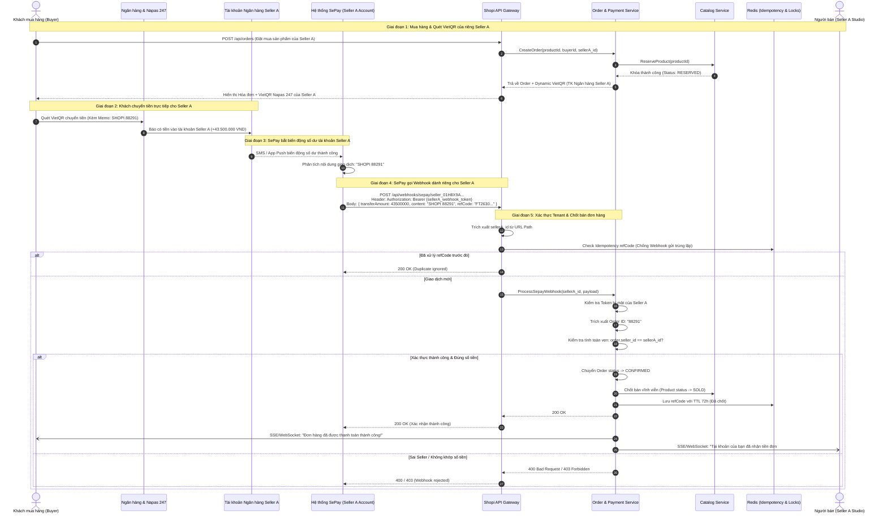
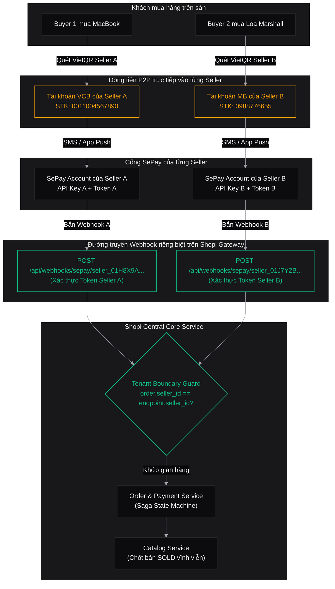

# Shopi C2C Used-Goods Marketplace
# Multi-Tenant Per-Seller SePay Architecture & UX Design Specifications

> **Author**: Lead UX/UI Designer & Software Architect  
> **Target Aesthetic**: High-End "Linear/Vercel" Zinc Monochrome  
> **Integration Model**: Decentralized Multi-Tenant Banking & SePay Automation  
> **Tech Ecosystem**: Next.js 15+ App Router, Spring Boot 3.3, Redis, PostgreSQL, Tailwind CSS, Radix UI  
> **Version**: 1.0.0 (Production Ready)  
> **Status**: CANONICAL ARCHITECTURAL SPECIFICATION  

---

## 1. Executive Summary: Decentralized Per-Seller Model

In peer-to-peer used-goods commerce (C2C) in Vietnam, individual sellers operate independently. Holding centralized platform escrow funds introduces complex payment intermediary licensing requirements and delays seller payouts. 

To solve this, **Shopi** adopts a **Decentralized Multi-Tenant SePay Architecture**:
- **Direct P2P Settlement**: Every Seller configures their own personal or business bank account (Vietcombank, MB Bank, Techcombank, etc.). Funds flow directly from the Buyer into the Seller's personal account via Napas 247.
- **Per-Seller SePay Gateway**: Each Seller registers their own SePay account and configures a unique, tenant-isolated webhook endpoint:  
  `https://api.shopi.vn/api/webhooks/sepay/{seller_id}`.
- **Tenant Isolation & Security**: The Shopi platform validates webhook payloads using Seller-specific authentication secrets, guarantees that memo `SHOPI <order_id>` belongs strictly to `{seller_id}`, and updates inventory atomically.

```
┌────────────────────────────────────────────────────────────────────────┐
│               PER-SELLER MULTI-TENANT ARCHITECTURE PRINCIPLES           │
├────────────────────────────────────────────────────────────────────────┤
│ 1. Zero Central Escrow Pool  : Money transfers directly to Seller bank.│
│ 2. Tenant-Isolated Endpoints : Unique endpoint /webhooks/sepay/{id}.   │
│ 3. Per-Seller Secrets        : Separate API Keys & Webhook Tokens.     │
│ 4. Cross-Tenant Anti-Spoofing: Order verification strictly validates   │
│                                order.seller_id == path.seller_id.      │
│ 5. Real-Time Auto Settlement : SePay notifies webhook -> Order chốt    │
│                                sang CONFIRMED và product sang SOLD.    │
└────────────────────────────────────────────────────────────────────────┘
```

---

## 2. Multi-Tenant Architectural Diagrams

### 2.1 Sequence Diagram: Multi-Tenant Payment Verification & Order Confirmation



---

### 2.2 Multi-Tenant Topology Flowchart



---

## 3. UX Design Specifications: Seller SePay Onboarding & Settings

### 3.1 UX Architecture & Rationale
Each seller requires a clean, focused control center inside **Seller Studio** (`/seller/settings/sepay`). The screen provides:
1. **Dedicated Tenant Webhook Banner**: A pre-formatted, unique URL with a one-click copy button, allowing the seller to copy and paste directly into their personal SePay dashboard.
2. **VietQR Bank Binding**: Dropdown of 40+ Napas 247 banks, account number verification, and auto-formatted unaccented uppercase account holder name.
3. **SePay API Key & Webhook Secret**: Masked inputs with show/hide password toggles.
4. **Sandbox Test Mode Switch**: Enables testing the seller's storefront without transferring actual money.
5. **Interactive Ping Test**: Lets the seller trigger an immediate mock webhook event to verify their integration.

### 3.2 Wireframe Layout

```
┌──────────────────────────────────────────────────────────────────────────────────┐
│  SELLER STUDIO > THIẾT LẬP SEPAY CỦA SHOP                                        │
├──────────────────────────────────────────────────────────────────────────────────┤
│                                                                                  │
│  ┌─ ĐƯỜNG DẪN WEBHOOK RIÊNG CỦA SHOP BẠN ─────────────────────────────────────┐  │
│  │  [i] Hãy dán liên kết webhook này vào bảng điều khiển SePay cá nhân của bạn: │  │
│  │  [ https://api.shopi.vn/api/webhooks/sepay/seller_01H8X9A7KQ4M ] [ SAO CHÉP ]│  │
│  └────────────────────────────────────────────────────────────────────────────┘  │
│                                                                                  │
│  ┌─ Chế độ thử nghiệm của Shop (Sandbox Test Mode) ───────────────────────────┐  │
│  │  Bật chế độ thử nghiệm để cho phép người mua test luồng mua hàng mà        │  │
│  │  không cần chuyển tiền thực tế vào tài khoản của bạn.           [ SWITCH ] │  │
│  └────────────────────────────────────────────────────────────────────────────┘  │
│                                                                                  │
│  ┌─ Thông tin tài khoản ngân hàng thụ hưởng Napas 247 ────────────────────────┐  │
│  │  Ngân hàng:          [ Vietcombank (VCB)                        ▼ ]        │  │
│  │  Số tài khoản:       [ 0011004567890                              ]        │  │
│  │  Tên chủ tài khoản:  [ NGUYEN HOANG KHANG                         ]        │  │
│  └────────────────────────────────────────────────────────────────────────────┘  │
│                                                                                  │
│  ┌─ Cấu hình mã khóa SePay cá nhân ───────────────────────────────────────────┐  │
│  │  SePay API Key:      [ ************************************  (Eye Icon) ]  │  │
│  │  Webhook Secret:     [ **********************                (Eye Icon) ]  │  │
│  └────────────────────────────────────────────────────────────────────────────┘  │
│                                                                                  │
│  [ Bắn thử Webhook (10.000₫) ]                          [ Lưu cấu hình Shop ]     │
└──────────────────────────────────────────────────────────────────────────────────┘
```

### 3.3 Component Specification: `SellerTenantSepaySettings.tsx`

```tsx
"use client";

import React, { useState } from "react";
import { Check, Copy, Eye, EyeOff, ShieldCheck, Zap, ExternalLink, ArrowRight, RefreshCw } from "lucide-react";
import { cn } from "@/lib/utils";

interface SellerTenantConfig {
  sellerId: string;
  shopName: string;
  bankCode: string;
  accountNumber: string;
  accountHolderName: string;
  sepayApiKey: string;
  webhookSecret: string;
  isTestMode: boolean;
}

export function SellerTenantSepaySettings({ initialConfig }: { initialConfig: SellerTenantConfig }) {
  const [config, setConfig] = useState<SellerTenantConfig>(initialConfig);
  const [showApiKey, setShowApiKey] = useState(false);
  const [showSecret, setShowSecret] = useState(false);
  const [copiedWebhook, setCopiedWebhook] = useState(false);
  const [isPinging, setIsPinging] = useState(false);
  const [pingResult, setPingResult] = useState<string | null>(null);
  const [isSaving, setIsSaving] = useState(false);
  const [saveSuccess, setSaveSuccess] = useState(false);

  // Dedicated Webhook URL for this specific Seller
  const dedicatedWebhookUrl = `https://api.shopi.vn/api/webhooks/sepay/${config.sellerId}`;

  const handleCopyWebhook = () => {
    navigator.clipboard.writeText(dedicatedWebhookUrl);
    setCopiedWebhook(true);
    setTimeout(() => setCopiedWebhook(false), 2000);
  };

  const handlePingTest = async () => {
    setIsPinging(true);
    setPingResult(null);
    // Simulate ping to backend gateway
    await new Promise((r) => setTimeout(r, 1000));
    setIsPinging(false);
    setPingResult("Webhook phản hồi 200 OK! Hệ thống đã sẵn sàng nhận thanh toán tự động.");
  };

  const handleSave = async (e: React.FormEvent) => {
    e.preventDefault();
    setIsSaving(true);
    await new Promise((r) => setTimeout(r, 700));
    setIsSaving(false);
    setSaveSuccess(true);
    setTimeout(() => setSaveSuccess(false), 3000);
  };

  return (
    <form onSubmit={handleSave} className="max-w-3xl space-y-8 font-sans">
      {/* Title */}
      <div>
        <h2 className="text-xl font-semibold tracking-tight text-zinc-100">
          Cấu hình Cổng Thanh toán SePay của Gian hàng
        </h2>
        <p className="mt-1 text-sm text-zinc-400">
          Thiết lập cổng kết nối tài khoản ngân hàng cá nhân của <strong>{config.shopName}</strong> để nhận tiền trực tiếp và kích hoạt xác thực đơn hàng tự động.
        </p>
      </div>

      {/* 1. Dedicated Webhook Endpoint Callout */}
      <div className="rounded-xl border border-emerald-500/30 bg-emerald-500/5 p-5 space-y-3">
        <div className="flex items-center justify-between">
          <div className="flex items-center gap-2">
            <span className="flex h-2 w-2 rounded-full bg-emerald-400 animate-ping" />
            <h3 className="text-xs font-semibold uppercase tracking-wider text-emerald-400">
              Đường dẫn Webhook dành riêng cho gian hàng của bạn
            </h3>
          </div>
          <a
            href="https://my.sepay.vn/integrations"
            target="_blank"
            rel="noreferrer"
            className="flex items-center gap-1 text-xs text-zinc-400 hover:text-zinc-200"
          >
            Mở SePay Dashboard <ExternalLink className="h-3 w-3" />
          </a>
        </div>
        <p className="text-xs text-zinc-300 leading-relaxed">
          Mỗi gian hàng trên Shopi có một endpoint webhook độc lập. Hãy sao chép liên kết dưới đây và dán vào mục <strong>Webhook URL</strong> trên bảng điều khiển SePay của bạn:
        </p>
        <div className="flex gap-2">
          <input
            type="text"
            readOnly
            value={dedicatedWebhookUrl}
            className="w-full rounded-lg border border-zinc-700 bg-zinc-950 px-3.5 py-2.5 font-mono text-xs text-zinc-300 select-all focus:outline-none"
          />
          <button
            type="button"
            onClick={handleCopyWebhook}
            className="flex shrink-0 items-center gap-1.5 rounded-lg border border-zinc-700 bg-zinc-800 px-4 py-2.5 text-xs font-medium text-zinc-200 hover:bg-zinc-700 active:bg-zinc-600 transition-colors"
          >
            {copiedWebhook ? <Check className="h-3.5 w-3.5 text-emerald-400" /> : <Copy className="h-3.5 w-3.5" />}
            {copiedWebhook ? "Đã copy" : "Sao chép"}
          </button>
        </div>
      </div>

      {/* 2. Sandbox Test Mode Switch */}
      <div
        className={cn(
          "rounded-xl border p-5 transition-all duration-200",
          config.isTestMode
            ? "border-amber-500/40 bg-amber-500/5 shadow-[0_0_24px_rgba(245,158,11,0.06)]"
            : "border-zinc-800 bg-zinc-900/40"
        )}
      >
        <div className="flex items-start justify-between gap-4">
          <div className="flex gap-3">
            <div
              className={cn(
                "mt-0.5 flex h-9 w-9 shrink-0 items-center justify-center rounded-lg border",
                config.isTestMode
                  ? "border-amber-500/30 bg-amber-500/10 text-amber-400"
                  : "border-zinc-700 bg-zinc-800 text-zinc-400"
              )}
            >
              <Zap className="h-5 w-5" />
            </div>
            <div>
              <div className="flex items-center gap-2">
                <span className="text-sm font-medium text-zinc-200">Chế độ thử nghiệm của Shop (Sandbox Test Mode)</span>
                {config.isTestMode && (
                  <span className="rounded-full border border-amber-500/30 bg-amber-500/10 px-2 py-0.5 text-[10px] font-semibold text-amber-400 uppercase tracking-wider">
                    Đang kích hoạt
                  </span>
                )}
              </div>
              <p className="mt-1 text-xs leading-relaxed text-zinc-400">
                Bật chế độ thử nghiệm để cho phép người mua test luồng mua hàng mà không cần chuyển tiền thực tế vào tài khoản của bạn. Nút <strong>&ldquo;Thanh toán giả lập&rdquo;</strong> sẽ hiển thị trên trang thanh toán của shop bạn.
              </p>
            </div>
          </div>

          <button
            type="button"
            role="switch"
            aria-checked={config.isTestMode}
            onClick={() => setConfig({ ...config, isTestMode: !config.isTestMode })}
            className={cn(
              "relative inline-flex h-6 w-11 shrink-0 cursor-pointer rounded-full border-2 border-transparent transition-colors duration-200 ease-in-out focus:outline-none",
              config.isTestMode ? "bg-amber-500" : "bg-zinc-700"
            )}
          >
            <span
              className={cn(
                "pointer-events-none inline-block h-5 w-5 transform rounded-full bg-white shadow-lg ring-0 transition duration-200 ease-in-out",
                config.isTestMode ? "translate-x-5" : "translate-x-0"
              )}
            />
          </button>
        </div>
      </div>

      {/* 3. Personal Banking Details */}
      <div className="rounded-xl border border-zinc-800 bg-zinc-900/60 p-6 space-y-4">
        <h3 className="text-sm font-semibold uppercase tracking-wider text-zinc-300">
          1. Tài khoản ngân hàng cá nhân thụ hưởng (Napas 247)
        </h3>
        <p className="text-xs text-zinc-400">
          Tiền từ khách mua hàng sẽ chuyển trực tiếp vào tài khoản ngân hàng này.
        </p>

        <div className="grid gap-4 sm:grid-cols-2 pt-2">
          <div className="sm:col-span-2">
            <label className="block text-xs font-medium text-zinc-300 mb-1.5">Ngân hàng thụ hưởng</label>
            <select
              value={config.bankCode}
              onChange={(e) => setConfig({ ...config, bankCode: e.target.value })}
              className="w-full rounded-lg border border-zinc-700 bg-zinc-950 px-3.5 py-2.5 text-sm text-zinc-100 focus:border-zinc-500 focus:outline-none"
            >
              <option value="VCB">Vietcombank - Ngân hàng Ngoại Thương</option>
              <option value="MB">MB Bank - Ngân hàng Quân Đội</option>
              <option value="TCB">Techcombank - Ngân hàng Kỹ Thương</option>
              <option value="VPB">VPBank - Ngân hàng Việt Nam Thịnh Vượng</option>
              <option value="ACB">ACB - Ngân hàng Á Châu</option>
              <option value="BIDV">BIDV - Ngân hàng Đầu tư & Phát triển</option>
            </select>
          </div>

          <div>
            <label className="block text-xs font-medium text-zinc-300 mb-1.5">Số tài khoản nhận tiền</label>
            <input
              type="text"
              value={config.accountNumber}
              onChange={(e) => setConfig({ ...config, accountNumber: e.target.value.replace(/\s+/g, "") })}
              className="w-full rounded-lg border border-zinc-700 bg-zinc-950 px-3.5 py-2.5 font-mono text-sm text-zinc-100 focus:border-zinc-500 focus:outline-none"
            />
          </div>

          <div>
            <label className="block text-xs font-medium text-zinc-300 mb-1.5">Tên chủ tài khoản (In hoa không dấu)</label>
            <input
              type="text"
              value={config.accountHolderName}
              onChange={(e) => setConfig({ ...config, accountHolderName: e.target.value.toUpperCase() })}
              className="w-full rounded-lg border border-zinc-700 bg-zinc-950 px-3.5 py-2.5 font-mono text-sm uppercase text-zinc-100 focus:border-zinc-500 focus:outline-none"
            />
          </div>
        </div>
      </div>

      {/* 4. SePay API Credentials */}
      <div className="rounded-xl border border-zinc-800 bg-zinc-900/60 p-6 space-y-4">
        <h3 className="text-sm font-semibold uppercase tracking-wider text-zinc-300">
          2. Mã khóa xác thực SePay cá nhân
        </h3>
        <p className="text-xs text-zinc-400">
          Dùng để xác thực tính toàn vẹn của webhook khi SePay thông báo biến động số dư.
        </p>

        <div className="space-y-4 pt-2">
          <div>
            <label className="block text-xs font-medium text-zinc-300 mb-1.5">SePay API Key (Secret Key của bạn)</label>
            <div className="relative">
              <input
                type={showApiKey ? "text" : "password"}
                value={config.sepayApiKey}
                onChange={(e) => setConfig({ ...config, sepayApiKey: e.target.value })}
                className="w-full rounded-lg border border-zinc-700 bg-zinc-950 px-3.5 py-2.5 pr-10 font-mono text-sm text-zinc-100 focus:border-zinc-500 focus:outline-none"
              />
              <button
                type="button"
                onClick={() => setShowApiKey(!showApiKey)}
                className="absolute right-3 top-2.5 text-zinc-400 hover:text-zinc-200"
              >
                {showApiKey ? <EyeOff className="h-4 w-4" /> : <Eye className="h-4 w-4" />}
              </button>
            </div>
          </div>

          <div>
            <label className="block text-xs font-medium text-zinc-300 mb-1.5">Webhook Authentication Secret Token</label>
            <div className="relative">
              <input
                type={showSecret ? "text" : "password"}
                value={config.webhookSecret}
                onChange={(e) => setConfig({ ...config, webhookSecret: e.target.value })}
                className="w-full rounded-lg border border-zinc-700 bg-zinc-950 px-3.5 py-2.5 pr-10 font-mono text-sm text-zinc-100 focus:border-zinc-500 focus:outline-none"
              />
              <button
                type="button"
                onClick={() => setShowSecret(!showSecret)}
                className="absolute right-3 top-2.5 text-zinc-400 hover:text-zinc-200"
              >
                {showSecret ? <EyeOff className="h-4 w-4" /> : <Eye className="h-4 w-4" />}
              </button>
            </div>
          </div>
        </div>
      </div>

      {/* Ping Test Callout */}
      {pingResult && (
        <div className="rounded-xl border border-emerald-500/30 bg-emerald-500/10 p-4 text-xs text-emerald-400 flex items-center gap-2">
          <ShieldCheck className="h-4 w-4 shrink-0" />
          <span>{pingResult}</span>
        </div>
      )}

      {/* Footer Actions */}
      <div className="flex items-center justify-between pt-2">
        <button
          type="button"
          onClick={handlePingTest}
          disabled={isPinging}
          className="flex items-center gap-2 rounded-lg border border-zinc-800 bg-zinc-900 px-4 py-2.5 text-xs font-medium text-zinc-300 hover:bg-zinc-800 hover:text-zinc-100 transition-colors disabled:opacity-60"
        >
          <RefreshCw className={cn("h-3.5 w-3.5", isPinging && "animate-spin")} />
          {isPinging ? "Đang gửi tín hiệu..." : "Bắn thử Webhook (Ping Test)"}
        </button>

        <div className="flex items-center gap-3">
          {saveSuccess && (
            <span className="text-xs text-emerald-400 flex items-center gap-1">
              <Check className="h-3.5 w-3.5" /> Đã lưu thành công!
            </span>
          )}
          <button
            type="submit"
            disabled={isSaving}
            className="rounded-lg bg-zinc-100 px-5 py-2.5 text-sm font-semibold text-zinc-950 hover:bg-white active:bg-zinc-200 transition-colors disabled:opacity-60"
          >
            {isSaving ? "Đang lưu..." : "Lưu cấu hình SePay"}
          </button>
        </div>
      </div>
    </form>
  );
}
```

---

## 4. UX Design Specifications: Seller Orders & Invoices Dashboard (`/seller/orders`)

### 4.1 UX Rationale & Screen Layout
Sellers need a high-density, real-time command dashboard to oversee orders, verify incoming payments, inspect digital invoices, and initiate shipping fulfillments.

#### Key Dashboard Capabilities:
1. **Financial KPI Bar**: Total Completed Revenue, In-Escrow/Reserved Amount (Đang giữ chỗ 15m), SePay Auto-Confirmed Ratio.
2. **Faceted Filter Tabs**:
   - Tất cả đơn hàng
   - Chờ thanh toán (`PENDING_PAYMENT` with 15m countdown)
   - Đã nộp biên lai (`PROOF_UPLOADED` - manual review)
   - Đã xác nhận (`CONFIRMED` - verified via SePay webhook or manual confirm)
   - Đang giao hàng (`SHIPPED` - tracking code attached)
   - Đã hoàn tất (`COMPLETED`)
   - Đã hủy (`CANCELLED`)
3. **Dual Verification Tag**: Clearly distinguishes between `Tự động qua SePay` (Green badge with bot icon) vs `Duyệt thủ công qua ảnh biên lai` (Amber badge).

### 4.2 Component Specification: `SellerOrdersInvoicesDashboard.tsx`

```tsx
"use client";

import React, { useState } from "react";
import Image from "next/image";
import { CheckCircle2, Clock, Search, ExternalLink, Bot, Eye, Truck, Filter, ArrowUpRight } from "lucide-react";
import { cn } from "@/lib/utils";

interface SellerOrder {
  id: string;
  orderCode: string;
  itemTitle: string;
  itemImageUrl: string;
  buyerName: string;
  amountVnd: number;
  status: "PENDING_PAYMENT" | "PROOF_UPLOADED" | "CONFIRMED" | "SHIPPED" | "CANCELLED";
  paymentMethod: "SEPAY_WEBHOOK" | "MANUAL_RECEIPT";
  sepayRefCode?: string;
  createdAt: string;
  trackingCode?: string;
}

export function SellerOrdersInvoicesDashboard() {
  const [activeTab, setActiveTab] = useState<string>("ALL");
  const [searchQuery, setSearchQuery] = useState<string>("");

  const [orders] = useState<SellerOrder[]>([
    {
      id: "ord-88291",
      orderCode: "SHOPI-88291",
      itemTitle: "MacBook Pro 16 inch M1 Max 32GB 1TB",
      itemImageUrl: "https://images.unsplash.com/photo-1517336714731-489689fd1ca8?w=200",
      buyerName: "Trần Anh Tuấn",
      amountVnd: 43500000,
      status: "CONFIRMED",
      paymentMethod: "SEPAY_WEBHOOK",
      sepayRefCode: "FT26304891823901",
      createdAt: "10 phút trước",
    },
    {
      id: "ord-88292",
      orderCode: "SHOPI-88292",
      itemTitle: "Loa Marshall Stanmore II Bluetooth Ash",
      itemImageUrl: "https://images.unsplash.com/photo-1545454675-3531b543be5d?w=200",
      buyerName: "Lê Minh Quân",
      amountVnd: 6500000,
      status: "PENDING_PAYMENT",
      paymentMethod: "SEPAY_WEBHOOK",
      createdAt: "3 phút trước",
    },
    {
      id: "ord-88290",
      orderCode: "SHOPI-88290",
      itemTitle: "Bàn phím cơ Custom Keychron Q1 Pro",
      itemImageUrl: "https://images.unsplash.com/photo-1587829741301-dc798b83add3?w=200",
      buyerName: "Nguyễn Hải Đăng",
      amountVnd: 4200000,
      status: "SHIPPED",
      paymentMethod: "SEPAY_WEBHOOK",
      sepayRefCode: "FT26298192019284",
      createdAt: "Hôm qua",
      trackingCode: "GHTK-881928301",
    },
  ]);

  const formatVnd = (val: number) =>
    new Intl.NumberFormat("vi-VN", { style: "currency", currency: "VND" }).format(val);

  return (
    <div className="space-y-8 font-sans">
      {/* 1. Dashboard Header & KPI Bar */}
      <div>
        <h2 className="text-xl font-semibold tracking-tight text-zinc-100">
          Quản lý Đơn hàng & Hóa đơn của Shop
        </h2>
        <p className="mt-1 text-sm text-zinc-400">
          Theo dõi dòng tiền chuyển khoản trực tiếp qua SePay và trạng thái vận chuyển cho từng sản phẩm.
        </p>
      </div>

      {/* KPI Cards */}
      <div className="grid gap-4 sm:grid-cols-3">
        <div className="rounded-xl border border-zinc-800 bg-zinc-900/50 p-5">
          <span className="text-xs font-medium text-zinc-400">Tổng doanh thu đã nhận về tài khoản</span>
          <div className="mt-2 font-mono text-2xl font-bold text-zinc-100">{formatVnd(47700000)}</div>
          <span className="mt-1 text-[11px] text-emerald-400 flex items-center gap-1">
            <CheckCircle2 className="h-3 w-3" /> Đã đối soát 100% qua SePay
          </span>
        </div>

        <div className="rounded-xl border border-zinc-800 bg-zinc-900/50 p-5">
          <span className="text-xs font-medium text-zinc-400">Đang giữ chỗ chờ thanh toán (15m)</span>
          <div className="mt-2 font-mono text-2xl font-bold text-amber-400">{formatVnd(6500000)}</div>
          <span className="mt-1 text-[11px] text-zinc-400 flex items-center gap-1">
            <Clock className="h-3 w-3" /> 1 đơn đang chờ thanh toán
          </span>
        </div>

        <div className="rounded-xl border border-zinc-800 bg-zinc-900/50 p-5">
          <span className="text-xs font-medium text-zinc-400">Tỷ lệ xác nhận SePay tự động</span>
          <div className="mt-2 font-mono text-2xl font-bold text-zinc-100">100%</div>
          <span className="mt-1 text-[11px] text-emerald-400 flex items-center gap-1">
            <Bot className="h-3 w-3" /> Tốc độ phản hồi trung bình ~3.2 giây
          </span>
        </div>
      </div>

      {/* 2. Filter Tabs & Search */}
      <div className="flex flex-col sm:flex-row items-center justify-between gap-4 border-b border-zinc-800 pb-4">
        {/* Tab Pills */}
        <div className="flex flex-wrap gap-2 text-xs">
          {[
            { key: "ALL", label: "Tất cả đơn" },
            { key: "PENDING_PAYMENT", label: "Chờ thanh toán (15m)" },
            { key: "CONFIRMED", label: "Đã xác nhận" },
            { key: "SHIPPED", label: "Đang giao" },
          ].map((tab) => (
            <button
              key={tab.key}
              onClick={() => setActiveTab(tab.key)}
              className={cn(
                "rounded-lg px-3.5 py-2 font-medium transition-colors",
                activeTab === tab.key
                  ? "bg-zinc-100 text-zinc-950 font-semibold"
                  : "bg-zinc-900 text-zinc-400 hover:bg-zinc-800 hover:text-zinc-200"
              )}
            >
              {tab.label}
            </button>
          ))}
        </div>

        {/* Search */}
        <div className="relative w-full sm:w-64">
          <Search className="absolute left-3 top-2.5 h-4 w-4 text-zinc-500" />
          <input
            type="text"
            value={searchQuery}
            onChange={(e) => setSearchQuery(e.target.value)}
            placeholder="Tìm theo mã đơn hoặc sản phẩm..."
            className="w-full rounded-lg border border-zinc-800 bg-zinc-950 py-2 pl-9 pr-3 text-xs text-zinc-200 placeholder:text-zinc-600 focus:border-zinc-700 focus:outline-none"
          />
        </div>
      </div>

      {/* 3. Orders Table */}
      <div className="overflow-hidden rounded-xl border border-zinc-800 bg-zinc-900/40">
        <table className="w-full text-left text-xs">
          <thead className="border-b border-zinc-800 bg-zinc-900/80 font-medium text-zinc-400">
            <tr>
              <th className="p-4">Đơn hàng / Sản phẩm</th>
              <th className="p-4">Khách mua</th>
              <th className="p-4">Số tiền (VND)</th>
              <th className="p-4">Phương thức</th>
              <th className="p-4">Trạng thái</th>
              <th className="p-4 text-right">Thao tác</th>
            </tr>
          </thead>
          <tbody className="divide-y divide-zinc-800/60">
            {orders.map((order) => (
              <tr key={order.id} className="hover:bg-zinc-800/30 transition-colors">
                {/* Product & Order Code */}
                <td className="p-4">
                  <div className="flex items-center gap-3">
                    <div className="relative h-12 w-12 shrink-0 overflow-hidden rounded-lg border border-zinc-800 bg-zinc-950">
                      <Image src={order.itemImageUrl} alt={order.itemTitle} fill className="object-cover" />
                    </div>
                    <div>
                      <span className="font-mono font-semibold text-zinc-200">{order.orderCode}</span>
                      <div className="text-zinc-400 line-clamp-1">{order.itemTitle}</div>
                      <span className="text-[10px] text-zinc-500">{order.createdAt}</span>
                    </div>
                  </div>
                </td>

                {/* Buyer */}
                <td className="p-4 font-medium text-zinc-300">{order.buyerName}</td>

                {/* Amount */}
                <td className="p-4 font-mono font-semibold text-zinc-100">{formatVnd(order.amountVnd)}</td>

                {/* Payment Channel */}
                <td className="p-4">
                  {order.paymentMethod === "SEPAY_WEBHOOK" ? (
                    <div className="inline-flex items-center gap-1.5 rounded-full border border-emerald-500/30 bg-emerald-500/10 px-2.5 py-1 text-[11px] font-medium text-emerald-400">
                      <Bot className="h-3 w-3" /> SePay Auto
                    </div>
                  ) : (
                    <span className="text-zinc-400">Thủ công</span>
                  )}
                  {order.sepayRefCode && (
                    <div className="font-mono text-[10px] text-zinc-500 mt-1">Ref: {order.sepayRefCode}</div>
                  )}
                </td>

                {/* Status Badge */}
                <td className="p-4">
                  {order.status === "CONFIRMED" && (
                    <span className="inline-flex items-center gap-1.5 rounded-full border border-emerald-500/25 bg-emerald-500/10 px-2.5 py-1 text-xs font-semibold text-emerald-400">
                      Đã chốt bán (SOLD)
                    </span>
                  )}
                  {order.status === "PENDING_PAYMENT" && (
                    <span className="inline-flex items-center gap-1.5 rounded-full border border-amber-500/30 bg-amber-500/10 px-2.5 py-1 text-xs font-semibold text-amber-400 animate-pulse">
                      Đang giữ chỗ 15m
                    </span>
                  )}
                  {order.status === "SHIPPED" && (
                    <span className="inline-flex items-center gap-1.5 rounded-full border border-blue-500/30 bg-blue-500/10 px-2.5 py-1 text-xs font-semibold text-blue-400">
                      <Truck className="h-3 w-3" /> Đang giao hàng
                    </span>
                  )}
                </td>

                {/* Action CTA */}
                <td className="p-4 text-right">
                  <button className="rounded-lg border border-zinc-800 bg-zinc-900 px-3 py-1.5 text-xs font-medium text-zinc-300 hover:bg-zinc-800 hover:text-zinc-100 transition-colors">
                    Chi tiết hóa đơn
                  </button>
                </td>
              </tr>
            ))}
          </tbody>
        </table>
      </div>
    </div>
  );
}
```

---

## 5. UX Design Specifications: Buyer Checkout & Invoice Experience

### 5.1 UX Rationale & Tenant Transparency
When a buyer initiates checkout on `/checkout/[orderId]`, transparency is paramount:
1. **Clear Shop Attribution**: Displays `"Đơn hàng từ Shop: Hoàng Khang Vintage"`.
2. **Seller's Personal Bank Account on VietQR**: The generated VietQR Napas 247 dynamic QR code directly targets the seller's configured bank account and BIN.
3. **Automated Confirmation Detection**: Next.js client listens to the Server-Sent Events (SSE) or WebSocket channel. The moment SePay calls the seller's webhook, the order automatically transitions to `CONFIRMED` without the buyer needing to click refresh.
4. **Sandbox Test Mode Button**: If the seller enabled `isTestMode`, the buyer sees a prominent button to test order confirmation.

### 5.2 Component Specification: `BuyerCheckoutTenantInvoice.tsx`

```tsx
"use client";

import React, { useState, useEffect } from "react";
import Image from "next/image";
import { Check, Copy, Clock, ShieldCheck, Zap, ArrowRight, Store } from "lucide-react";

interface TenantCheckoutProps {
  orderId: string;
  sellerShopName: string;
  sellerBankName: string;
  sellerAccountNo: string;
  sellerAccountName: string;
  itemTitle: string;
  itemImageUrl: string;
  amountVnd: number;
  transferMemo: string;
  isSellerTestMode: boolean;
  paymentDeadlineEpochMs: number;
}

export function BuyerCheckoutTenantInvoice({ data }: { data: TenantCheckoutProps }) {
  const [copiedField, setCopiedField] = useState<string | null>(null);
  const [isSimulating, setIsSimulating] = useState(false);
  const [orderConfirmed, setOrderConfirmed] = useState(false);
  const [countdown, setCountdown] = useState("15:00");

  const formatVnd = (amount: number) =>
    new Intl.NumberFormat("vi-VN", { style: "currency", currency: "VND" }).format(amount);

  const handleCopy = (field: string, val: string) => {
    navigator.clipboard.writeText(val);
    setCopiedField(field);
    setTimeout(() => setCopiedField(null), 2000);
  };

  const handleTestPayment = async () => {
    setIsSimulating(true);
    // Simulates SePay webhook callback to /api/webhooks/sepay/{sellerId}
    await new Promise((r) => setTimeout(r, 1200));
    setIsSimulating(false);
    setOrderConfirmed(true);
  };

  // Timer hook
  useEffect(() => {
    const timer = setInterval(() => {
      const diff = data.paymentDeadlineEpochMs - Date.now();
      if (diff <= 0) {
        setCountdown("00:00");
        clearInterval(timer);
      } else {
        const m = Math.floor(diff / 60000);
        const s = Math.floor((diff % 60000) / 1000);
        setCountdown(`${m.toString().padStart(2, "0")}:${s.toString().padStart(2, "0")}`);
      }
    }, 1000);
    return () => clearInterval(timer);
  }, [data.paymentDeadlineEpochMs]);

  // VietQR Dynamic Image URL for Seller's Personal Bank
  const qrUrl = `https://img.vietqr.io/image/${data.sellerBankName}-${data.sellerAccountNo}-compact2.png?amount=${data.amountVnd}&addInfo=${encodeURIComponent(
    data.transferMemo
  )}&accountName=${encodeURIComponent(data.sellerAccountName)}`;

  if (orderConfirmed) {
    return (
      <div className="rounded-2xl border border-emerald-500/30 bg-emerald-500/5 p-8 text-center font-sans max-w-xl mx-auto">
        <div className="mx-auto flex h-14 w-14 items-center justify-center rounded-full bg-emerald-500/20 text-emerald-400">
          <ShieldCheck className="h-8 w-8" />
        </div>
        <h3 className="mt-4 text-xl font-semibold text-zinc-100">Đã nhận được thanh toán!</h3>
        <p className="mt-2 text-xs leading-relaxed text-zinc-400">
          Hệ thống SePay của gian hàng <strong>{data.sellerShopName}</strong> đã ghi nhận biến động số dư thành công. Đơn hàng đã được chuyển sang trạng thái <strong>CONFIRMED</strong> và chốt bán cho bạn.
        </p>
        <div className="mt-6">
          <a
            href="/buyer/orders"
            className="inline-flex items-center gap-2 rounded-lg bg-emerald-500 px-5 py-2.5 text-xs font-semibold text-zinc-950 hover:bg-emerald-400 transition-colors"
          >
            Xem đơn mua của tôi <ArrowRight className="h-4 w-4" />
          </a>
        </div>
      </div>
    );
  }

  return (
    <div className="max-w-4xl mx-auto grid gap-8 lg:grid-cols-12 font-sans">
      {/* Left: Invoice & Shop Info (5 Cols) */}
      <div className="space-y-6 lg:col-span-5">
        <div className="rounded-xl border border-zinc-800 bg-zinc-900/60 p-6 space-y-5">
          {/* Shop Header Attribution */}
          <div className="flex items-center justify-between border-b border-zinc-800 pb-3">
            <div className="flex items-center gap-2 text-xs text-zinc-300">
              <Store className="h-4 w-4 text-emerald-400" />
              <span>Gian hàng: <strong>{data.sellerShopName}</strong></span>
            </div>
            <div className="flex items-center gap-1.5 rounded-full border border-amber-500/30 bg-amber-500/10 px-2.5 py-0.5 text-xs font-mono text-amber-400">
              <Clock className="h-3 w-3 animate-pulse" />
              <span>{countdown}</span>
            </div>
          </div>

          {/* Item details */}
          <div className="flex gap-4">
            <div className="relative h-16 w-16 shrink-0 overflow-hidden rounded-lg border border-zinc-800 bg-zinc-950">
              <Image src={data.itemImageUrl} alt={data.itemTitle} fill className="object-cover" />
            </div>
            <div className="flex flex-col justify-center text-xs">
              <h4 className="font-semibold text-zinc-100 line-clamp-1">{data.itemTitle}</h4>
              <span className="font-mono font-bold text-emerald-400 mt-1">{formatVnd(data.amountVnd)}</span>
            </div>
          </div>

          {/* Pricing Breakdown */}
          <div className="space-y-2 border-t border-zinc-800/80 pt-3 text-xs">
            <div className="flex justify-between text-zinc-400">
              <span>Tạm tính</span>
              <span className="font-mono text-zinc-200">{formatVnd(data.amountVnd)}</span>
            </div>
            <div className="flex justify-between text-zinc-400">
              <span>Phí giao dịch sàn</span>
              <span className="text-emerald-400">0₫ (Miễn phí)</span>
            </div>
            <div className="flex justify-between border-t border-zinc-800 pt-2 font-semibold">
              <span className="text-zinc-100">Tổng thanh toán</span>
              <span className="font-mono text-base font-bold text-emerald-400">{formatVnd(data.amountVnd)}</span>
            </div>
          </div>
        </div>

        {/* Sandbox Test Mode Callout (when seller enabled) */}
        {data.isSellerTestMode && (
          <div className="rounded-xl border border-amber-500/40 bg-amber-500/10 p-5 space-y-3">
            <div className="flex items-center gap-2 text-amber-400 text-xs font-semibold uppercase tracking-wider">
              <Zap className="h-4 w-4" />
              <span>Gian hàng đang bật chế độ thử nghiệm</span>
            </div>
            <p className="text-xs text-zinc-300 leading-relaxed">
              Bạn có thể bấm nút bên dưới để mô phỏng webhook SePay xác nhận đơn hàng ngay lập tức mà không cần chuyển khoản tiền thật.
            </p>
            <button
              type="button"
              onClick={handleTestPayment}
              disabled={isSimulating}
              className="w-full flex items-center justify-center gap-2 rounded-lg bg-amber-500 px-4 py-2.5 text-xs font-bold text-zinc-950 hover:bg-amber-400 transition-colors disabled:opacity-60"
            >
              <Zap className="h-4 w-4" />
              {isSimulating ? "Đang gửi webhook giả lập..." : "Thanh toán giả lập (Test Mode)"}
            </button>
          </div>
        )}
      </div>

      {/* Right: Seller's Personal VietQR Napas 247 Box (7 Cols) */}
      <div className="rounded-xl border border-zinc-800 bg-zinc-900/60 p-6 space-y-6 lg:col-span-7">
        <div className="border-b border-zinc-800 pb-3">
          <h3 className="text-sm font-semibold text-zinc-100">
            Quét mã VietQR chuyển khoản trực tiếp cho Người bán
          </h3>
          <p className="mt-0.5 text-xs text-zinc-400">
            Tiền chuyển thẳng vào tài khoản của <strong>{data.sellerShopName}</strong>, SePay sẽ tự động đối soát sau 3 giây.
          </p>
        </div>

        <div className="grid gap-6 sm:grid-cols-12 items-center">
          {/* QR */}
          <div className="sm:col-span-5 flex flex-col items-center">
            <div className="relative h-52 w-52 overflow-hidden rounded-xl border border-zinc-700 bg-white p-3 shadow-md">
              <Image src={qrUrl} alt="VietQR" fill className="object-contain p-2" />
            </div>
            <span className="mt-2 text-[10px] text-zinc-500">Mã QR động tự động điền STK & Memo</span>
          </div>

          {/* Credentials with copy */}
          <div className="sm:col-span-7 space-y-3 text-xs">
            <div>
              <span className="text-zinc-500">Ngân hàng thụ hưởng</span>
              <div className="font-medium text-zinc-200 mt-0.5">{data.sellerBankName}</div>
            </div>

            <div>
              <span className="text-zinc-500">Số tài khoản cá nhân của người bán</span>
              <div className="mt-0.5 flex items-center justify-between rounded-lg border border-zinc-800 bg-zinc-950 px-3 py-1.5">
                <span className="font-mono text-sm font-semibold text-zinc-100">{data.sellerAccountNo}</span>
                <button
                  onClick={() => handleCopy("account", data.sellerAccountNo)}
                  className="text-[11px] text-zinc-400 hover:text-zinc-200 flex items-center gap-1"
                >
                  {copiedField === "account" ? <Check className="h-3 w-3 text-emerald-400" /> : <Copy className="h-3 w-3" />}
                  {copiedField === "account" ? "Đã chép" : "Copy"}
                </button>
              </div>
            </div>

            <div>
              <span className="text-zinc-500">Chủ tài khoản</span>
              <div className="font-mono uppercase font-semibold text-zinc-200 mt-0.5">{data.sellerAccountName}</div>
            </div>

            <div>
              <span className="text-zinc-500">Nội dung chuyển khoản (Bắt buộc giữ nguyên)</span>
              <div className="mt-0.5 flex items-center justify-between rounded-lg border border-amber-500/30 bg-amber-500/5 px-3 py-1.5">
                <span className="font-mono font-bold text-amber-400">{data.transferMemo}</span>
                <button
                  onClick={() => handleCopy("memo", data.transferMemo)}
                  className="text-[11px] text-zinc-300 hover:text-white flex items-center gap-1"
                >
                  {copiedField === "memo" ? <Check className="h-3 w-3 text-emerald-400" /> : <Copy className="h-3 w-3" />}
                  {copiedField === "memo" ? "Đã chép" : "Copy"}
                </button>
              </div>
            </div>
          </div>
        </div>
      </div>
    </div>
  );
}
```

---

## 6. Security, Tenant Isolation & Fraud Prevention Matrix

| Security Threat / Edge Case | Attack Vector | Multi-Tenant Defense Mechanism |
| :--- | :--- | :--- |
| **Cross-Tenant Memo Hijack** | Seller B configures a webhook to capture order memos belonging to Seller A (`SHOPI 88291`). | **Tenant Boundary Guard**: In `POST /api/webhooks/sepay/{seller_id}`, the gateway checks `order.seller_id == path.seller_id`. If Seller B's webhook attempts to confirm Seller A's order, it is rejected with HTTP 403 Forbidden and an audit security alert is generated. |
| **Webhook Replay Attack** | An attacker intercepts SePay webhook payload and replays it multiple times. | **Redis Idempotency Lock**: `SETNX idempotency:sepay:{refCode} 1 EX 259200` (72 hours). Second and subsequent requests are rejected immediately with HTTP 200 without executing the state machine. |
| **Forged Webhook Payloads** | Malicious actor posts fake transfer data to `{seller_id}` endpoint. | **Per-Seller Secret Verification**: The gateway checks `Authorization: Bearer <token>` or signature against the seller's stored secret token in PostgreSQL/Redis before parsing payload body. |
| **Partial / Underpaid Transfer** | Buyer modifies transfer amount to 10.000 VND instead of 43.500.000 VND. | **Strict Amount Matching**: State machine asserts `payload.transferAmount == order.total_amount`. If underpaid, order remains `PENDING_PAYMENT`, flags a dispute note, and sends a push notification to both parties. |

---

*Tài liệu kiến trúc SePay đa người bán (Per-Seller Multi-Tenant) đã hoàn thành và sẵn sàng cho việc triển khai vào hệ thống.*
