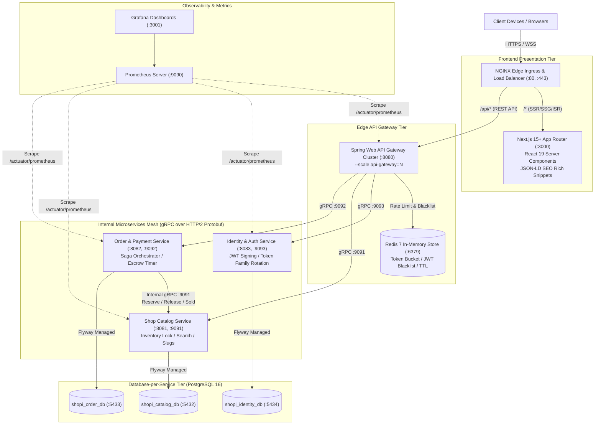
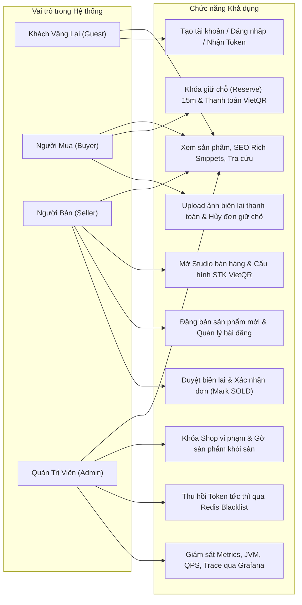
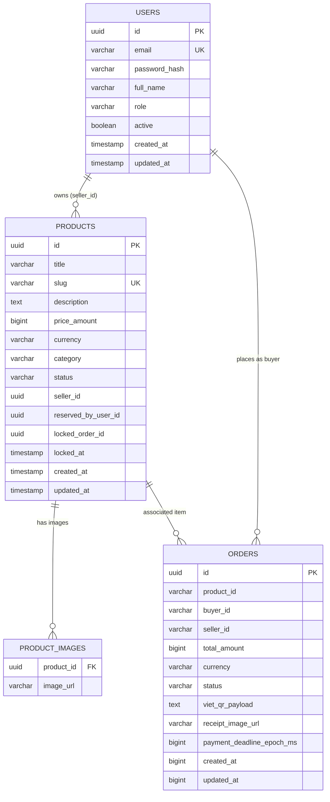
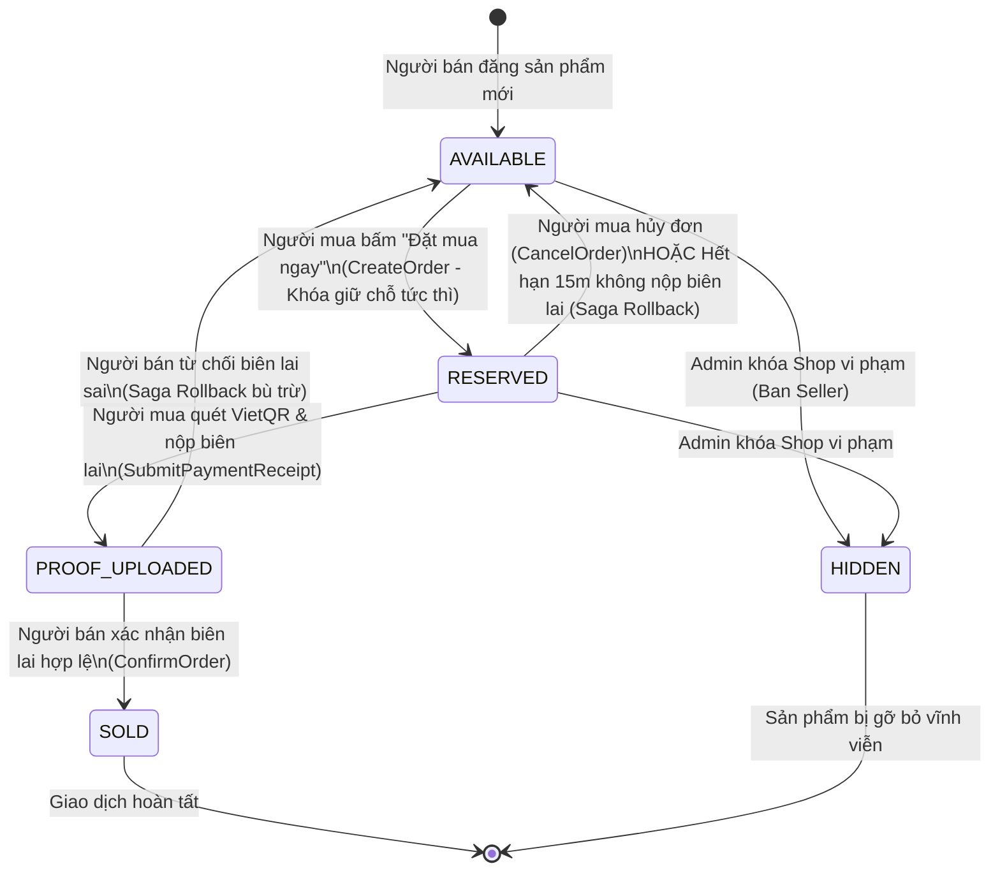
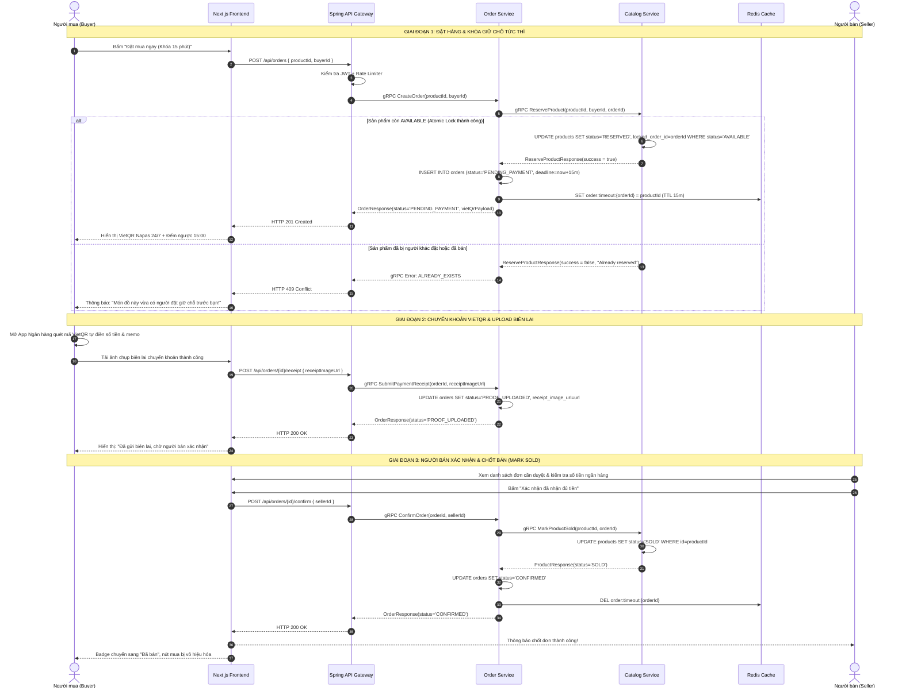
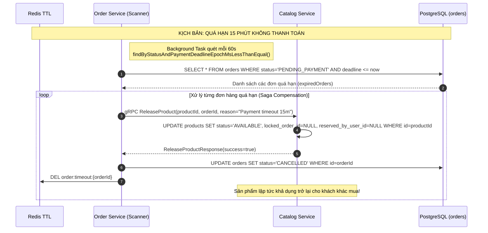
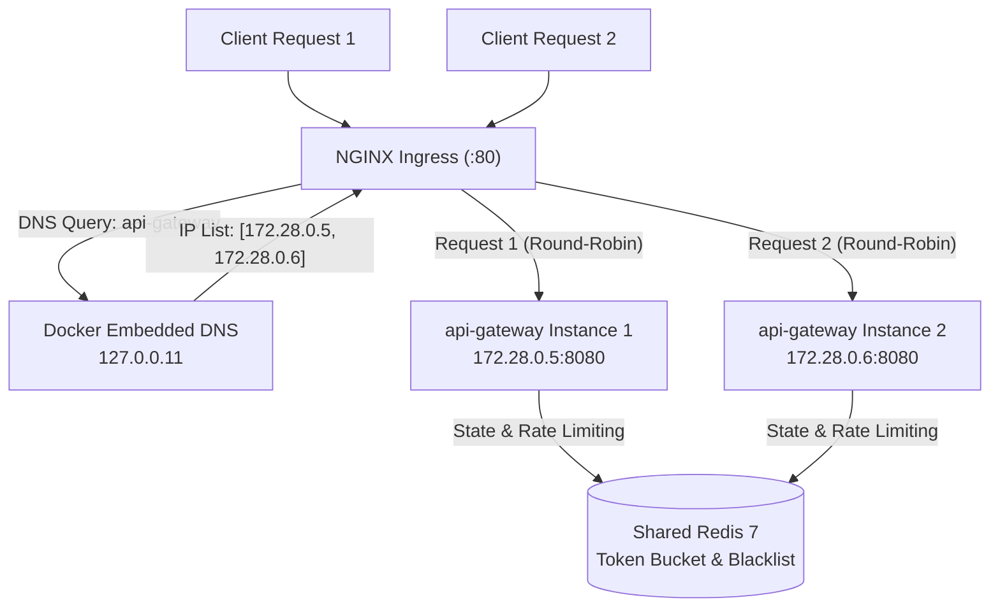
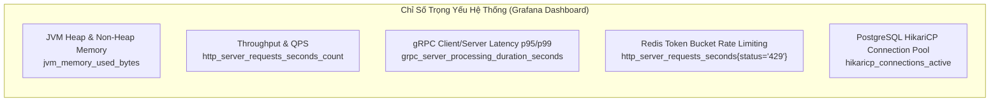
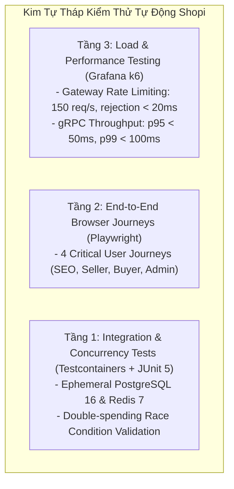

# Tài liệu Kiến trúc Hệ thống Shopi C2C Used-Goods Marketplace
## System Architecture & Technical Specifications

> **Dự án**: Sàn Thương Mại Điện Tử C2C Đồ Cũ Hiệu Năng Cao ("Shopi")  
> **Phiên bản**: 1.0.0 (Production Architecture Standard)  
> **Tài liệu**: Kiến trúc Kỹ thuật, Phân quyền Người dùng, Thiết kế Database, Giao dịch Phân tán Saga & Đảm bảo Chất lượng  

---

## Mục Lục
1. [Tổng quan Kiến trúc Hệ thống (System Architecture Blueprint)](#1-tổng-quan-kiến-trúc-hệ-thống)
2. [Phân quyền & Chức năng Người dùng theo Vai trò (RBAC Matrix)](#2-phân-quyền--chức-năng-người-dùng-theo-vai-trò)
3. [Thiết kế Cơ sở Dữ liệu & Lưu trữ (Storage & Database Architecture)](#3-thiết-kế-cơ-sở-dữ-liệu--lưu-trữ)
4. [Giao dịch Phân tán & Máy trạng thái Saga (Distributed Transaction & State Machine)](#4-giao-dịch-phân-tán--máy-trạng-thái-saga)
5. [Cân bằng Tải & Kiến trúc Mở rộng Ngang (Load Balancing & Horizontal Scaling)](#5-cân-bằng-tải--kiến-trúc-mở-rộng-ngang)
6. [Hạ tầng Giám sát & Đo lường (Observability & Monitoring Stack)](#6-hạ-tầng-giám-sát--đo-lường)
7. [Ma trận Kiểm thử & Đảm bảo Chất lượng (QA/QC Testing Matrix)](#7-ma-trận-kiểm-thử--đảm-bảo-chất-lượng)

---

## 1. Tổng quan Kiến trúc Hệ thống

Hệ thống **Shopi** được xây dựng theo mô hình **Microservices Mesh phân tán** hướng sự kiện, tối ưu hóa cho mô hình kinh doanh đồ cũ C2C độc bản (*single-stock item, quantity = 1*), cam kết tính toàn vẹn dữ liệu, chống mua trùng lặp (*double-spending*) và bảo vệ người mua thông qua giải pháp thanh toán bảo chứng **VietQR Escrow**.

### 1.1 Sơ đồ Kiến trúc Tổng thể (High-Level Architecture)



### 1.2 Thành phần Kiến trúc Chi tiết

| Thành phần | Công nghệ chủ đạo | Vai trò & Trách nhiệm kiến trúc |
| :--- | :--- | :--- |
| **Edge Ingress** | NGINX 1.27 Alpine | Điểm tiếp nhận traffic đầu vào, SSL/TLS Termination, nén Gzip, áp dụng bảo mật HTTP Headers, định tuyến upstream và cân bằng tải Round-Robin giữa các container scaled. |
| **Frontend UI** | Next.js 15+ (React 19, TypeScript, Tailwind CSS) | Render phía server (SSR/SSG/ISR), tối ưu hóa SEO với Schema.org JSON-LD, hiển thị đồng hồ đếm ngược 15 phút và mã QR VietQR Napas 24/7. |
| **API Gateway** | Spring Boot 3.3.4, Netty/Tomcat, JJWT | Đóng vai trò Reverse Proxy chuyển đổi REST HTTP/1.1 sang gRPC HTTP/2 Protobuf, xác thực Access Token JWT, kiểm tra Redis Blacklist, thực thi Redis Token Bucket Rate Limiting. |
| **Identity Service** | Java 21, Spring Boot, Spring Security Crypto | Quản lý thông tin định danh người dùng, mã hóa mật khẩu BCrypt, cấp phát token JWT HMAC-SHA256, xử lý Refresh Token Rotation và Replay Detection. |
| **Catalog Service** | Java 21, Spring Data JPA, gRPC | Quản lý danh mục hàng hóa, quản lý trạng thái khóa sản phẩm độc quyền (`AVAILABLE`, `RESERVED`, `SOLD`, `HIDDEN`). |
| **Order Service** | Java 21, Spring Boot, Scheduled Scanner | Đóng vai trò Saga Orchestrator cho giao dịch mua hàng C2C, khởi tạo đơn hàng, quản lý thời hạn thanh toán 15 phút, kích hoạt bù trừ rollback khi quá hạn. |
| **Storage Tier** | PostgreSQL 16 Alpine (3 Instances) | Triển khai mô hình **Database-per-service**: mỗi microservice sở hữu schema độc lập, đảm bảo tính đóng gói (*loose coupling*), kiểm soát phiên bản bằng Flyway. |
| **Cache & State** | Redis 7 Alpine | Lưu trữ token blacklist, token family sessions, bộ đếm giới hạn tần suất (*Token Bucket*), và key đếm ngược thời hạn thanh toán (*TTL 15 minutes*). |

---

## 2. Phân quyền & Chức năng Người dùng theo Vai trò

Shopi áp dụng mô hình phân quyền dựa trên vai trò nghiêm ngặt (**Role-Based Access Control - RBAC**), chia làm 4 nhóm người dùng chính: **Khách vãng lai (Guest)**, **Người mua (Buyer)**, **Người bán (Seller)**, và **Quản trị viên (Admin)**.



### 2.1 Ma trận Chức năng Chi tiết (RBAC Matrix)

| Nhóm chức năng | Khách (Guest) | Người mua (Buyer) | Người bán (Seller) | Quản trị (Admin) | Ghi chú kỹ thuật |
| :--- | :---: | :---: | :---: | :---: | :--- |
| **Xem sản phẩm & Danh mục** | ✅ | ✅ | ✅ | ✅ | SSR/ISR cache 60s, nhúng Schema JSON-LD |
| **Tìm kiếm & Lọc theo giá/loại** | ✅ | ✅ | ✅ | ✅ | Index B-Tree trên Category, Price, Status |
| **Đăng ký / Đăng nhập / Refresh Token** | ✅ | ✅ | ✅ | ✅ | Token Family Rotation chống lộ refresh token |
| **Đặt hàng & Khóa giữ chỗ 15 phút** | ❌ | ✅ | ❌ | ❌ | Chuyển trạng thái `AVAILABLE` -> `RESERVED` |
| **Quét mã VietQR chuyển khoản Escrow** | ❌ | ✅ | ❌ | ❌ | Payload sinh động kèm Amount & Order Memo |
| **Upload biên lai thanh toán (Proof)** | ❌ | ✅ | ❌ | ❌ | Chuyển trạng thái `PROOF_UPLOADED` |
| **Tự hủy đơn hàng đã đặt** | ❌ | ✅ | ❌ | ❌ | Bù trừ Saga trả hàng về `AVAILABLE` |
| **Mở Studio & Đăng ký VietQR ngân hàng** | ❌ | ❌ | ✅ | ❌ | Cấu hình Bank Code (MB, VCB,...), STK, Tên chủ TK |
| **Đăng bán sản phẩm cũ mới** | ❌ | ❌ | ✅ | ❌ | Cung cấp độ mới, mô tả, ảnh, giá bán |
| **Duyệt biên lai & Hoàn tất đơn hàng** | ❌ | ❌ | ✅ | ❌ | Chốt đơn `CONFIRMED` & sản phẩm `SOLD` |
| **Từ chối đơn / Hủy đơn do sai biên lai** | ❌ | ❌ | ✅ | ❌ | Kích hoạt nhả kho về `AVAILABLE` |
| **Khóa Shop vi phạm (Ban Seller)** | ❌ | ❌ | ❌ | ✅ | Ẩn toàn bộ sản phẩm của shop khỏi sàn |
| **Thu hồi phiên đăng nhập tức thì** | ❌ | ❌ | ❌ | ✅ | Đưa JWT vào Redis Blacklist với TTL 15 phút |
| **Giám sát hệ thống & Xem Grafana** | ❌ | ❌ | ❌ | ✅ | Phân tích QPS, gRPC latency, CPU, RAM |

---

## 3. Thiết kế Cơ sở Dữ liệu & Lưu trữ

Hệ thống áp dụng triệt để kiến trúc **Database-per-Service** với PostgreSQL 16 nhằm cô lập miền dữ liệu (*domain isolation*), ngăn chặn việc truy vấn chéo schema và tối đa hóa khả năng mở rộng độc lập.

### 3.1 Sơ đồ Thực thể Liên kết (Entity Relationship Diagram - ERD)



### 3.2 Đặc tả Schema Database Chi tiết

#### Dịch vụ 1: `shopi_identity_db` (Quản lý Định danh & Phân quyền)
*Tập tin migration*: `backend/identity-service/src/main/resources/db/migration/V1__init_identity_schema.sql`

| Tên Cột | Kiểu Dữ Liệu | Ràng Buộc | Mô Tả |
| :--- | :--- | :--- | :--- |
| `id` | `UUID` | `PRIMARY KEY` | Khóa chính ngẫu nhiên |
| `email` | `VARCHAR(100)` | `NOT NULL, UNIQUE` | Địa chỉ email đăng nhập duy nhất |
| `password_hash` | `VARCHAR(255)` | `NOT NULL` | Mật khẩu băm an toàn theo giải thuật BCrypt (strength 12) |
| `full_name` | `VARCHAR(100)` | `NOT NULL` | Họ tên người dùng |
| `role` | `VARCHAR(20)` | `NOT NULL, DEFAULT 'BUYER'` | Vai trò: `BUYER`, `SELLER`, `ADMIN` |
| `active` | `BOOLEAN` | `NOT NULL, DEFAULT TRUE` | Cờ kích hoạt tài khoản |
| `created_at` | `TIMESTAMP WITH TIME ZONE` | `NOT NULL, DEFAULT NOW()` | Thời điểm tạo tài khoản |
| `updated_at` | `TIMESTAMP WITH TIME ZONE` | `NOT NULL, DEFAULT NOW()` | Thời điểm cập nhật cuối |

- **Chỉ mục Index**:
  - `idx_users_email` (B-Tree trên `email`) - Tối ưu hóa truy vấn xác thực người dùng `O(log N)`.
  - `idx_users_role` (B-Tree trên `role`) - Hỗ trợ lọc danh sách người dùng theo vai trò quản trị.

---

#### Dịch vụ 2: `shopi_catalog_db` (Quản lý Danh mục & Sản phẩm)
*Tập tin migration*: `backend/shop-catalog-service/src/main/resources/db/migration/V1__init_catalog_schema.sql`

**Bảng `products`**:
| Tên Cột | Kiểu Dữ Liệu | Ràng Buộc | Mô Tả |
| :--- | :--- | :--- | :--- |
| `id` | `UUID` | `PRIMARY KEY` | Định danh duy nhất sản phẩm |
| `title` | `VARCHAR(200)` | `NOT NULL` | Tiêu đề sản phẩm đăng bán |
| `slug` | `VARCHAR(250)` | `NOT NULL, UNIQUE` | Chuỗi định danh URL thân thiện cho SEO (ví dụ: `macbook-pro-16-m1-max`) |
| `description` | `TEXT` | `NOT NULL` | Mô tả chi tiết tình trạng hàng, phụ kiện, lịch sử sử dụng |
| `price_amount` | `BIGINT` | `NOT NULL` | Giá bán theo đơn vị tiền tệ cơ sở (VND) |
| `currency` | `VARCHAR(10)` | `NOT NULL, DEFAULT 'VND'` | Đơn vị tiền tệ |
| `category` | `VARCHAR(100)` | `NOT NULL` | Danh mục: `DoDienTu`, `MayAnh`, `NoiThat`, `DienThoai`,... |
| `status` | `VARCHAR(30)` | `NOT NULL, DEFAULT 'AVAILABLE'` | Trạng thái: `AVAILABLE`, `RESERVED`, `SOLD`, `HIDDEN` |
| `seller_id` | `UUID` | `NOT NULL` | ID của người bán sở hữu món đồ |
| `reserved_by_user_id`| `UUID` | `NULL` | ID người mua đang giữ chỗ (khi status = RESERVED) |
| `locked_order_id` | `UUID` | `NULL` | Mã đơn hàng đang thực hiện khóa giữ chỗ |
| `locked_at` | `TIMESTAMP WITH TIME ZONE` | `NULL` | Thời điểm bắt đầu khóa giữ chỗ |
| `created_at` | `TIMESTAMP WITH TIME ZONE` | `NOT NULL, DEFAULT NOW()` | Thời điểm đăng bán |
| `updated_at` | `TIMESTAMP WITH TIME ZONE` | `NOT NULL, DEFAULT NOW()` | Thời điểm cập nhật trạng thái |

**Bảng `product_images`**:
| Tên Cột | Kiểu Dữ Liệu | Ràng Buộc | Mô Tả |
| :--- | :--- | :--- | :--- |
| `product_id` | `UUID` | `NOT NULL, REFERENCES products(id) ON DELETE CASCADE` | Khóa ngoại liên kết bảng products |
| `image_url` | `VARCHAR(500)` | `NOT NULL` | Đường dẫn CDN/S3 chứa hình ảnh chụp thực tế sản phẩm |

- **Chỉ mục Index**:
  - `idx_products_slug` (B-Tree trên `slug`) - Phục vụ routing nhanh chóng trang chi tiết sản phẩm chuẩn SEO.
  - `idx_products_status` (B-Tree trên `status`) - Lọc nhanh các mặt hàng khả dụng trên trang chủ.
  - `idx_products_seller` (B-Tree trên `seller_id`) - Truy vấn kho đồ của từng người bán.
  - `idx_products_category` (B-Tree trên `category`) - Lọc sản phẩm theo ngành hàng.

---

#### Dịch vụ 3: `shopi_order_db` (Quản lý Đơn hàng & Thanh toán Escrow)
*Tập tin migration*: `backend/order-payment-service/src/main/resources/db/migration/V1__init_order_schema.sql`

| Tên Cột | Kiểu Dữ Liệu | Ràng Buộc | Mô Tả |
| :--- | :--- | :--- | :--- |
| `id` | `UUID` | `PRIMARY KEY` | Mã đơn hàng duy nhất |
| `product_id` | `VARCHAR(64)` | `NOT NULL` | Mã sản phẩm được giao dịch |
| `buyer_id` | `VARCHAR(64)` | `NOT NULL` | Mã người mua hàng |
| `seller_id` | `VARCHAR(64)` | `NOT NULL` | Mã người bán nhận tiền |
| `total_amount` | `BIGINT` | `NOT NULL` | Tổng tiền thanh toán của đơn hàng (VND) |
| `currency` | `VARCHAR(16)` | `NOT NULL, DEFAULT 'VND'` | Đơn vị tiền tệ |
| `status` | `VARCHAR(32)` | `NOT NULL` | `PENDING_PAYMENT`, `PROOF_UPLOADED`, `CONFIRMED`, `SHIPPED`, `CANCELLED` |
| `viet_qr_payload` | `TEXT` | `NULL` | Chuỗi URL/Data QR chuẩn Napas 24/7 để tạo mã VietQR động |
| `receipt_image_url`| `VARCHAR(1024)` | `NULL` | Ảnh chụp màn hình chuyển khoản ngân hàng do người mua tải lên |
| `payment_deadline_epoch_ms` | `BIGINT` | `NOT NULL` | Thời điểm hết hạn 15 phút (epoch milliseconds) |
| `created_at` | `BIGINT` | `NOT NULL` | Thời điểm tạo đơn |
| `updated_at` | `BIGINT` | `NOT NULL` | Thời điểm cập nhật cuối |

- **Chỉ mục Index**:
  - `idx_orders_buyer_id` - Truy vấn lịch sử mua hàng của khách.
  - `idx_orders_seller_id` - Truy vấn danh sách đơn hàng người bán cần xác nhận.
  - `idx_orders_product_id` - Liên kết nhanh đơn hàng với sản phẩm.
  - `idx_orders_status` - Quét định kỳ các đơn hàng cần xử lý tự động bù trừ.

---

### 3.3 Cấu trúc Lưu trữ Dữ liệu trong Redis 7

| Định dạng Key | Kiểu Dữ Liệu | Thời hạn TTL | Mục đích sử dụng |
| :--- | :--- | :--- | :--- |
| `auth:blacklist:<jwt_token>` | `String` ("revoked") | 15 Phút | Thu hồi hiệu lực của Access Token ngay lập tức khi đăng xuất hoặc bị Admin ban. |
| `auth:refresh:<refresh_token>` | `String` (`userId:familyId`) | 14 Ngày | Lưu trữ Refresh Token đang hoạt động, map với người dùng và gia đình token. |
| `auth:family:<familyId>` | `String` (`<active_token>`) | 14 Ngày | Quản lý token hợp lệ duy nhất trong gia đình token. |
| `auth:consumed:<old_token>` | `String` (`familyId`) | 24 Giờ | Ghi nhận token đã được sử dụng. Nếu token này được gửi lại -> phát hiện tấn công Replay -> hủy toàn bộ session trong gia đình. |
| `order:timeout:<orderId>` | `String` (`productId`) | 15 Phút | Theo dõi thời hạn đếm ngược của đơn hàng đang giữ chỗ. |
| `ratelimit:<client_key>` | `String` (Số lượt còn lại) | 1 Giây | Thực hiện thuật toán Token Bucket giới hạn tần suất request tại Gateway. |

---

## 4. Giao dịch Phân tán & Máy trạng thái Saga

Đối với sàn C2C đồ cũ, mỗi mặt hàng là độc nhất. Việc áp dụng giao dịch phân tán kiểu truyền thống (*Two-Phase Commit - 2PC*) sẽ gây khóa tài nguyên kéo dài, giảm hiệu năng và dễ dẫn đến deadlock mạng. Shopi áp dụng **Saga Pattern (Orchestration-based)** kết hợp cơ chế khóa giữ chỗ tạm thời và bù trừ tự động (*Compensating Transactions*).

### 4.1 Máy Trạng Thái Vòng Đời Sản Phẩm & Đơn Hàng (State Machine)



---

### 4.2 Luồng Giao Dịch Thành Công (Happy Path Sequence Diagram)



---

### 4.3 Luồng Bù Trừ Tự Động (Saga Rollback Compensation Sequence Diagram)



---

## 5. Cân bằng Tải & Kiến trúc Mở rộng Ngang

### 5.1 Cấu hình NGINX Ingress Reverse Proxy
NGINX được thiết kế như một **Edge Load Balancer**, đảm nhận nhiệm vụ định tuyến thông minh giữa lưu lượng giao diện người dùng Next.js và API Gateway cụm backend:

```nginx
upstream frontend_upstream {
    server nextjs-frontend:3000;
}

upstream gateway_upstream {
    server api-gateway:8080;
}

server {
    listen 80;
    server_name localhost shopi.vn;

    # Bảo mật Headers chuẩn OWASP
    add_header X-Frame-Options "SAMEORIGIN" always;
    add_header X-XSS-Protection "1; mode=block" always;
    add_header X-Content-Type-Options "nosniff" always;
    add_header Referrer-Policy "strict-origin-when-cross-origin" always;

    # Định tuyến Backend REST API
    location /api/ {
        proxy_pass http://gateway_upstream;
        proxy_http_version 1.1;
        proxy_set_header Upgrade $http_upgrade;
        proxy_set_header Connection 'upgrade';
        proxy_set_header Host $host;
        proxy_set_header X-Real-IP $remote_addr;
        proxy_set_header X-Forwarded-For $proxy_add_x_forwarded_for;
        proxy_set_header X-Forwarded-Proto $scheme;
        proxy_read_timeout 60s;
        proxy_connect_timeout 60s;
    }

    # Định tuyến Next.js Frontend
    location / {
        proxy_pass http://frontend_upstream;
        proxy_http_version 1.1;
        proxy_set_header Host $host;
        proxy_set_header X-Real-IP $remote_addr;
        proxy_set_header X-Forwarded-For $proxy_add_x_forwarded_for;
    }
}
```

### 5.2 Cơ chế Horizontal Scaling với Docker Internal DNS (`127.0.0.11`)

Khi mở rộng hệ thống bằng câu lệnh:
```bash
docker compose up -d --scale api-gateway=2
```

1. **Docker Internal DNS Resolution**:
   - Mạng ảo bridge `shopi-net` tích hợp sẵn DNS server nội bộ tại địa chỉ IP `127.0.0.11`.
   - Tên miền nội bộ `api-gateway` sẽ được ánh xạ tới danh sách nhiều địa chỉ IP container nội bộ (ví dụ: `172.28.0.5` và `172.28.0.6`).
2. **Dynamic Round-Robin Upstream**:
   - Khi NGINX phân giải tên máy chủ `api-gateway`, cơ chế Round-Robin của NGINX và Docker DNS sẽ tự động luân phiên phân bổ các request từ client đều giữa `api-gateway-1` và `api-gateway-2`.
3. **Stateless Edge Tier**:
   - Cả 2 instance `api-gateway` đều là **Stateless**: phiên làm việc, danh sách Blacklist, và số lượng token rate limit đều được lưu trữ tập trung tại cụm **Redis 7**. Do đó, request của người dùng có thể gửi tới bất kỳ instance nào mà không bị gián đoạn hay mất phiên.



---

## 6. Hạ tầng Giám sát & Đo lường

Hệ thống tích hợp bộ công cụ đo lường tiêu chuẩn doanh nghiệp **Prometheus & Grafana**, thu thập dữ liệu chỉ số theo thời gian thực từ Spring Boot Actuator qua giao thức Micrometer.

### 6.1 Danh mục Endpoints Thu thập Metrics (Scrape Targets)

| Dịch vụ | Cổng Actuator | Endpoint Prometheus Scrape | Tần suất quét |
| :--- | :---: | :--- | :---: |
| **api-gateway** | `:8080` | `http://api-gateway:8080/actuator/prometheus` | 5 giây |
| **identity-service** | `:8083` | `http://identity-service:8083/actuator/prometheus` | 5 giây |
| **shop-catalog-service** | `:8081` | `http://shop-catalog-service:8081/actuator/prometheus` | 5 giây |
| **order-payment-service** | `:8082` | `http://order-payment-service:8082/actuator/prometheus` | 5 giây |

### 6.2 Các Chỉ Số Đo Lường Then Chốt (Key Observability Metrics)



1. **JVM Performance**:
   - `jvm_memory_used_bytes{area="heap"}`: Giám sát mức độ tiêu thụ RAM Heap, phát hiện sớm nguy cơ rò rỉ bộ nhớ (*Memory Leak*).
   - `jvm_gc_pause_seconds_count`: Theo dõi tần suất và thời gian dừng Garbage Collector.
2. **gRPC RPC Latency**:
   - `grpc_server_processing_duration_seconds_bucket`: Đảm bảo thời gian phản hồi giữa API Gateway và các microservices nội bộ đạt chuẩn SLA: **p95 < 50ms, p99 < 100ms**.
3. **HTTP Ingress & Error Rate**:
   - `http_server_requests_seconds_count`: Theo dõi tổng số request mỗi giây (QPS).
   - Tỷ lệ mã lỗi HTTP `4xx` (đặc biệt là `429 Too Many Requests` và `409 Conflict`) và cảnh báo tức thì nếu mã lỗi `5xx` vượt quá `0.01%`.
4. **Database Connection Health**:
   - `hikaricp_connections_active` / `hikaricp_connections_idle`: Đảm bảo pool kết nối cơ sở dữ liệu không bị cạn kiệt khi lưu lượng tăng đột biến.

---

## 7. Ma trận Kiểm thử & Đảm bảo Chất lượng

Hệ thống được bảo vệ bởi 3 tầng kiểm thử tự động toàn diện: **Integration & Concurrency Tests** (Testcontainers), **End-to-End User Journeys** (Playwright), và **Load & Rate-Limiting Benchmarks** (Grafana k6).



### 7.1 Kiểm thử Tích hợp & Chống Đua Tranh Dữ liệu (Backend Integration)

| Tập tin kiểm thử | Trọng tâm kiểm thử | Kịch bản chi tiết | Kết quả xác minh |
| :--- | :--- | :--- | :--- |
| [`OrderServiceGrpcIntegrationTest.java`](file:///d:/PersonalProject/shopi/backend/order-payment-service/src/test/java/com/shopi/order/OrderServiceGrpcIntegrationTest.java) | **Saga Happy Path** | CreateOrder -> nộp biên lai SubmitPaymentReceipt -> xác nhận ConfirmOrder -> sản phẩm chuyển `SOLD`. | ✅ **BUILD SUCCESS** |
| [`OrderServiceGrpcIntegrationTest.java`](file:///d:/PersonalProject/shopi/backend/order-payment-service/src/test/java/com/shopi/order/OrderServiceGrpcIntegrationTest.java) | **Double-Spending Prevention** | Dùng `ExecutorService` bắn 2 luồng đồng thời vào cùng 1 sản phẩm độc bản tại cùng 1 mili-giây. Kiểm tra nghiêm ngặt: **Đúng 1 luồng thành công (201)**, luồng còn lại nhận lỗi **`ALREADY_EXISTS` (409)**. | ✅ **BUILD SUCCESS** |
| [`OrderServiceGrpcIntegrationTest.java`](file:///d:/PersonalProject/shopi/backend/order-payment-service/src/test/java/com/shopi/order/OrderServiceGrpcIntegrationTest.java) | **Saga Rollback Compensation** | Hủy đơn thủ công hoặc hết hạn 15 phút -> kích hoạt `releaseProduct` hoàn trả sản phẩm về `AVAILABLE`. | ✅ **BUILD SUCCESS** |
| [`AuthSecurityIntegrationTest.java`](file:///d:/PersonalProject/shopi/backend/api-gateway/src/test/java/com/shopi/gateway/AuthSecurityIntegrationTest.java) | **Token Family Rotation** | Cấp phát token mới khi refresh hợp lệ. | ✅ **BUILD SUCCESS** |
| [`AuthSecurityIntegrationTest.java`](file:///d:/PersonalProject/shopi/backend/api-gateway/src/test/java/com/shopi/gateway/AuthSecurityIntegrationTest.java) | **Replay Attack Detection** | Phát hiện tái sử dụng refresh token cũ -> lập tức thu hồi toàn bộ session trong gia đình token (HTTP 401). | ✅ **BUILD SUCCESS** |
| [`AuthSecurityIntegrationTest.java`](file:///d:/PersonalProject/shopi/backend/api-gateway/src/test/java/com/shopi/gateway/AuthSecurityIntegrationTest.java) | **Redis Blacklist on Logout** | Đăng xuất lập tức ghi JWT vào Redis Blacklist -> các request kế tiếp dùng token đó bị chặn với HTTP 401. | ✅ **BUILD SUCCESS** |

---

### 7.2 Kiểm thử Đầu-Cuối Hành trình Người dùng (Playwright E2E)
*Tập tin kiểm thử*: [`frontend/e2e/marketplace-journeys.spec.ts`](file:///d:/PersonalProject/shopi/frontend/e2e/marketplace-journeys.spec.ts)

1. **Journey 1: Khách vãng lai xem trang sản phẩm chuẩn SEO**:
   - Truy cập `/products/macbook-pro-16-m1-max-32gb-1tb`, xác nhận HTTP status 200.
   - Kiểm tra đầy đủ thẻ Meta OpenGraph (`og:title`, `og:description`, `og:image`) và Canonical Link.
   - Phân tích `<script type="application/ld+json">`, kiểm tra cấu trúc Schema.org `@type: "Product"` (giá, đơn vị tiền tệ, tình trạng hàng) và `@type: "BreadcrumbList"` (4 cấp đường dẫn).
2. **Journey 2: Người bán đăng ký Shop & Cấu hình VietQR**:
   - Đăng nhập xác thực, mở Studio người bán.
   - Thiết lập tài khoản ngân hàng thụ hưởng (Ngân hàng Quân Đội MB, STK, Tên chủ tài khoản).
   - Đăng bài bán sản phẩm mới -> sản phẩm hiển thị trên sàn với trạng thái `AVAILABLE`.
3. **Journey 3: Người mua thực hiện quy trình Escrow bảo chứng**:
   - Người mua bấm "Đặt mua ngay (Khóa 15 phút)".
   - Huy hiệu trạng thái đổi sang **"Đang giữ chỗ (Reserved)"**.
   - Đồng hồ đếm ngược 15 phút hiển thị chính xác và đếm từng giây.
   - Hộp thanh toán VietQR Napas 24/7 hiển thị đúng số tiền, nội dung chuyển khoản `SHOPI <orderId>`, kiểm tra tính năng 1-click copy.
   - Upload ảnh biên lai chuyển khoản.
   - Người bán bấm xác nhận -> huy hiệu chuyển hẳn sang **"Đã bán (Sold Out)"** và nút mua bị vô hiệu hóa.
4. **Journey 4: Quản trị viên xử lý gian lận & Delist sản phẩm**:
   - Admin ban Shop vi phạm chính sách (`POST /api/admin/shops/{id}/ban`).
   - Truy cập vào link sản phẩm của shop lập tức trả về **HTTP 404 Not Found** ("Không tìm thấy sản phẩm").
   - Token của người bán bị vô hiệu hóa tức thì trong Redis Blacklist.

---

### 7.3 Kiểm thử Tải & Giới hạn Tần suất (Grafana k6 Load Testing)

#### Kịch bản 1: Kiểm thử Gateway Rate Limiting
- **Tập tin**: [`testing/load/gateway-rate-limit.js`](file:///d:/PersonalProject/shopi/testing/load/gateway-rate-limit.js)
- **Tải giả lập**: Bắn **150 req/s** liên tục trong 30 giây vào endpoint `POST /api/orders`.
- **Tiêu chuẩn SLA**:
  - Các request vượt ngưỡng giới hạn phải nhận mã lỗi **HTTP 429 Too Many Requests**.
  - Thời gian phản hồi từ chối tại Edge Gateway phải cực nhanh: **`p(95) < 20ms`**, **`p(99) < 30ms`** nhằm triệt tiêu tải trước khi chạm vào backend microservices.

#### Kịch bản 2: Đo lường Thông lượng Đơn hàng & Độ trễ gRPC
- **Tập tin**: [`testing/load/order-throughput.js`](file:///d:/PersonalProject/shopi/testing/load/order-throughput.js)
- **Tải giả lập**: Ramping VUs từ 30 lên 60 VUs đồng thời.
- **Tiêu chuẩn SLA**:
  - Toàn bộ chu trình gRPC Order Creation: **`p(95) < 50ms`**, **`p(99) < 100ms`**.
  - Tỷ lệ lỗi máy chủ bất thường (`unexpected 5xx`): **`< 0.01%`**.
  - Phân tách minh bạch giữa đơn tạo thành công (HTTP 201) và đơn bị từ chối do tranh chấp giữ chỗ (HTTP 409 Conflict).

---

## 8. Kết luận & Hướng Dẫn Vận Hành

Tài liệu này là đặc tả kiến trúc chuẩn mực của sàn thương mại điện tử **Shopi C2C**. Nhờ sự kết hợp giữa kiến trúc microservices tách biệt, giao dịch phân tán Saga đảm bảo tính nhất quán cuối cùng (*Eventual Consistency*), thanh toán VietQR Napas 24/7 bảo chứng Escrow và hệ thống kiểm định chất lượng đa tầng, hệ thống sẵn sàng đáp ứng yêu cầu vận hành sản xuất với độ ổn định và độ tin cậy cao nhất.
