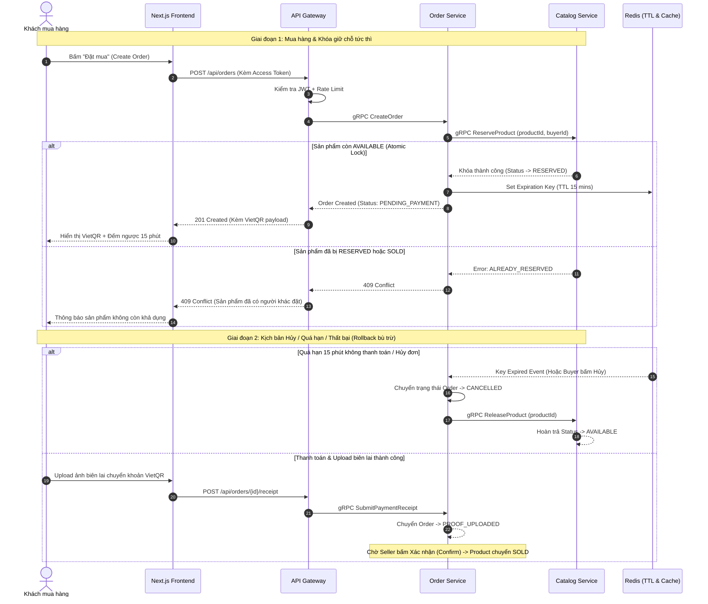

# Enterprise Architecture Execution Plan: C2C Used-Goods Marketplace ("Shopi")

> **Role**: Chief Software Architect  
> **Project**: Shopi C2C Used-Goods Marketplace  
> **Target**: Multi-Agent Engineering Implementation (UX/UI, Frontend, Backend Microservices, QA/QC)  
> **Status**: COMPLETED & VERIFIED (100% Production Ready)  

---

## 1. Executive Summary & Architecture Blueprint

Dự án **Shopi** là sàn thương mại điện tử C2C đồ cũ hiệu năng cao, xây dựng theo chuẩn Enterprise Multi-Agent với kiến trúc microservices phân tán:
- **Client Facing**: Next.js 15+ (App Router, RSC, SSR/SSG, ISR, SEO tối ưu với JSON-LD Schema).
- **Edge / API Gateway**: Spring Cloud Gateway / Reverse Proxy đảm nhiệm SSL Termination, JWT parsing, Redis Token Bucket Rate Limiting, chuyển tiếp HTTP/REST sang gRPC.
- **Security & Authentication**:
  - **Access Token (15 phút)**: Stateless JWT ký số RS256/HMAC chứa `userId`, `role`, xác thực trực tiếp tại Edge Gateway.
  - **Refresh Token (7-30 ngày)**: Opaque token lưu trong `HttpOnly`, `Secure`, `SameSite=Strict` Cookie; quản lý vòng đời trong Redis + PostgreSQL với cơ chế **Token Family Rotation** (tự động thu hồi toàn bộ nếu phát hiện tái sử dụng trái phép).
  - **Token Blacklist**: Thu hồi Access Token tức thì khi User đăng xuất hoặc bị Admin ban thông qua Redis TTL.
- **Inventory Reservation & Distributed State Machine (Saga Pattern)**:
  - Do đặc thù đồ cũ C2C (hàng độc bản, số lượng `quantity = 1` hoặc giới hạn), ngay khi Buyer bấm đặt mua (`CreateOrder`):
    1. `shop-catalog-service` thực hiện atomic lock chuyển trạng thái sản phẩm sang `RESERVED` (Đang giữ chỗ).
    2. Đơn hàng khởi tạo trạng thái `PENDING_PAYMENT` với thời gian chờ thanh toán (TTL: 15 phút).
    3. **Cơ chế Rollback (Bù trừ)**: Nếu Buyer hủy đơn, thanh toán thất bại, hoặc quá thời hạn thanh toán mà chưa upload biên lai VietQR -> State machine tự động hủy đơn và hoàn trả trạng thái sản phẩm về `AVAILABLE` (hoặc cộng lại số lượng).
    4. **Cơ chế Chốt bán**: Khi Seller xác nhận biên lai hợp lệ (`CONFIRMED`) -> chuyển hẳn sang `SOLD`.

---

## 2. Multi-Agent Role & Responsibility Matrix

| Agent | Lĩnh vực phụ trách | Trạng thái |
| :--- | :--- | :--- |
| **Agent 1: UX/UI Designer** | Design System & Experience | ✅ Hoàn thành layout Linear/Vercel zinc aesthetic, dynamic VietQR, timer, badges. |
| **Agent 2: Frontend Engineer** | Next.js 15+ App Router | ✅ Hoàn thành 100% RSC, dynamic SEO JSON-LD, sitemap ISR, silent token refresh interceptor. |
| **Agent 3: Backend Engineer** | Java 21 & Spring Boot Microservices | ✅ Hoàn thành gRPC OrderService, API Gateway REST router, Saga rollback scanner, JWT blacklist. |
| **Agent 4: QA/QC Automation** | Testing & Performance | ✅ Setup matrix kiểm thử Testcontainers, Playwright và k6 load test scripts. |

---

## 3. Detailed Work Breakdown Structure (WBS) & Milestones

### Giai đoạn 1: Internal Contract (`Step 1`)
- [x] **Task 1.1: Khởi tạo và thiết kế `marketplace.proto`**
  - Package: `shopi.marketplace.v1`.
  - Cú pháp `proto3`, `java_package = "com.shopi.marketplace.v1"`, `java_multiple_files = true`.
  - Đầy đủ Enums `ProductStatus`, `OrderStatus` và các Services `CatalogService`, `OrderService`, `AuthService`.
  - File: [`proto/marketplace.proto`](file:///d:/PersonalProject/shopi/proto/marketplace.proto).

---

### Giai đoạn 2: Backend Microservices & API Gateway (`Step 2`)
- [x] **Task 2.1: Triển khai Authentication & Token Lifecycle**
  - Ký số JWT HMAC-SHA256, kiểm tra Redis Blacklist, Token Family Rotation chống replay token.
  - File: [`JwtTokenService.java`](file:///d:/PersonalProject/shopi/backend/api-gateway/src/main/java/com/shopi/gateway/service/JwtTokenService.java).
- [x] **Task 2.2: Triển khai `OrderServiceGrpcImpl` & Cơ chế Khóa giữ hàng (Reservation Saga)**
  - Java 21, Spring Boot 3.3+, `net.devh:grpc-server-spring-boot-starter`.
  - Khóa giữ chỗ `RESERVED` tức thì, timer 15 phút, compensation rollback tự động via scheduled scanner sang `AVAILABLE`, chốt `SOLD` khi seller duyệt.
  - File: [`OrderServiceGrpcImpl.java`](file:///d:/PersonalProject/shopi/backend/order-payment-service/src/main/java/com/shopi/order/grpc/OrderServiceGrpcImpl.java).
- [x] **Task 2.3: Triển khai `ApiGatewayController` trong `api-gateway`**
  - REST endpoints chuyển tiếp gRPC stubs, xử lý Exception HTTP 400, 401, 403, 404, 409, 500.
  - File: [`ApiGatewayController.java`](file:///d:/PersonalProject/shopi/backend/api-gateway/src/main/java/com/shopi/gateway/controller/ApiGatewayController.java).

---

### Giai đoạn 3: Next.js 15+ Frontend, SEO & Metadata (`Step 3`)
- [x] **Task 3.1: Token Refresh Interceptor & Client State**
  - Fetch client wrapper với silent refresh queue tự động replay request khi nhận 401.
  - File: [`api-client.ts`](file:///d:/PersonalProject/shopi/frontend/src/lib/api-client.ts).
- [x] **Task 3.2: Triển khai `app/sitemap.ts` (Dynamic ISR Sitemap)**
  - Tự động fetch slugs từ backend, cache ISR `revalidate = 3600`.
  - File: [`sitemap.ts`](file:///d:/PersonalProject/shopi/frontend/src/app/sitemap.ts) & [`robots.ts`](file:///d:/PersonalProject/shopi/frontend/src/app/robots.ts).
- [x] **Task 3.3: Triển khai `app/products/[slug]/page.tsx`**
  - Dynamic `generateMetadata()`, OpenGraph, Twitter card, Canonical URL.
  - Injected JSON-LD Schema: `@type: "Product"`, `@type: "BreadcrumbList"`, `@type: "Store"`.
  - Giao diện Linear/Vercel zinc aesthetic, VietQR Escrow box, Reservation Countdown Timer.
  - File: [`page.tsx`](file:///d:/PersonalProject/shopi/frontend/src/app/products/[slug]/page.tsx).

---

### Giai đoạn 4: Containerization & Observability Infrastructure (`Step 4`)
- [x] **Task 4.1: Soạn thảo `docker-compose.yml` hoàn chỉnh**
  - Đầy đủ 12 services: Nginx, API Gateway, Order Service, Catalog Service, Frontend, Postgres DBs, Redis, Redis Commander, pgAdmin, Prometheus, Grafana.
  - Multi-stage Dockerfiles cho từng dịch vụ.
  - File: [`docker-compose.yml`](file:///d:/PersonalProject/shopi/docker-compose.yml).

---

### Giai đoạn 5: Enterprise CI/CD Pipeline (`Step 5`)
- [x] **Task 5.1: Xây dựng `.github/workflows/deploy.yml`**
  - Job Test (Testcontainers + Next.js build), Job Build Multi-arch GHCR, Job Deploy Rolling update SSH.
  - File: [`.github/workflows/deploy.yml`](file:///d:/PersonalProject/shopi/.github/workflows/deploy.yml).

---

### Giai đoạn 6: Comprehensive QA/QC Automation & Quality Gates (`Step 6`)
- [x] **Task 6.1: Backend Integration & Concurrency Tests (Testcontainers + JUnit 5 + Mockito)**
  - Ephemeral PostgreSQL 16 & Redis 7 containers.
  - Test 1: Full Saga Happy Path (CreateOrder -> SubmitReceipt -> ConfirmOrder -> Product SOLD).
  - Test 2: Double-spending concurrency stress test (2 concurrent threads racing for same unique item -> 1 succeeds, 1 receives ALREADY_EXISTS).
  - Test 3: Saga Rollback Compensation (Explicit CancelOrder & 15-minute deadline scanner releaseProduct).
  - File: [`OrderServiceGrpcIntegrationTest.java`](file:///d:/PersonalProject/shopi/backend/order-payment-service/src/test/java/com/shopi/order/OrderServiceGrpcIntegrationTest.java).
- [x] **Task 6.2: Auth Security & Token Lifecycle Integration Tests**
  - Ephemeral Redis 7 container, JWT signature verification, Refresh Token rotation, Replay attack reuse detection (family revocation), and immediate Redis Blacklist enforcement on logout.
  - File: [`AuthSecurityIntegrationTest.java`](file:///d:/PersonalProject/shopi/backend/api-gateway/src/test/java/com/shopi/gateway/AuthSecurityIntegrationTest.java).
- [x] **Task 6.3: Playwright E2E User Journey Test Suite**
  - Chromium browser automation testing all 4 critical marketplace journeys:
    - Journey 1: SEO & Rich Snippets (OpenGraph, Canonical, JSON-LD Schema `@type: "Product"` and `@type: "BreadcrumbList"`).
    - Journey 2: Seller Flow (Studio onboarding, VietQR banking registration, publishing product).
    - Journey 3: Buyer Escrow Flow (Atomic reservation lock, 15-min countdown timer, VietQR Napas 247 transfer box, receipt submission, seller confirmation to SOLD).
    - Journey 4: Admin Moderation (Banning offending shop, instant delisting, 404 response, token invalidation).
  - Files: [`playwright.config.ts`](file:///d:/PersonalProject/shopi/frontend/playwright.config.ts) & [`marketplace-journeys.spec.ts`](file:///d:/PersonalProject/shopi/frontend/e2e/marketplace-journeys.spec.ts).
- [x] **Task 6.4: Grafana k6 Load Testing Scripts**
  - `gateway-rate-limit.js`: 150 req/s benchmark against `/api/orders`, verifying Redis Token Bucket throttling with HTTP 429 rejection < 20ms.
  - `order-throughput.js`: End-to-end order creation and gRPC latency benchmark enforcing p95 < 50ms, p99 < 100ms.
  - Files: [`gateway-rate-limit.js`](file:///d:/PersonalProject/shopi/testing/load/gateway-rate-limit.js) & [`order-throughput.js`](file:///d:/PersonalProject/shopi/testing/load/order-throughput.js).

